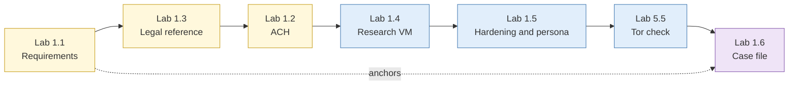

# Day 1: OSINT and OPSEC fundamentals

By the end of today you will have a scoped requirement for the running case, a hardened and snapshotted research environment, a persona usage policy, and a case file in Hunchly and Obsidian that you will use for the rest of the week.

## The day at a glance

Think of today as setting up a new stall at a hawker centre before the lunch crowd arrives. In the morning you decide what you will sell and to whom (requirements), learn the hygiene rules you must follow (legal boundaries) and how to avoid serving the wrong order (analytical pitfalls). In the afternoon you set up the stall itself: the clean kitchen (the research VM), the uniform that does not give away who you are (persona and hardening), and the order book and receipt system (Hunchly and Obsidian). By 5pm the stall is ready to open, and every lab for the rest of the week cooks in it.

## Learning objectives covered

| # | Objective |
| --- | --- |
| 1 | Run a structured OSINT investigation through the full intelligence cycle |
| 2 | Configure and verify an operationally secure research environment |
| 3 | Apply structured analytic techniques to counter bias and false attribution |
| 4 | Capture, hash, catalogue and retrieve evidence defensibly |
| 11 | Operate within PDPA and Computer Misuse Act boundaries |

## Run sheet

| Time | Item | Min |
| --- | --- | --- |
| 08:45 | Opening: safety, legal ground rules, running-case brief | 10 |
| 08:55 | [S1 Intelligence cycle and analytic foundations](sessions/s1-intelligence-cycle.md) | 15 |
| 09:10 | [Lab 1.1 Scoping the requirement](labs/lab-1-1-scoping-the-requirement.md) | 30 |
| 09:40 | [S3 Legal and ethical boundaries](sessions/s3-legal-and-ethical-boundaries.md) | 25 |
| 10:05 | [Lab 1.3 Legal boundary classification](labs/lab-1-3-legal-boundary-classification.md) | 25 |
| 10:30 | Break | |
| 10:45 | [S2 Analytical pitfalls](sessions/s2-analytical-pitfalls.md) | 25 |
| 11:10 | [Lab 1.2 Competing hypotheses](labs/lab-1-2-competing-hypotheses.md) | 40 |
| 11:50 | [S4 Operational security for the researcher](sessions/s4-operational-security.md) | 25 |
| 12:15 | Buffer | 15 |
| 12:30 | Lunch | |
| 13:30 | [Lab 1.4 Building the research environment](labs/lab-1-4-research-environment.md) | 30 |
| 14:00 | [S5 Research accounts](sessions/s5-research-accounts.md) | 15 |
| 14:15 | [Lab 1.5 Leak test and persona hygiene](labs/lab-1-5-leak-test-and-persona-hygiene.md) | 40 |
| 14:55 | [Dark web access and isolation](sessions/s7-dark-web-access.md) | 15 |
| 15:10 | [Lab 5.5 Tor isolation and source evaluation](labs/lab-5-5-tor-isolation-and-source-evaluation.md) | 20 |
| 15:30 | Break | |
| 15:45 | [S6 Collection and cataloguing](sessions/s6-collection-and-cataloguing.md) | 20 |
| 16:05 | [Lab 1.6 Case construction](labs/lab-1-6-case-construction.md) | 55 |
| 17:00 | Buffer and case-file catch-up | 30 |

## What you take into Day 2

- Requirements definition (Lab 1.1)
- Personal legal decision reference with 20 rulings (Lab 1.3)
- Snapshotted research VM, named `clean-baseline` (Lab 1.4)
- Before-and-after exposure record and persona usage policy (Lab 1.5)
- Running case file in Hunchly and Obsidian, exported and verified (Lab 1.6)
