# Lab 1.1 Scoping the requirement

| Duration | Type | Running case | Assessed |
| --- | --- | --- | --- |
| 30 minutes | Individual, then pairs | Yes: this is the anchor for the week | No |

## Aim

Turn a vague stakeholder request into scoped intelligence requirements that tell you what to collect, what to ignore and when you are done.

## Outcome

A one-page **requirements definition** containing three intelligence requirements (IRs), the answer standard for each, and an explicit out-of-scope list. You save it as `00-admin/requirements.md` in your case in Lab 1.6, and every running-case lab this week checks against it.

## The analogy: the renovation contractor

You hire a contractor to renovate your new BTO flat and say, "Make it nice." A bad contractor starts hacking walls the next morning. A good one sits you down first. How many bedrooms do you want to keep? What is your budget? Which walls are structural and cannot be touched? When do you need to move in? What are you definitely not doing (no feature wall, no cove lighting)?

At the end of that conversation the contractor has a scope of works. Every later decision gets checked against it, and when the scope is done, the job is done. This lab is that conversation, and the requirements definition is your scope of works.

## What you need to do

- [ ] List the assumptions hidden in the stakeholder's email
- [ ] Write one sentence stating the decision the board will make
- [ ] Ask the stakeholder (the instructor) your three best clarifying questions and record the answers
- [ ] Write three intelligence requirements using the template in Step 4
- [ ] Write an out-of-scope list with at least four items, including one legal or OPSEC exclusion
- [ ] Swap with a partner, challenge each other's sheets, and improve yours once
- [ ] Save the final sheet as `requirements.md`

**Deliverable:** `requirements.md`, one page.

## What the instructor sets up beforehand

- The stakeholder email below, with `{{CLIENT_ORG}}` and `{{BOARD_DATE}}` filled in from the scenario bible
- The role-play answer sheet for the Head of Security (instructor notes)
- A timer visible to the room for each step

## Before you start

- Read [S1 The intelligence cycle and analytic foundations](../sessions/s1-intelligence-cycle.md).
- **Tools:** a text editor (Notepad, TextEdit or VS Code). Your VM is built later today. Save the file on your laptop for now and move it into the case in Lab 1.6.

## Rules for this lab

- No collection in this lab. You are deciding what to collect, not collecting it. Do not search for the client online.
- Use only the information in the email and the answers the instructor gives you in Step 3.

## How the lab flows

```mermaid
flowchart LR
    A[Read the vague<br/>tasking] --> B[List hidden<br/>assumptions]
    B --> C[State the<br/>board decision]
    C --> D[Ask 3 questions]
    D --> E[Write 3 IRs]
    E --> F[Out-of-scope list]
    F --> G[Peer challenge]
    G --> H[requirements.md]
    classDef yellow fill:#FFF8DC,stroke:#C9A227,color:#333
    classDef green fill:#E3F4E1,stroke:#5E9E5A,color:#333
    classDef blue fill:#E1EEFB,stroke:#4A7FB5,color:#333
    classDef purple fill:#EFE4F7,stroke:#8A5FB0,color:#333
    class A,B yellow
    class C,D blue
    class E,F green
    class G,H purple
```



## The tasking

> **From:** Head of Security, {{CLIENT_ORG}}
> **Subject:** Need you to look into this
>
> Hi,
>
> Something's going on. Over the last month we've had a couple of odd emails to our finance team, someone's been posting about us online, and one of our customers said they saw a website that looks a lot like ours. The board meets on {{BOARD_DATE}} and I need to tell them whether we have a problem.
>
> Can you find out who's behind it and anything else we should know?
>
> Thanks

## Steps

### Step 1: Read the tasking and list what is unclear (5 min)

1. Read the email twice, slowly.
2. Open a new file called `requirements.md` and add a heading `## Assumptions`.
3. Under it, list every assumption you would have to make to start work. Aim for at least six. Write each as a question, for example:
   - Which "odd emails"? How many, sent to whom, asking for what?
   - "Posting about us online": which platforms, and saying what?
4. Put a star next to the two assumptions that would waste the most effort if you guessed wrong.

**Check:** your list should cover the time period, the emails, the platforms, what "behind it" means, the lookalike website, and what decision the board is making.

### Step 2: Identify the decision (3 min)

1. Add a heading `## Decision supported`.
2. Write one sentence naming the decision the board will make on {{BOARD_DATE}}. Start it with "Whether to".
3. Underneath, write one line on what the board needs to know to make it, and one line on how confident they need to be.

**Check:** a good decision statement names an action ("whether to bring in an incident response firm") and not a topic ("the security situation").

### Step 3: Clarify with the stakeholder (5 min)

1. Pick your **three** most important questions from Step 1. Choose carefully, because you only get three.
2. Raise your hand and put them to the instructor, who plays the Head of Security.
3. Add a heading `## Stakeholder answers` and write down each answer word for word.

**Check:** you can explain to your partner why you chose those three questions over the others.

### Step 4: Write three requirements (10 min)

Copy this template three times into your file and fill it in:

```markdown
## IR-<n>: <question ending in a question mark>

- **Decision supported:**
- **Why it matters:**
- **Answer standard:** what evidence would answer this, and what confidence is enough
- **Boundaries:** time period, entities, platforms, geography
- **Methods not permitted:**
- **Priority:** 1 (highest) to 3
- **Deadline:**
```

1. Write each requirement as a question that could be answered "yes", "no", or with a specific finding.
2. Make the answer standard concrete, for example "lookalike domain linked to the finance emails by shared infrastructure, at moderate confidence or better".
3. Rank them 1 to 3. Ask yourself: if I only had time for one, which would the board most need?

**Check:** each requirement could be marked "answered", "partly answered" or "not answered" at the end of the week.

### Step 5: State what is out of scope (3 min)

1. Add a heading `## Out of scope`.
2. List at least four things you will not do or look at, each with a short reason.
3. Include at least one legal or OPSEC exclusion, such as "No contact with the people posting about the client (would alert them; active interaction)".

### Step 6: Peer challenge (4 min)

1. Swap laptops with the person next to you.
2. Read their sheet and ask two questions out loud:
   - "Could I start collecting tomorrow with this?"
   - "Would I know when to stop?"
3. Swap back. Make one improvement to your own sheet based on their challenge, and note what you changed under a heading `## Revision`.

## Worked example

This is a requirement from a different scenario, so you can see the level of detail expected.

```markdown
## IR-2: Is the supplier "Example Freight Pte Ltd" linked by ownership or directorship to any entity on the MAS or UN sanctions lists?

- **Decision supported:** Whether procurement signs the 3-year contract on 14 Nov
- **Why it matters:** A sanctions link would expose the company to MAS enforcement
- **Answer standard:** Any shared director or shareholder confirmed in ACRA or an equivalent registry; moderate confidence or better
- **Boundaries:** Directors and shareholders past and present, last 5 years; Singapore and Malaysia registries
- **Methods not permitted:** No contact with the supplier or its staff; no breach data
- **Priority:** 1
- **Deadline:** 12 Nov, 5pm
```

## Common mistakes

- Writing "Who is behind it?" as a requirement. It has no boundary and no stopping point.
- Leaving out the decision, so there is no way to judge how good the answer needs to be.
- An out-of-scope list that only says "illegal things". Be specific.
- Using all three questions on details you could have reasonably assumed.

## If you finish early

Write a fourth requirement the stakeholder did not ask for but probably needs (for example, whether customer data has actually leaked). Mark it "proposed" and add one line explaining why you would raise it with the stakeholder before working on it.

## Summary

You converted a request asking for "anything else we should know" into three bounded questions tied to a board decision. The out-of-scope list matters as much as the requirements. It protects you legally (PDPA purpose limitation), operationally (fewer touches on the target) and practically (you know when you are done). Like the contractor's scope of works, every later decision this week gets checked against it.

## Carries forward

- Lab 1.6: `requirements.md` goes into `00-admin/` in your case.
- Every running-case lab: check new collection against these requirements before you file it.
- Capstone: your assessment reports against these requirements.
