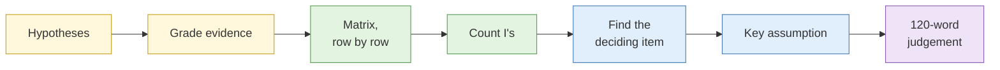

# Lab 1.2 Competing hypotheses

| Duration | Type | Running case | Assessed |
| --- | --- | --- | --- |
| 40 minutes | Pairs | No: a separate mini-case | No |

## Aim

Use analysis of competing hypotheses (ACH) to reach a judgement from contradictory evidence, and find out which single item of evidence your judgement depends on most.

## Outcome

A completed **ACH matrix** and a written judgement of no more than 120 words naming the most likely hypothesis, its confidence, the most diagnostic evidence, and the one assumption most likely to break the assessment.

## The analogy: who ate the last kueh?

You bought a box of kueh lapis and left it on the dining table. When you come home, the last piece is gone. Suspects: your brother, your sister, your helper, or the cat.

Your first instinct is your brother, because he always eats your snacks. That is anchoring. A careful approach looks at each clue against every suspect:

- "There are crumbs on the table." Everyone who eats kueh leaves crumbs. This clue points at nobody.
- "The box was put back neatly in the cupboard." Your brother never puts anything back. The cat certainly does not. This clue rules people out.
- "Your sister was in school all day, and the CCTV at the lift lobby shows she came home after you." This rules her out completely.

The clue that solves it is the one that is **inconsistent** with all but one suspect. Lots of clues that fit everyone (the crumbs) feel convincing but tell you nothing. This lab trains you to find the clue that actually decides it.

## What you need to do

- [ ] Write at least four hypotheses for how the data left the company
- [ ] Grade the reliability of every evidence item
- [ ] Build the ACH matrix, working across each row
- [ ] Count inconsistencies for each hypothesis
- [ ] Strike out non-diagnostic evidence and name the item doing the most work
- [ ] List the assumptions behind your leading hypothesis and pick the one most likely to break it
- [ ] Write the 120-word judgement

**Deliverables:** the completed matrix (spreadsheet or paper) and the written judgement.

## What the instructor sets up beforehand

- Printed copies of the mini-case, or this page on screen
- A blank matrix template in a shared spreadsheet, one tab per pair
- The answer key and facilitation questions (instructor notes)

## Before you start

- Read [S2 Analytical pitfalls](../sessions/s2-analytical-pitfalls.md), especially the ACH section.
- **Tools:** Excel, Google Sheets, LibreOffice Calc, or paper.

## How the lab flows

## The mini-case: the Kelmbrook customer list

Kelmbrook Retail, a fictional Singapore online retailer, has learned that a file claiming to be its customer database is being advertised on a cybercrime forum. Management asks: **how did this data leave Kelmbrook?**

| ID | Evidence |
| --- | --- |
| E1 | The forum post appeared on 14 August. The seller's account was created on 12 August. |
| E2 | The sample published by the seller contains 500 records with names, emails, phone numbers and order totals. |
| E3 | Kelmbrook's security team finds no alerts or unusual logins on its e-commerce platform in July or August. |
| E4 | 38 of the 500 sample emails also appear in a public breach of a different retailer from 2022. |
| E5 | The sample includes an "internal_ref" column using a format Kelmbrook adopted in March this year. |
| E6 | Kelmbrook's marketing agency received a full customer export on 2 July for an email campaign. |
| E7 | A customer service employee resigned on 1 August after a disciplinary process. They had read access to customer records. |
| E8 | The seller's post contains spelling typical of Singapore English, according to a colleague. |
| E9 | The marketing agency confirms it suffered a phishing compromise of one staff mailbox in late July. |
| E10 | Order totals in the sample match Kelmbrook's records as they stood on 2 July. None of the 500 records reflects orders placed after 2 July, although 61 of those customers have ordered since. |

## Steps

### Step 1: Generate hypotheses (5 min)

1. With your partner, write at least four hypotheses for how the data left Kelmbrook. Label them H1, H2, H3, H4.
2. Include at least one that management will not want to hear (for example, one involving their own staff or partners), and one where the data did not come from Kelmbrook at all.
3. Check that they are as mutually exclusive as possible. If two could both be true at the same time, split or merge them.

**Check:** you have four or more hypotheses, and none of them is "a combination of the above".

### Step 2: Grade the evidence (5 min)

1. Add two columns to the evidence table: **Source** and **Grade**.
2. For each item, write where the information came from (Kelmbrook security team, the agency, a colleague's opinion, the forum post) and give it a reliability grade A to F from S1.
3. Circle any item that is really someone's opinion or an assumption rather than a fact.

**Check:** at least one item should have a low grade. Look closely at E8.

### Step 3: Build the matrix (12 min)

1. Open the matrix template. Put your hypotheses across the top and E1 to E10 down the side.

| Evidence | H1 | H2 | H3 | H4 |
| --- | --- | --- | --- | --- |
| E1 | | | | |
| E2 | | | | |
| … | | | | |
| **Inconsistency count** | | | | |

2. Take **E1**. Ask of each hypothesis in turn: "If this hypothesis were true, would I expect to see E1?" Mark **C** (consistent), **I** (inconsistent), **II** (strongly inconsistent) or **N/A**.
3. Move to E2 and repeat. Work across every row before going down to the next.
4. When all rows are filled, count the I's (count II as two) at the bottom of each column.

**Check:** you worked row by row. If you filled one column at a time, you were testing your favourite hypothesis instead of comparing them.

### Step 4: Find the diagnostic evidence (6 min)

1. Draw a line through every row where all hypotheses are marked C. Those items are the crumbs on the table: they fit everyone.
2. From the remaining rows, pick the two or three that most separate the hypotheses.
3. Write down the **single item doing the most work**. Then ask: if it turned out to be false, which hypothesis would lead instead?

### Step 5: Check your assumptions (5 min)

1. Under your leading hypothesis, list every assumption it rests on. Aim for at least three.
2. For each, write one line on what would make it untrue.
3. Choose the **one assumption most likely to break the assessment** and mark it.

### Step 6: Write the judgement (7 min)

Write no more than 120 words covering:

- The most likely hypothesis, with a confidence level (low, moderate or high)
- The second hypothesis and why it is not ruled out
- The most diagnostic evidence
- The assumption most likely to break the assessment
- The one piece of collection that would most reduce uncertainty

## Worked example (different mini-case)

This shows the shape of a judgement, using an unrelated scenario about a leaked internal memo.

> **Judgement.** We assess with moderate confidence that the memo was leaked by a recipient on the original distribution list (H2), rather than through an email compromise (H1). The memo version online contains a handwritten annotation that existed only on the printed copies handed out at the meeting, which is inconsistent with H1 and H3. H1 remains possible if a scanned copy was emailed afterwards. This judgement assumes no printed copy left the meeting room. Confirming whether any copy was scanned or removed would most reduce uncertainty.

## Common mistakes

- Choosing the insider (E7) early because it makes a good story, and then marking everything else to fit.
- Treating E4 as strong evidence. It is common for the same email addresses to appear in several unrelated breaches.
- Giving E8 weight. It is one colleague's opinion about spelling.
- Writing "high confidence" when the case rests on one item.

## If you finish early

Add a fifth hypothesis that combines a source and a method you have not yet considered. Re-run the matrix for it only. Does it change your leading hypothesis? Then write two sentences explaining what single new piece of evidence would most change the matrix.

## Summary

ACH makes you test every item of evidence against every explanation, so you weigh inconsistency instead of counting supporting points. In this case several items fit almost any explanation and carry little weight. A small number separate the hypotheses, and one does most of the work. Knowing which item your judgement hangs on tells you exactly what to verify next, and what to tell a stakeholder about how firm the conclusion is. It is the kueh box put back neatly in the cupboard.

## Carries forward

- Lab 3.8 and the capstone: you will state your most diagnostic evidence and key assumption in each assessment.
- Lab 4.7: you will use the same discipline to test whether two campaigns share an operator.
