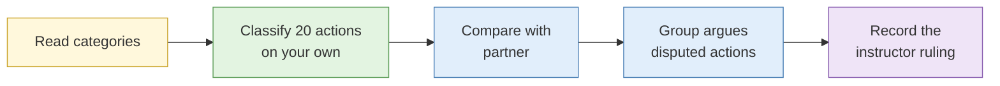

# Lab 1.3 Legal boundary classification

| Duration | Type | Running case | Assessed |
| --- | --- | --- | --- |
| 25 minutes | Individual, then group adjudication | No | No |

## Aim

Practise classifying investigative actions before you take them, so that checking the legal and policy line becomes a habit during live work.

## Outcome

An annotated **decision reference**: twenty actions, each classified, referenced to the PDPA, the Computer Misuse Act or other law where relevant, with the instructor's ruling on the disputed ones. You keep it open in every lab this week and take it back to work.

## The analogy: the traffic light at the junction

Every investigative action is a junction. Green means go (passive collection). Amber means slow down, look both ways and get permission (active interaction). Red means stop (unauthorised access). There is also a sign that says "No U-turn": breaking it gets you a fine, not jail, but it still costs you (terms of service).

An experienced driver reads the lights without thinking. A new driver has to look deliberately at every junction until it becomes automatic. This lab is your driving lesson.

## What you need to do

- [ ] Read the four categories
- [ ] Classify all twenty actions on your own, with the law or policy and a one-line reason
- [ ] Mark every action you are unsure about with a "?"
- [ ] Compare with a partner and list your disagreements
- [ ] Argue the disputed actions in the group, with someone taking the opposite side
- [ ] Write the instructor's ruling and reasoning into your table

**Deliverable:** your completed twenty-row table, saved as `legal-decision-reference.md` (it goes into `00-admin/` in Lab 1.6).

## What the instructor sets up beforehand

- This page on screen, or the table printed for each delegate
- The adjudication key (instructor notes)
- A list of which actions to take first in the group discussion (usually 2, 5, 8, 10, 12, 14, 15, 17)

## Before you start

- Read [S3 Legal and ethical boundaries](../sessions/s3-legal-and-ethical-boundaries.md).
- **Tools:** this page, or a copy of the table below in a text editor.

## Categories

| Code | Category | Traffic light |
| --- | --- | --- |
| P | Passive collection | Green |
| A | Active interaction | Amber |
| T | Terms of service breach (can combine with P or A) | "No U-turn" sign |
| U | Unauthorised access: potential CMA offence | Red |

An action can carry more than one code, for example **A + T**. Some actions may not fit any of the four. Say so if you think that is the case.

## How the lab flows

## Steps

### Step 1: Classify individually (12 min)

Assume you work for a private-sector organisation in Singapore and have a valid, approved requirement. For each action, fill in the code(s), the law or policy that applies, and a one-line reason.

| # | Action | Code | Law or policy | Reason |
| --- | --- | --- | --- | --- |
| 1 | Search ACRA BizFile for a company's directors | | | |
| 2 | View a subject's public LinkedIn profile while logged in as yourself | | | |
| 3 | View the same profile from an instructor-supplied research account | | | |
| 4 | Send a connection request to the subject from a research account | | | |
| 5 | Enter the subject's email on a site's "forgot password" page to see whether an account exists | | | |
| 6 | Read archived copies of a deleted web page on the Wayback Machine | | | |
| 7 | Change `id=104` to `id=105` in the URL of a supplier's order-tracking page to see another customer's order | | | |
| 8 | Download a file from a publicly listed open directory on the target's web server | | | |
| 9 | Log in to a target's webmail with a password found on a paste site | | | |
| 10 | Scrape 50,000 public posts from a platform whose terms prohibit scraping | | | |
| 11 | Look up the subject's email on a breach-notification service that only confirms whether it appears in known breaches | | | |
| 12 | Download and search a full breach corpus from a forum | | | |
| 13 | Join a private Telegram group about the target company using a research account | | | |
| 14 | Run a port scan against the target organisation's IP range | | | |
| 15 | Publish the home address of a person you identified as running a scam site | | | |
| 16 | Read a Singapore court judgment involving the subject on the Supreme Court's public judgments page | | | |
| 17 | Save the subject's mobile number into a phone contact list to see their WhatsApp profile photo | | | |
| 18 | Phone the target company's main line, pretending to be a customer, to ask the name of the finance manager | | | |
| 19 | Use a commercial people-search site that sells Singapore mobile numbers linked to names | | | |
| 20 | Run a WHOIS lookup and a passive DNS query on the subject's domain | | | |

**Check:** you should have at least three actions marked "?". If you have none, you are probably being overconfident.

### Step 2: Compare in pairs (5 min)

1. Read your codes out to your neighbour, one row at a time.
2. On a separate list, write the numbers of every action where you disagree.
3. For each disagreement, note in one line why each of you chose your answer.

### Step 3: Group adjudication (8 min)

1. The instructor calls out the disputed actions in turn.
2. Someone argues for their classification. Someone else **must** argue the opposite, even if they agree. (This is devil's advocacy from S2.)
3. Record the instructor's ruling and the reasoning in the last column of your table. Cross out your original answer if it was wrong, but do not erase it. Seeing your first instinct next to the ruling is how you learn.

## Worked example

Here is one row completed in the expected style, using an action not on the list:

| # | Action | Code | Law or policy | Reason |
| --- | --- | --- | --- | --- |
| ex | Search the Singapore Gazette for a company's winding-up notice | P | PDPA publicly available exception | Official public notice; no interaction; collect only what the requirement needs |

## Common mistakes

- Treating anything visible on the internet as passive. Action 7 is visible through a browser and is still unauthorised access.
- Forgetting that some passive-looking actions notify the subject. Check action 2 and action 5 carefully.
- Forgetting dissemination. What you publish can break the law even if what you collected did not.

## If you finish early

Write two new actions from your own work context: one you are sure is passive, and one you genuinely cannot classify. Bring the second one to the group discussion.

## Summary

Most OSINT work is comfortably passive, but the line to active interaction is crossed more easily than people expect, often with a single click such as a password-reset check or a contact sync. The line to unauthorised access under the CMA is crossed by using anything you were not given: a found password, a guessed URL, someone else's session. Terms of service breaches are a separate question, with their own costs. Like reading traffic lights, the goal is to make this check automatic.

Before every action in live work, ask three questions:

1. Is this passive?
2. Will the subject, or their system, see me?
3. Am I entitled to be here?

## Carries forward

- Keep this table open in every lab. Instructors will ask you to classify actions before you take them.
- Lab 3.1: you will annotate each selector-validation technique with its alerting risk, building on actions 5, 11 and 17.
- Day 3 dataset lab: breach data handling builds on actions 11 and 12.
