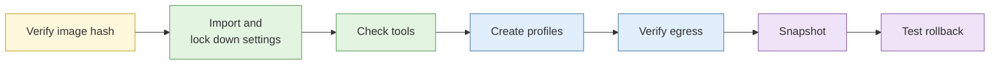

# Lab 1.4 Building the research environment

| Duration | Type | Running case | Assessed |
| --- | --- | --- | --- |
| 30 minutes in class (Path A). Path B, the full build, takes about 75 minutes and is for after class or a longer delivery | Individual | Environment used for every remaining lab | No |

## Aim

Set up an isolated research virtual machine (VM), confirm it is separated from your laptop and your identity, and make snapshot and rollback a habit.

## Outcome

A working research VM with a separate browser profile for the running case, verified network egress, and a snapshot named `clean-baseline` that you have successfully rolled back to.

## The analogy: the hotel room

Think of your laptop as your home and the VM as a hotel room you check into for one investigation. You bring nothing personal: no family photos, no house keys, no mail with your address on it. You use the hotel's towels and the hotel's Wi-Fi. When you check out, housekeeping resets the room so the next guest finds no trace of you.

The snapshot is housekeeping. Rolling back is checking out. A snapshot taken now is the room as it looked when you first walked in, and you can return it to that state whenever you like.

## What you need to do

- [ ] Check the VM image has not been tampered with by comparing its SHA-256 hash
- [ ] Import the VM and switch off every sharing feature between it and your laptop
- [ ] Log in and change the default password
- [ ] Confirm every tool in the stack opens
- [ ] Create two Firefox profiles: `case-running` and `scratch`
- [ ] Prove the VM's internet traffic leaves through the course egress, not your laptop's connection
- [ ] Take a `clean-baseline` snapshot, break something on purpose, and roll back

**Deliverable:** a VM with a `clean-baseline` snapshot, and your completed egress table from Step 5.

## What the instructor sets up beforehand

- The course VM image on USB drives and a download link, with its SHA-256 hash written on the whiteboard
- `{{HYPERVISOR}}` installation confirmed on every delegate laptop (from the joining instructions)
- Loaner laptops or an ARM image for anyone on Apple Silicon or without admin rights
- The course egress (VPN or proxy) running, and the expected egress IP written on the whiteboard
- The egress check address `{{EGRESS_CHECK_URL}}`


Values in `{{BRACES}}` are filled in once the course image is built. If you are working through Path B on your own, use the values given in Path B.


## Before you start

- Read [S4 Operational security for the researcher](../sessions/s4-operational-security.md).
- **Tools:** `{{HYPERVISOR}}` installed on your laptop; the course VM image `{{IMAGE_FILE}}`.

## Rules for this lab

- From the end of this lab, all research happens inside the VM.
- Never sign in to any personal or work account inside the VM.

## How the lab flows



## Path A: set up from the course image (30 minutes)

### Step 1: Verify the image (4 min)

1. Copy `{{IMAGE_FILE}}` from the USB drive to your Desktop.
2. Open a terminal on your **laptop** (not the VM, which does not exist yet):
   - **Windows:** press Start, type `PowerShell`, press Enter.
   - **macOS:** press Cmd + Space, type `Terminal`, press Enter.
3. Go to your Desktop and calculate the hash:
   - **Windows:**
     ```powershell
     cd $HOME\Desktop
     Get-FileHash .\{{IMAGE_FILE}} -Algorithm SHA256
     ```
   - **macOS:**
     ```bash
     cd ~/Desktop
     shasum -a 256 {{IMAGE_FILE}}
     ```
4. Compare the long string that appears with the hash on the whiteboard, character by character for the first and last eight characters at least.

**Check:** the hashes match exactly. If they do not, do not import the image. Ask the instructor for a fresh copy. (Think of this as checking the tamper seal on the hotel minibar.)

### Step 2: Import and lock down the settings (6 min)

1. Open `{{HYPERVISOR}}` and import `{{IMAGE_FILE}}` (in VirtualBox: **File → Import Appliance**, select the file, click **Next**, then **Finish**).
2. **Before you start the VM**, select it and open **Settings**. Change these:

| Setting | Where (VirtualBox) | Set to | Why |
| --- | --- | --- | --- |
| Network | Network → Adapter 1 → Attached to | NAT | The VM shares your laptop's connection through a private network; other devices on the venue Wi-Fi cannot see it |
| Shared folders | Shared Folders | None listed | Stops files leaking between VM and laptop |
| Shared clipboard | General → Advanced → Shared Clipboard | Disabled | Stops copied text leaking either way |
| Drag and drop | General → Advanced → Drag'n'Drop | Disabled | Same reason |
| USB | USB → Enable USB Controller | Unticked | Stops your phone or drives connecting to the VM |
| Memory | System → Motherboard → Base Memory | 4096 MB or more if available | Browsers with many tabs need memory |

3. Click **OK**, then **Start**.
4. Log in with username `{{VM_USER}}` and password `{{VM_PASSWORD}}`.
5. Change the password straight away. Open a terminal in the VM and run:
   ```bash
   passwd
   ```
   Enter the old password, then your new one twice. Write the new password down somewhere safe that is not on the VM.

**Check:** copy any text on your laptop and try to paste it into the VM's terminal. Nothing should paste.

### Step 3: Confirm the tooling stack (4 min)

In the VM, open each tool and tick it off. For command-line tools, run the command in a terminal.

| Tool | How to check | Expected result | Tick |
| --- | --- | --- | --- |
| Firefox | Open from the dock | Opens to a blank page | [ ] |
| Tor Browser | Open from the dock or menu | Shows the "Connect to Tor" screen (do not connect yet) | [ ] |
| Hunchly | Open from the dock | Hunchly window opens; extension icon visible in Firefox toolbar | [ ] |
| Obsidian | Open from the dock | Obsidian welcome screen | [ ] |
| Python 3 | `python3 --version` | `Python 3.x.x` | [ ] |
| ExifTool | `exiftool -ver` | A version number | [ ] |
| curl | `curl --version` | A version number | [ ] |

**Check:** every box ticked. Tell the assistant if anything is missing.

### Step 4: Create investigation browser profiles (5 min)

**The analogy:** profiles are separate lockers at the gym. What you put in one never ends up in another.

1. Close Firefox completely.
2. In a terminal, open the profile manager:
   ```bash
   firefox -P
   ```
3. Click **Create Profile**, then **Next**, name it `case-running`, click **Finish**.
4. Repeat to create a second profile named `scratch`.
5. Untick **Use the selected profile without asking at startup**, so Firefox always asks which profile to open.
6. Select `case-running` and click **Start Firefox**.
7. In the address bar type `about:profiles` and press Enter. Confirm you can see both profiles, and that `case-running` says "This is the profile in use".

**Check:** the `case-running` profile has no bookmarks, no history and no saved logins.

### Step 5: Verify network egress (5 min)

1. On your **laptop** (outside the VM), open a browser, go to `{{EGRESS_CHECK_URL}}` and note the IP address shown.
2. In the **VM**, open Firefox with the `scratch` profile and go to the same address. Note the IP address.
3. Also check from the VM's terminal:
   ```bash
   curl -s https://ifconfig.me ; echo
   ```
4. Fill in the table:

| Check | Laptop | VM |
| --- | --- | --- |
| IP address shown | | |
| Country and ISP shown | | |
| Matches the expected course egress on the whiteboard? | n/a | |

5. In the VM's settings (or the network icon in the VM's top bar), disconnect the network. Reload the page and confirm it fails. Reconnect.

**Check:** the VM's IP matches the course egress on the whiteboard, and differs from your laptop's and the venue's own address.

### Step 6: Snapshot and test rollback (6 min)

1. Shut the VM down from inside (top-right menu → **Power Off**).
2. Take a snapshot. In VirtualBox: select the VM, click the menu icon next to its name → **Snapshots** → **Take**.
   - Name: `clean-baseline`
   - Description: `Course image, password changed, profiles created, egress verified, <today's date>`
3. Start the VM. Open a terminal and create a test file:
   ```bash
   echo "this should disappear" > ~/Desktop/delete-me.txt
   ls ~/Desktop
   ```
4. Shut down the VM again.
5. In **Snapshots**, select `clean-baseline` and click **Restore**. If asked whether to save the current state, choose **not** to.
6. Start the VM and check:
   ```bash
   ls ~/Desktop
   ```

**Check:** `delete-me.txt` is gone. You have just checked out of the hotel room and checked back in to a freshly cleaned one.

## Path B: build the VM from scratch (about 75 minutes, after class)

Use this path if you are setting up your own environment back at work. It uses free software and Ubuntu 24.04 LTS.

### B1: Install the hypervisor

- **Windows, or Mac with an Intel chip:** install VirtualBox 7 from virtualbox.org.
- **Mac with Apple Silicon (M1 to M4):** install UTM from mac.getutm.app and use the ARM64 version of Ubuntu in B2.

### B2: Download and verify Ubuntu

1. Download the Ubuntu 24.04 LTS Desktop ISO from ubuntu.com/download/desktop (ARM64 server ISO with a desktop installed afterwards for Apple Silicon).
2. Download the `SHA256SUMS` file from the same release page.
3. Hash the ISO as in Path A Step 1 and confirm the value appears in `SHA256SUMS`.

### B3: Create the VM

1. In VirtualBox, click **New**.
2. Name: `osint-research`. Select the ISO. Type: Linux, Ubuntu (64-bit).
3. Tick **Skip Unattended Installation** so you control the username.
4. Memory: 4096 MB or more. CPUs: 2. Disk: 60 GB, dynamically allocated.
5. Before first boot, apply every setting in the Path A Step 2 table.
6. Start the VM and install Ubuntu. When asked:
   - Use a generic computer name such as `ubuntu`. Do not use your name or company.
   - Use a generic username such as `analyst`.
   - Choose **Minimal installation**.
   - Do not sign in to any Ubuntu, Google or other online account during setup.

### B4: Update the system and install the tools

Open a terminal in the VM and run each block:

```bash
# Update everything
sudo apt update && sudo apt full-upgrade -y

# Command-line tools used this week
sudo apt install -y curl git jq python3-pip python3-venv libimage-exiftool-perl

# Tor Browser (the launcher downloads and verifies the official build)
sudo apt install -y torbrowser-launcher
torbrowser-launcher

# Obsidian
sudo snap install obsidian --classic
```

Then install Hunchly by following the Linux instructions on your Hunchly account page (a licence is needed), and add the Hunchly extension to Firefox.

### B5: Remove what you do not need and harden the basics

```bash
# Turn on the firewall
sudo ufw enable

# Confirm no services are listening for incoming connections
sudo ss -tulpn
```

In **Settings → Privacy**, switch off location services, diagnostics and problem reporting. In **Settings → Date & Time**, choose whether the VM shows Singapore time or UTC, and record your choice. It matters for Lab 1.5.

### B6: Continue with Path A

Carry on from Path A Step 3 (confirm tools) through to Step 6 (snapshot and rollback).

## Common mistakes

- Starting the VM before changing settings, so the shared clipboard is already active.
- Using bridged networking because "NAT didn't work", which puts the VM directly on the venue Wi-Fi.
- Forgetting which Firefox profile is open. Firefox shows the profile name in `about:profiles`. Check it before every lab.
- Taking the snapshot while the VM is running and saving its memory state. Shut down first so the snapshot is clean.

## If you finish early

1. Take a second snapshot called `before-lab-1-5`.
2. In the VM, run `timedatectl` and note the time zone. Decide whether it should match your persona in Lab 1.5, and write your reasoning in one line.
3. Run `ip addr` in the VM and on your laptop (`ipconfig` on Windows, `ifconfig` on macOS). Compare the private IP ranges and explain in one sentence what NAT is doing.

## Summary

Your research VM is now separated from your laptop by network mode, disabled sharing and a separate identity, with a profile dedicated to the running case. The `clean-baseline` snapshot is your known-good state, the freshly cleaned hotel room. Return to it at the start of any new investigation, and take named snapshots before risky steps so you can go back.

## Carries forward

- Lab 1.5: you will test this environment for leaks and harden it.
- Lab 5.5: Tor Browser in this VM is used for dark web access.
- Every lab from here runs in the `case-running` or `scratch` profile, as the lab says.
