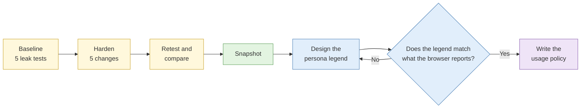

# Lab 1.5 Attribution leak test and persona hygiene

| Duration | Type | Running case | Assessed |
| --- | --- | --- | --- |
| 40 minutes | Individual | Yes: the persona supports later running-case labs | No |

## Aim

Measure what your research environment gives away about you, reduce it, and prove the reduction. Then design a persona for the running case and the rules that govern its use.

## Outcome

1. A **before-and-after exposure record** showing what each test revealed and what changed after hardening.
2. A **persona design and usage policy** for the running case, linked to an instructor-supplied research account.

## The analogy: the airport body scanner

At Changi, before you fly, you walk through the scanner. It shows security everything you are carrying, including the coins you forgot were in your pocket. You take them out, walk through again, and this time the scanner is clear.

The leak-test sites in this lab are the body scanner for your browser. The first pass shows everything you are carrying without knowing it: your real IP through WebRTC, your time zone, your fonts. Hardening is emptying your pockets. The second pass proves what you removed. Some things, like your height, the scanner will always see. Some parts of a browser fingerprint are like that too.

## What you need to do

- [ ] Run five leak tests in the `case-running` profile and record every result
- [ ] Apply five hardening changes in Firefox
- [ ] Re-run all five tests and complete the before-and-after table
- [ ] Snapshot the hardened VM as `hardened-<date>`
- [ ] Read your persona account card and complete the persona legend
- [ ] Check the legend against your browser's test results and fix any contradiction
- [ ] Write the persona usage policy

**Deliverables:** the exposure table, `persona.md` (legend plus policy) and the `hardened-<date>` snapshot.

## What the instructor sets up beforehand

- One printed persona account card per delegate (platform, handle, where the credentials are held)
- The DNS-over-HTTPS setting to use with the course egress, written on the whiteboard
- The research need each persona serves, matched to the running-case requirements
- Confirmation that the five test sites below load through the course egress

## Before you start

- Complete [Lab 1.4](lab-1-4-research-environment.md) and read [S5 Research accounts](../sessions/s5-research-accounts.md).
- **Tools:** the research VM and the Firefox `case-running` profile.

## Rules for this lab

- Use only the test sites listed below.
- **Do not create an account on any real platform.** You use the instructor-supplied account only.
- Do not log in to the supplied account in this lab. You will use it in later labs.

## How the lab flows



## Part A: leak test and hardening (25 min)

### Step 1: Baseline test (8 min)

1. Start the VM and open Firefox. Choose the `case-running` profile.
2. Visit each site below and record what it shows in the **Before** column of the table in Step 3.

| Test | Site | What to look for |
| --- | --- | --- |
| IP and location | `https://ipleak.net` | The top box: IP address, country, ISP |
| DNS leak | `https://www.dnsleaktest.com` then click **Standard test** | The list of DNS servers and who owns them |
| WebRTC leak | `https://browserleaks.com/webrtc` | Any IP address listed under "WebRTC Leak Test" |
| Fingerprint uniqueness | `https://coveryourtracks.eff.org`, click **Test your browser** | Whether it says your browser has a unique fingerprint; scroll down to see the time zone and language reported |
| Canvas fingerprint | `https://browserleaks.com/canvas` | The signature value and the uniqueness percentage |

**Check:** you have a value in every row of the Before column. If a site does not load, tell the assistant.

### Step 2: Harden the profile (9 min)

Make these changes in the `case-running` profile only.

1. **Stop WebRTC leaking your IP.**
   - Type `about:config` in the address bar and press Enter.
   - Click **Accept the Risk and Continue**.
   - In the search box type `media.peerconnection.enabled`.
   - Double-click the value so it changes from `true` to `false`.
2. **Reduce fingerprinting.**
   - In the same `about:config` page, search `privacy.resistFingerprinting`.
   - Double-click to set it to `true`. Firefox now reports standard values for time zone (UTC), screen size and several other properties.
3. **Set the DNS route.**
   - Click the menu (three lines, top right) → **Settings** → **Privacy & Security**.
   - Scroll to **DNS over HTTPS** and choose the option written on the whiteboard.
4. **Block trackers.**
   - In the same page, under **Enhanced Tracking Protection**, choose **Strict**.
5. **Check the language.**
   - Go to **Settings → General → Language**. Set it to match your persona (Part B). If you have not decided yet, use **English (United States)**, which is the most common setting worldwide and so the least distinctive.
6. Close Firefox completely and open it again with the `case-running` profile.

### Step 3: Retest and record (8 min)

Run every test from Step 1 again and fill in the After column.

| Test | Before | After | Changed? | What still shows |
| --- | --- | --- | --- | --- |
| IP and location | | | | |
| DNS servers | | | | |
| WebRTC | | | | |
| Fingerprint unique? | | | | |
| Time zone reported | | | | |
| Language reported | | | | |
| Canvas signature | | | | |

**Check:** WebRTC no longer shows an IP, and the time zone now reports UTC. Your fingerprint may still be unique. Write why in the last column. Hardening reduces exposure, but rarely removes it completely, just as the body scanner will always see your height.

When finished, shut down the VM and take a snapshot named `hardened-<date>` (VirtualBox: **Snapshots → Take**).

## Part B: persona design and usage policy (15 min)

### Step 4: Design the legend (8 min)

1. Read your persona account card.
2. Create `persona.md` and copy in the template:

```markdown
# Persona: <account handle from the card>

- **Research need served:** which IR from Lab 1.1 this supports, and why logged-in access is needed
- **Platform(s):**
- **Name:**
- **Age range:**
- **Location and time zone:**
- **Language and spelling style:**
- **Occupation (general):**
- **Interests (three, ordinary):**
- **Profile image source:** generated or licensed; confirmed not reused elsewhere
- **Activity hours:** when this persona would plausibly be online
```

3. Fill in every line. Keep it plausible and boring, like a supporting character in a drama, not the lead.

**Check:** put your legend side by side with your Step 3 results. A persona who lives in Woodlands, uses a browser that reports UTC, and is online only during your office hours has three inconsistencies. Decide how you will handle each one and write it under the legend (for example, "time zone mismatch accepted because resistFingerprinting is on; persona only browses, never posts times").

### Step 5: Write the usage policy (7 min)

Add this to `persona.md` and complete it:

```markdown
## Usage policy

- **Approved by / date:** (instructor, for this course)
- **Permitted actions:** for example, view public and logged-in-visible content only
- **Prohibited actions:** at least five, for example no following, liking, messaging, joining groups, or any contact with a real person
- **Environment:** research VM, `case-running` profile only, never from my laptop or phone
- **Logging:** every session recorded in `00-admin/persona-log.md` with date, time, purpose and what was viewed
- **Stop conditions:** what makes me stop using the account immediately
- **Retirement criteria:** when the account is retired
```

**Check:** your prohibited list covers accidental interaction (a mis-tap on "like"), and your stop conditions include any platform warning, verification request or CAPTCHA loop.

## Worked example: a completed exposure row

| Test | Before | After | Changed? | What still shows |
| --- | --- | --- | --- | --- |
| WebRTC | Public IP 203.0.113.24 (course egress) and local IP 10.0.2.15 | No IP shown | Yes | Nothing |
| Time zone reported | Asia/Singapore (UTC+8) | UTC | Yes | Reports UTC, which is common for Tor and hardened browsers and may itself stand out |

## Common mistakes

- Running the baseline in the `scratch` profile and the retest in `case-running`, so the comparison is meaningless.
- Expecting "Your browser has a unique fingerprint" to disappear. It often will not. Record it honestly.
- Writing a persona legend full of colourful detail that is hard to keep consistent.
- Forgetting to restart Firefox after changing `about:config`.

## If you finish early

1. In the `scratch` profile, run the Cover Your Tracks test with no hardening and compare the number of "bits of identifying information" with your hardened `case-running` result.
2. Write two lines on which single change made the biggest difference, and why you think so.

## Summary

Your environment leaked identifying information before hardening, most likely through WebRTC, time zone and fingerprint. Hardening reduced the exposure but did not make you invisible. A unique fingerprint can persist, which is why compartmentalisation and behaviour matter as much as settings. Your persona legend must agree with what your browser reports, or the persona contradicts itself. The usage policy turns good intentions into rules you can be held to.

## Carries forward

- The `hardened-<date>` snapshot is your new working baseline.
- Lab 1.6: `persona.md` goes into `00-admin/`.
- Day 3 labs: the instructor-supplied account is used under this policy.
