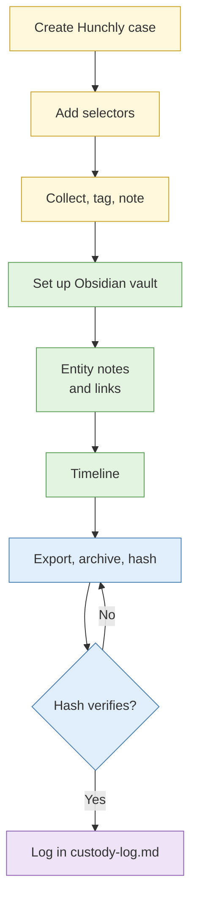

# Lab 1.6 Case construction with Hunchly and Obsidian

| Duration | Type | Running case | Assessed |
| --- | --- | --- | --- |
| 55 minutes | Individual | Yes: creates the case file used all week | No |

## Aim

Build the case file for the running investigation. Capture evidence with Hunchly, organise it in Obsidian, start the timeline, then export and verify the case so you can prove its integrity.

## Outcome

A populated, **exported and verified case**: a Hunchly case with tagged captures and selectors, an Obsidian vault with entity notes and a working timeline, and a hash record proving the export matches.

## The analogy: moving into a new flat with a labelled-box system

When you move house, you can throw everything into boxes and sort it out later. Three months on, you are still looking for the rice cooker. Or you can label every box by room before it leaves the old flat, keep a list of what is in each one, and photograph the contents. On moving day, every box goes straight to the right room, and if the movers break something, your photo proves what it looked like before.

Hunchly is the photograph of each box's contents. Obsidian is the labelled list that says which room every box belongs in. The export and hash at the end are the signed delivery note from the movers.

## What you need to do

- [ ] Create the Hunchly case and paste in your three requirement questions
- [ ] Add the seed selectors from the collection brief, plus two of your own
- [ ] Work through the collection brief with Hunchly recording, tagging and noting every page you rely on
- [ ] Set up the Obsidian vault from the course template and move your Day 1 files into `00-admin/`
- [ ] Create at least five linked entity notes, each citing a capture
- [ ] Add at least four dated events to the timeline, each with its date source
- [ ] Export the Hunchly case, archive and hash the whole case folder, verify the hash and log it

**Deliverables:** the case folder `CASE-<year>-001-running`, its `.tar.gz` archive, the `.sha256` file and a line in `custody-log.md`.

## What the instructor sets up beforehand

- Hunchly licences activated in the VM image, and the Hunchly extension installed in the `case-running` profile
- The `osint-case-template` vault on the VM desktop, with entity templates in `_templates/`
- The printed **collection brief** listing the sandbox and public sources to visit and the seed selectors
- The sandbox sites named in the brief online and tested from the course egress

## Before you start

- Complete Labs [1.1](lab-1-1-scoping-the-requirement.md), [1.4](lab-1-4-research-environment.md) and [1.5](lab-1-5-leak-test-and-persona-hygiene.md). Read [S6 Collection and cataloguing](../sessions/s6-collection-and-cataloguing.md).
- **Tools:** research VM, Firefox `case-running` profile, Hunchly, Obsidian, terminal.
- **Files from today:** `requirements.md`, `legal-decision-reference.md`, `persona.md`, `onion-source-evaluation.md`.

## Rules for this lab

- Collect only from the sources named in the collection brief.
- Every page you rely on must be captured in Hunchly while the running case is active.

## How the lab flows



## Steps

### Step 1: Create the Hunchly case (5 min)

1. Open Hunchly from the dock.
2. Create a new case. Name it `CASE-<year>-001-running` (for example `CASE-2026-001-running`).
3. In the case description field, paste the three IR questions from your `requirements.md`.
4. Open Firefox with the `case-running` profile. Click the Hunchly icon in the toolbar and make sure `CASE-<year>-001-running` is selected as the active case and that recording is on.

**Check:** the extension icon shows that the case is recording. If you browse with the wrong case active, those captures go into the wrong box.

### Step 2: Add selectors (5 min)

1. In Hunchly, open the case's **Selectors** section.
2. Add every seed selector listed on the collection brief (for example the client's name, the client's domain, the lookalike domain and the email address from the finance emails).
3. Add at least two selectors of your own that your requirements suggest, such as a likely variant spelling of the lookalike domain, or the name of the person who signed the finance emails.

**Check:** the dashboard lists all selectors for the case.

### Step 3: Run the collection task (15 min)

1. Work through the collection brief, visiting each source in the `case-running` profile.
2. For every page you will rely on:
   - In Hunchly, find the capture and add a **tag**: `IR-1`, `IR-2` or `IR-3`, showing which requirement it serves.
   - Add a **note** of one line saying why it matters, for example "Lookalike domain registered 9 days before first finance email".
3. Open the Hunchly dashboard and look at **selector hits**. Write down any page where a selector appeared that you did not expect.

**Check:** you have at least six tagged captures, each with a note, and you have reviewed the selector hits.

### Step 4: Set up the Obsidian vault (5 min)

1. In a terminal, copy the template into your cases folder:
   ```bash
   mkdir -p ~/cases
   cp -r ~/Desktop/osint-case-template ~/cases/CASE-2026-001-running
   ls ~/cases/CASE-2026-001-running
   ```
2. Open Obsidian. Click **Open folder as vault** and choose `~/cases/CASE-2026-001-running`.
3. Go to **Settings → Core plugins** and switch on **Templates**. Then go to **Settings → Templates** and set the template folder to `_templates`.
4. Move today's files into `00-admin/`:
   ```bash
   cd ~/cases/CASE-2026-001-running
   mv ~/requirements.md ~/legal-decision-reference.md ~/persona.md ~/onion-source-evaluation.md 00-admin/
   touch 00-admin/persona-log.md 00-admin/custody-log.md
   ```
   (Adjust the paths if you saved the files somewhere else.)

   `requirements.md` and `legal-decision-reference.md` were written on your laptop before the VM existed, and the shared clipboard and folders are switched off on purpose. Create both files in `00-admin/` and retype them. It takes a few minutes, and it is a good moment to tighten the wording. Never switch sharing back on to save time.

**Check:** the folder structure in Obsidian's left panel matches the one in S6.

### Step 5: Create entity notes (10 min)

1. For each person, organisation, domain or account in your captures, create a note in the right `01-entities/` subfolder. Name it `<Type> - <Name>`, for example `Domain - example-lookalike.com`.
2. With the note open, press Ctrl + P, type `Insert template`, and choose the matching template (Person, Organisation, Domain or Account).
3. Fill in at least these sections: Summary, Selectors, Sources (the Hunchly capture number), Confidence.
4. Link related entities by typing `[[` and choosing the other note's name. For example, link the organisation note to its real domain, and the lookalike domain note to the organisation it imitates.
5. Open **Graph view** (Ctrl + G) and check the entities are joined the way you expect. An entity floating on its own with no links usually means a missing link or a note that does not belong.

**Check:** at least five entity notes, each linked to at least one other, each citing a capture.

### Step 6: Start the timeline (5 min)

1. Open `timeline.md`.
2. Add every dated event from your captures as a row:

```markdown
| Date | Event | Entities | Evidence | Date source |
| --- | --- | --- | --- | --- |
| 2026-07-02 | Lookalike domain registered | [[Domain - example-lookalike.com]] | Hunchly #12 | WHOIS creation date |
| 2026-07-11 | First "change bank details" email received | [[Organisation - Client]] | Hunchly #15 | Email date in tasking (stakeholder) |
```

3. Fill the **date source** column for every row. A WHOIS creation date, an archive capture date and a page's own "posted on" date mean different things (see the table in S6).

**Check:** at least four dated rows, each with a date source.

### Step 7: Export, hash and verify (10 min)

1. In Hunchly, export the case into the evidence folder: choose the export option for the case and save it to `~/cases/CASE-2026-001-running/03-evidence/hunchly-export/`.
2. Close Obsidian, so no files are being written while you archive.
3. In a terminal, create the archive and its hash:
   ```bash
   cd ~/cases
   tar -czf CASE-2026-001-running_$(date +%F).tar.gz CASE-2026-001-running
   sha256sum CASE-2026-001-running_$(date +%F).tar.gz | tee CASE-2026-001-running_$(date +%F).sha256
   ```
4. Verify the archive against the recorded hash:
   ```bash
   sha256sum -c CASE-2026-001-running_$(date +%F).sha256
   ```
5. Add one line to `00-admin/custody-log.md` in this format:
   ```markdown
   | 2026-11-03 17:05 SGT | Archive created | CASE-2026-001-running_2026-11-03.tar.gz | <first 16 characters of hash>… | <your name> |
   ```

**Check:** the verify command prints `OK`. That is the movers' signed delivery note.

## Worked example: a completed entity note

```markdown
# Domain - example-lookalike.com

**Type:** Domain
**Imitates:** [[Organisation - Client]] (client's real domain is example.com)

## Summary
Registered 2026-07-02 through a privacy service. Landing page copies the client's logo and shows a login form.

## Selectors
- example-lookalike.com
- Registrar: (from WHOIS)

## Linked entities
- [[Organisation - Client]] (imitated brand)
- [[Email - finance-request@example-lookalike.com]] (sender of finance emails, per tasking)

## Sources
- Hunchly #12: WHOIS/RDAP record, captured 2026-11-03 16:21 SGT
- Hunchly #13: landing page, captured 2026-11-03 16:23 SGT

## Confidence
Registration date: high (registry record). Link to the finance emails: moderate (same domain in sender address; headers not yet seen).
```

## Common mistakes

- Browsing before checking the Hunchly extension shows the right case.
- Typing evidence into Obsidian without the Hunchly capture number, so the note cannot be proven.
- Two notes for the same entity because of different spellings.
- Hashing the archive while Obsidian is still open and changing files.

## If you finish early

1. In Obsidian, add a `## Gaps` section to the bottom of `timeline.md` listing two periods where you expected activity and found none.
2. In Graph view, find the entity with the most links. Write one line in its note on why it might be the "interchange station" for the next day's collection.

## Summary

You now have the case file you will use for the rest of the week. Hunchly holds the evidence with hashes and selector tracking. Obsidian holds entities, links, the timeline and your requirements, and every note cites the evidence. The export and hash give you a fixed point you can prove later. Repeat the export, hash and custody-log entry at the end of every day, like labelling every box before it leaves the flat.

## Carries forward

- Every running-case lab adds captures to this Hunchly case and notes to this vault.
- End of each day: export, hash, verify, update the custody log (the 17:00 buffer slot is for this).
- Capstone: you start from this case. If it falls behind, the instructor gives you a catch-up case pack.
