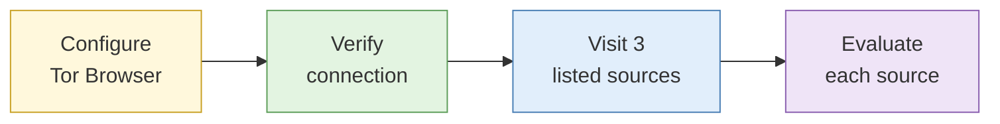

# Lab 5.5 Tor isolation and dark web source evaluation

| Duration | Type | Running case | Assessed |
| --- | --- | --- | --- |
| 20 minutes | Individual | No | No |


This lab was moved from Day 5 so that it follows the leak test. If the venue network blocks Tor, the instructor runs it as a live demonstration and you complete Step 4 from the screen.


## Aim

Confirm that Tor Browser in your research VM is isolated and not leaking, then evaluate a small set of onion sources for reliability, currency and operational risk.

## Outcome

A **source evaluation record** for three onion sources, each with a reliability grade, a currency note and an operational risk note.

## The analogy: visiting a pasar malam you have never been to

At a night market in an unfamiliar neighbourhood, some stalls are long-running family businesses and some appeared last week and will vanish next week. Some sell exactly what the sign says. Some sell fakes. A few are there only to pick pockets. You do not buy from the first stall you see. You look at how long it has been there, whether the signboard matches what is on the table, and whether anyone is watching you a little too closely.

Onion sites are that pasar malam. This lab teaches you to walk through it with your wallet in your front pocket and judge each stall before trusting it.

## What you need to do

- [ ] Open Tor Browser in the VM and set the security level to Safest
- [ ] Confirm you are on Tor and compare your exit IP with your Lab 1.5 results
- [ ] Visit your three assigned onion addresses without following any other links
- [ ] Grade each source for reliability, record how current it is, and write an operational risk note

**Deliverable:** the completed source evaluation table in Step 4, saved as `onion-source-evaluation.md`.

## What the instructor sets up beforehand

- A vetted list of onion addresses for legitimate news, search and organisational services, each taken from that organisation's official website and tested the day before
- Three addresses assigned to each delegate
- Tor tested on the venue network, with a 4G/5G router and the demo laptop ready if it is blocked

## Before you start

- Complete [Lab 1.5](lab-1-5-leak-test-and-persona-hygiene.md) and read [Dark web access and isolation](../sessions/s7-dark-web-access.md).
- **Tools:** Tor Browser in the research VM.

## Rules for this lab

- Visit only the addresses on your assigned list.
- No logins, registrations, posts or downloads.
- If anything unexpected or disturbing appears, close the tab and tell the instructor.

## How the lab flows

## Steps

### Step 1: Configure Tor Browser (4 min)

1. In the VM, open Tor Browser and click **Connect**. Wait for the connection to finish.
2. Click the shield icon to the right of the address bar, then **Settings**.
3. Under **Security Level**, choose **Safest**. This turns off JavaScript on all sites.
4. Leave the window at the size it opened in. Do not maximise it and do not install add-ons.

### Step 2: Verify the connection (4 min)

1. Visit `https://check.torproject.org`. It should say "Congratulations. This browser is configured to use Tor." Note the IP address it shows.
2. Visit `https://ipleak.net` and compare with your Lab 1.5 result.
3. Fill in the table:

| Check | Firefox `case-running` (Lab 1.5) | Tor Browser |
| --- | --- | --- |
| IP shown | | |
| Country | | |
| WebRTC exposure | | |
| Time zone reported | | |

**Check:** the Tor exit IP is different from your course egress IP, and no WebRTC address appears.

### Step 3: Visit the listed sources (6 min)

1. Copy your first assigned onion address from the instructor's list into the address bar. Type it carefully: onion addresses are long, and a single wrong character takes you to a different site or nowhere.
2. When the page loads, note what the site is, what it offers, and any date that shows when it was last updated.
3. Do not click any link that leads away from the listed page.
4. Repeat for the other two addresses.

### Step 4: Evaluate each source (6 min)

Create `onion-source-evaluation.md` and complete one row per source:

| Source (first 16 characters of the onion address) | What it is | Reliability grade (A to F) and why | Currency: most recent visible update | Operational risk note |
| --- | --- | --- | --- | --- |
| | | | | |
| | | | | |
| | | | | |

For the operational risk note, ask yourself: could this site log or fingerprint visitors? Does it invite me to interact or register? Does it link to anything outside the vetted list? Is the onion address the same one the organisation publishes on its normal website?

## Worked example

| Source | What it is | Reliability | Currency | Operational risk note |
| --- | --- | --- | --- | --- |
| `example1234abcd…` | Onion mirror of an international news organisation | B: address matches the one published on the organisation's own website; content matches its clearnet site | Front page dated today | Low. No login prompt; no outbound links off the list; still assume visits are logged |

## Common mistakes

- Maximising the window "to read better".
- Clicking a link inside the onion site to "see where it goes".
- Grading a site as reliable because it looks professional. Phishing copies of onion sites often look identical to the real one.

## If you finish early

Pick one of your three sources and find the official clearnet page where the organisation publishes its onion address. Confirm the address matches exactly. Write one line on why this check matters.

## Summary

Tor Browser hid your course egress IP and did not leak WebRTC. It still showed that you were using Tor, and each site could see everything you did on the page. Even legitimate onion services vary in how current and verifiable they are, so the S1 grading discipline applies here as well. On criminal marketplaces and forums the risk is far higher, like the pickpockets at the pasar malam, which is why dark web work needs policy approval and a vetted address list.

## Carries forward

- Capstone: some optional flags involve onion sources. Use this record format and the same safety rules.
