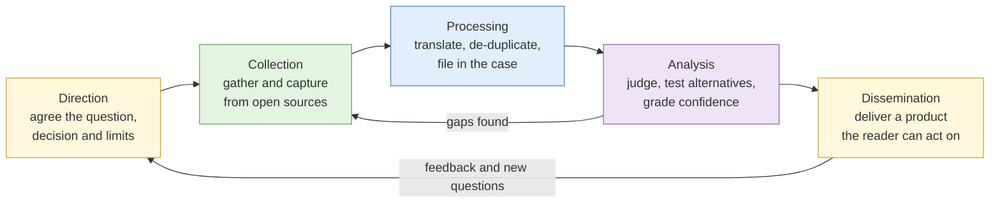
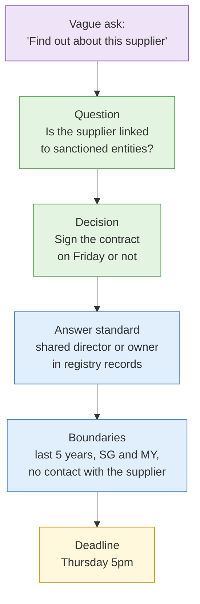
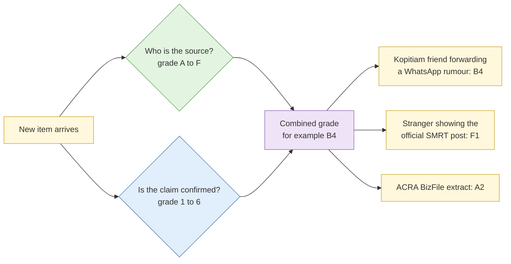

# S1 The intelligence cycle and analytic foundations

**Duration:** 15 minutes in class, about 25 minutes to read in full · **Leads into:** [Lab 1.1 Scoping the requirement](../labs/lab-1-1-scoping-the-requirement.md)

An OSINT investigation usually goes wrong before the first search, at the point where nobody pinned down the question. Collection is cheap and never ends. It only becomes intelligence when it answers a question someone needs answered, with a stated level of confidence, in time to be useful.

## The analogy: ordering at the hawker centre

Picture your boss asking you to "go buy lunch for the team". You walk into a hawker centre with forty stalls. If you start buying a plate from every stall, you will spend all your money, carry back more than anyone can eat, and still get it wrong, because Ah Hock is vegetarian and the deadline was 12:15, not 1:30.

A good runner asks a few questions first. How many people? Any dietary restrictions? Budget? By what time? Then they go to the right three stalls and come back on time.

That is the intelligence cycle. The questions you ask before walking in are **direction**. The stalls you visit are **collection**. Sorting the packets, checking the orders and labelling whose is whose is **processing**. Deciding that the chicken rice stall is the safest bet because the queue moves fast and everyone likes it is **analysis**. Handing out the packets with "the blue rubber band is the no-chilli one" is **dissemination**.

## The cycle applied to open sources

| Stage | What it means in OSINT | Typical failure | Hawker centre version |
| --- | --- | --- | --- |
| Direction | Agree the question, the decision it supports, the deadline and the boundaries | Starting to search before the question is agreed | Walking in without knowing how many packets |
| Collection | Gather material from open sources and capture it so it can be proven later | Collecting everything "just in case" | Buying from every stall |
| Processing | Translate, de-duplicate, normalise, extract metadata, file it in the case | Raw captures nobody can find again | Twenty unlabelled packets in one bag |
| Analysis | Turn information into judgements, test them against alternatives, grade confidence | Mistaking a pile of findings for an answer | Not checking which packet has the prawns |
| Dissemination | Deliver a product the stakeholder can act on | A long report with the conclusion on page 12 | Dumping the bag on the table and leaving |

The cycle is a loop. Analysis often sends you back to collection because you found a gap. A stakeholder's reaction to a draft can send you back to direction because the question has changed. Each loop should be a decision you record, so that you can explain later why you went back.

## Writing intelligence requirements

A requirement is a fence. It tells you where to collect, and it tells you where you are not allowed to wander.

A useful requirement has five parts:

1. **A question that can be answered.** "Is our new logistics supplier linked to any company on the MAS or UN sanctions lists?" works. "Find out about the supplier" is a topic, and you can never finish a topic.
2. **The decision it supports.** If the CFO is deciding whether to sign a S$2 million contract next Friday, you know how good the answer needs to be and when.
3. **An answer standard.** What evidence would answer it, and how confident is enough? "A director in common, confirmed in ACRA records, at moderate confidence or better" is a standard you can check against.
4. **Boundaries.** Time period, geography, the entities in and out of scope, and methods that are off limits.
5. **A deadline.** An answer delivered after the contract is signed is worth nothing.

### Why unbounded collection hurts you

Collecting "everything just in case" feels thorough. It causes three problems:

- **Legal exposure.** Under the PDPA, personal data you collect must fit a purpose. If you hold the director's children's school photos and your question was about sanctions, you will struggle to justify having them.
- **OPSEC exposure.** Every extra page you visit on the target's site is another line in their server logs.
- **Noise.** The one ACRA record that answers the question is buried under 300 screenshots.

## Data, information, evidence and inference

People use these words loosely. In this course they have exact meanings, and your reports are marked on keeping them apart.

**The analogy:** think of a Grab ride receipt.

- The raw GPS points the phone logged are **data**.
- "The ride went from Tampines to Raffles Place at 8.10am on Tuesday" is **information**: data placed in context.
- A saved, timestamped copy of that receipt, which you can show to your manager to prove the trip, is **evidence**: information captured, attributable to a source, and relevant to a question (did this person go to the office on Tuesday?).
- "He probably works in the CBD" is **inference**: a judgement drawn from evidence, which could be wrong. He might have had a dentist appointment.

| Term | Meaning | OSINT example |
| --- | --- | --- |
| Data | Raw, uninterpreted material | A WHOIS record; a photo file |
| Information | Data placed in context | The domain was registered on 3 March through a privacy service |
| Evidence | Information bearing on a specific question, captured and attributable | A hashed capture of the WHOIS record showing the registration date |
| Inference | A judgement from evidence that may be wrong | The domain was probably registered to prepare for the phishing campaign |

A reader of your report must always be able to tell which sentences are evidence and which are your inference. If they cannot, they will either trust your guesses too much or distrust your facts.

## Grading sources and information

Grade the source and the information separately.

**The analogy:** your most reliable kopitiam friend, the one who is always right about which stall has the shortest queue, tells you the MRT line is down. He is a reliable source. But he heard it from someone in a WhatsApp group, and the message is a forward of a forward. The source is good. The information is unconfirmed. Now imagine a stranger at the next table, whom you have never met, says the same thing while showing you the official SMRT post on his phone. Unknown source, but the information is confirmed. You need both grades to describe each situation fairly.

This course uses the common six-by-six system, often called the Admiralty or NATO system.

### Source reliability

| Grade | Meaning |
| --- | --- |
| A | Completely reliable: no doubt about authenticity, trustworthiness or competence; history of complete reliability |
| B | Usually reliable: minor doubts; history of mostly valid information |
| C | Fairly reliable: some doubts; has given valid information before |
| D | Not usually reliable: significant doubts |
| E | Unreliable: lacks authenticity or competence; history of invalid information |
| F | Reliability cannot be judged |

### Information credibility

| Grade | Meaning |
| --- | --- |
| 1 | Confirmed by other independent sources |
| 2 | Probably true: logical, consistent with other information, not confirmed |
| 3 | Possibly true: reasonably logical, agrees with some other information |
| 4 | Doubtful: not logical but possible; no other information on the subject |
| 5 | Improbable: illogical and contradicted by other information |
| 6 | Truth cannot be judged |

Most open sources start at F, because you have no history with them. That is normal and honest. Grade 1 (confirmed by independent sources) is harder to reach than it looks, because sources that seem independent often copy each other. S2 covers this under circular reporting.

### Grading in practice: three Singapore examples

| Item | Source grade | Information grade | Why |
| --- | --- | --- | --- |
| A company's directors listed in an ACRA BizFile extract | A | 1 or 2 | Statutory register; still only as accurate as what the company filed |
| A Straits Times article quoting "sources familiar with the matter" | B | 3 | Established outlet, but the claim rests on unnamed sources |
| A Telegram channel post saying the company's data has been leaked | F | 4 to 6 | No history with the channel; no corroboration yet |

## Common mistakes

- **Grading the outlet, not the claim.** A reputable newspaper reprinting a press release is only as good as the press release.
- **Treating "official" as "true".** Registries record what was filed. People file wrong addresses, outdated directors and nominee shareholders.
- **Writing requirements after collecting.** If you write the question to fit what you found, you are not answering a question, you are decorating a pile.

## Check your understanding

1. Rewrite "Research the new competitor" as a requirement with a question, decision, answer standard, boundaries and deadline.
2. Why is it wrong to grade a story in a major newspaper as A1 by default?
3. Label each as data, information, evidence or inference: a screenshot file; "the account posts between 01:00 and 03:00 UTC"; "the operator probably lives in UTC+8".
4. Your colleague hands you 400 screenshots and asks you to "find something useful". What do you ask before opening any of them?

## Key points

- Direction decides everything after it. Agree the question, decision, standard, limits and deadline first.
- Keep data, information, evidence and inference separate in your notes and reports.
- Grade source reliability and information credibility independently. Most open sources start at F.

## Further reading

- Richards J. Heuer Jr., *Psychology of Intelligence Analysis* (CIA Center for the Study of Intelligence, 1999), chapters 1 to 4.
- UN Office of the High Commissioner for Human Rights and UC Berkeley Human Rights Center, *Berkeley Protocol on Digital Open Source Investigations* (2022), section on investigation planning.
