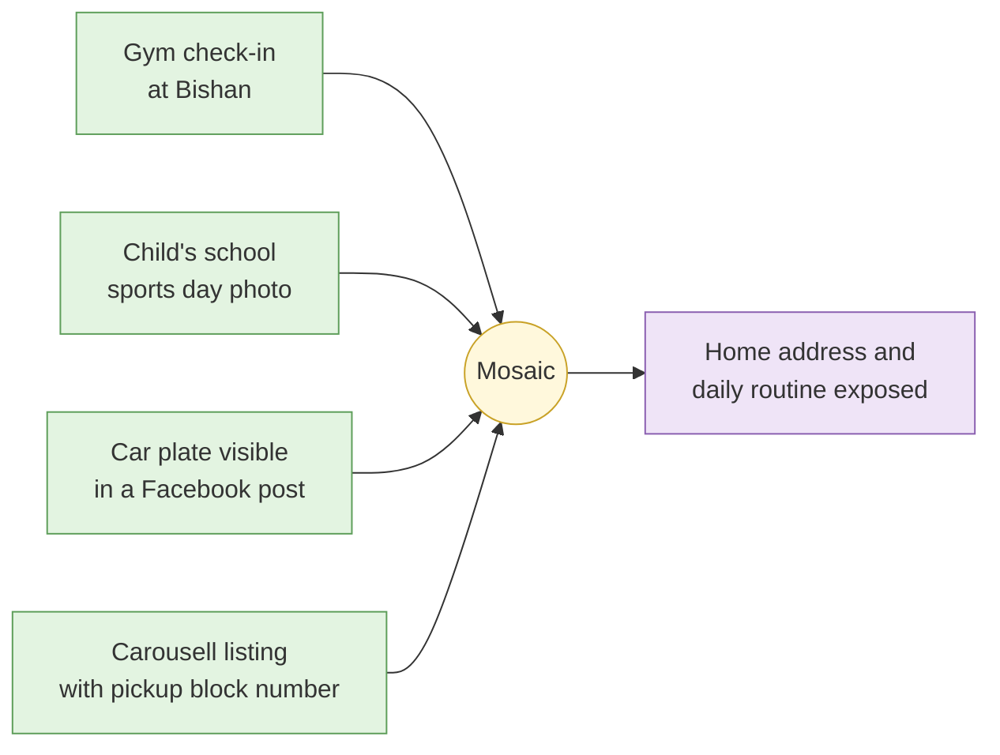
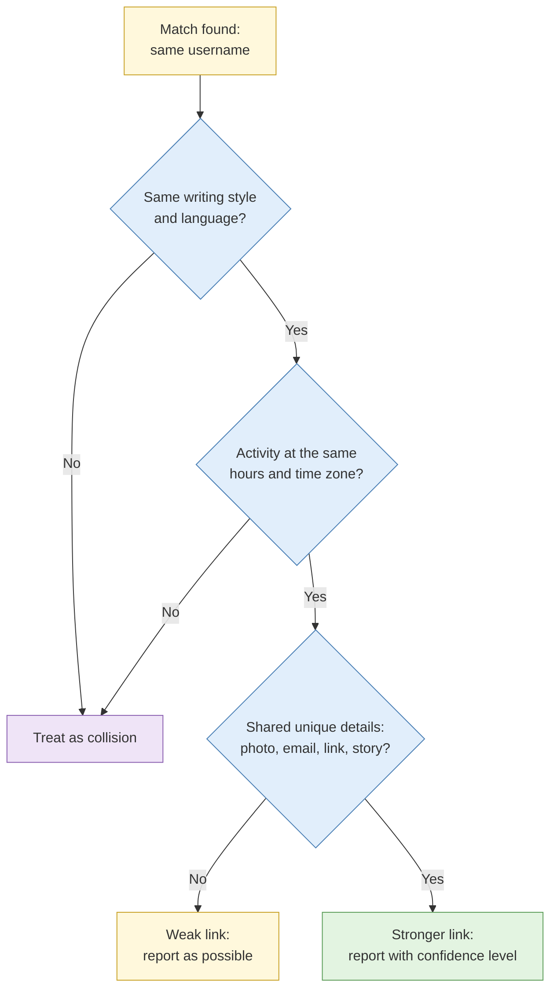
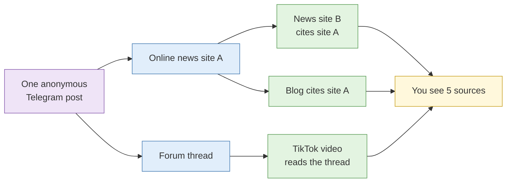

# S2 Analytical pitfalls

**Duration:** 25 minutes in class, about 30 minutes to read in full · **Leads into:** [Lab 1.2 Competing hypotheses](../labs/lab-1-2-competing-hypotheses.md)

Most wrong OSINT conclusions come from good data read badly. The analyst had the right material and still reached the wrong answer because of how their own mind handled it. This session covers the errors that come up again and again, and the structured techniques that catch them.

## The analogy: the "uncle on WhatsApp" problem

Everyone in Singapore has received it. A family chat forwards a message: "CONFIRMED: new ERP charges from Monday, my friend in LTA said." Within an hour, three other groups have the same message. Your aunt says it must be true because she has now seen it "from four different people".

Four separate errors are packed into that one moment:

- She already believed ERP was going up, so she accepted the message without checking. That is **confirmation bias**.
- The first version she saw said "Monday", and every later version is judged against that. That is **anchoring**.
- She assumes the forwarder's "friend in LTA" behaves like her own friends do: careful, honest, well placed. That is **mirror imaging**.
- Four forwards of one message feel like four sources. They are one source copied four times. That is **circular reporting**.

Every bias in this session is a version of something you have already seen in a family WhatsApp group. The difference is that in an investigation, the consequences land on a real person or a real business decision.

## Cognitive biases that matter in OSINT

| Bias | What it looks like in an investigation | Everyday Singapore version | Counter |
| --- | --- | --- | --- |
| Confirmation bias | You search for evidence that the suspect is guilty and stop when you find it | Reading only the Google reviews that agree with you about a restaurant | Search explicitly for evidence that would disprove your lead, and record that you did |
| Anchoring | The first theory in the tasking email shapes everything after it | The first flat you view in a BTO launch becomes the yardstick for every other flat | Write down at least three hypotheses before collecting |
| Mirror imaging | Assuming the subject thinks, works and uses technology the way you do | Assuming a scammer is "obviously" overseas because no Singaporean would do it | Ask what someone with different resources, culture or goals would do |
| Premature closure | Declaring the case solved once a plausible answer appears | Stopping your MRT route search at the first option, missing the faster bus | Ask which single item, if wrong, would collapse your answer |

Knowing the names of these biases does not protect you from them. Studies of analysts consistently find that awareness alone changes very little. What protects you is process: hypotheses written down before collection, disconfirming searches recorded in the case file, and someone whose job is to challenge your work.

## The mosaic effect

Individually harmless facts can combine into something sensitive.

**The analogy:** a jigsaw puzzle of the Marina Bay skyline. One piece showing a bit of blue sky tells you nothing. Thirty pieces together tell you exactly where the photographer stood.

### Real case: the Strava heatmap (2018)

In January 2018, analysts noticed that the fitness app Strava's public global heatmap, built from users' running and cycling routes, showed the outlines of military bases in conflict zones. Each soldier's jogging route was a harmless personal record. Aggregated, the routes revealed base perimeters, patrol routes and the daily routines of personnel. No single person leaked anything. The mosaic did.

### What it means for you

- **As an investigator,** aggregation is your main technique and your main ethical risk. Collect what the requirement needs, not everything that can be joined.
- **As a defender,** it explains why your own organisation's scattered public information (staff LinkedIn profiles, job adverts listing your tech stack, conference photos with lanyards) is more dangerous together than any single item.

## False attribution

The most damaging OSINT error is pinning activity on the wrong person or organisation. Once a name is attached to an accusation, it is very hard to detach.

**The analogy:** in a hawker centre, you see a tissue packet on a table and assume the table is "choped" by the person sitting nearest. It might belong to someone queuing at the satay stall. Proximity is not ownership.

### Real case: the Boston Marathon bombing (2013)

After the bombing, users on Reddit and other forums tried to identify the bombers from crowd photos. They publicly named a missing university student who had nothing to do with the attack. The name spread across social media and some news outlets before the FBI released images of the actual suspects. The student's family suffered weeks of harassment during an already terrible time. He was later found to have died before the bombing. The crowd had pictures, enthusiasm and no method.

### The four common collisions

| Collision | How it misleads | Singapore example |
| --- | --- | --- |
| Username | Popular handles exist on many platforms, owned by different people | `@jasontan88` on Instagram and on a gaming forum are almost certainly two different Jason Tans |
| Name | Common names, transliteration and name order produce false matches | "Tan Wei Ming", "Wei Ming Tan", "Tan Wei-Ming" and "Chen Weiming" may be one person or four |
| Photograph | Reverse image search finds similar faces; similar is not the same | Stock photos and stolen profile pictures used by scam accounts on Carousell |
| Infrastructure | Shared hosting or a common template is weak evidence of a shared operator | Two scam sites on the same cheap shared hosting IP may have nothing else in common |

A match on username, name or photo alone is a lead. Before calling it a link, ask: **what else would have to be true if this were the same person, and have I checked it?**

## Structured analytic techniques

### Analysis of competing hypotheses (ACH)

**The analogy:** a Crimewatch episode. A weak detective picks the most suspicious-looking person and collects reasons why they did it. A good detective lists every possible suspect, then asks of each clue: "who does this rule out?" The clue that the getaway car was a red Honda is useless if all four suspects own red Hondas. The clue that the thief was left-handed, when only one suspect is, is the clue that solves the case.

ACH formalises that second detective.

1. List all reasonable hypotheses, including ones nobody wants to hear.
2. List the significant evidence and arguments.
3. Build a matrix. For each item, mark whether it is **consistent (C)**, **inconsistent (I)** or **not applicable (N/A)** with each hypothesis. Work across each row, one item of evidence at a time.
4. Focus on inconsistency. The strongest hypothesis is the one with the fewest serious inconsistencies, which is not always the one with the most supporting evidence.
5. Identify the **diagnostic evidence**: items consistent with one hypothesis and inconsistent with others. Evidence consistent with everything tells you nothing, like the red Honda.
6. Ask which single item is doing the most work. If it turned out to be false, would the conclusion change?
7. Report the relative likelihood of all hypotheses, and the developments that would change your view.

```mermaid
flowchart LR
    H[List hypotheses] --> E[List evidence]
    E --> M[Matrix: test each item<br/>against every hypothesis]
    M --> I[Count inconsistencies]
    I --> D[Find diagnostic items]
    D --> S[Sensitivity: which item<br/>would flip the answer?]
    S --> R[Report all hypotheses<br/>with likelihood]
    classDef yellow fill:#FFF8DC,stroke:#C9A227,color:#333
    classDef green fill:#E3F4E1,stroke:#5E9E5A,color:#333
    classDef blue fill:#E1EEFB,stroke:#4A7FB5,color:#333
    classDef purple fill:#EFE4F7,stroke:#8A5FB0,color:#333
    class H,E yellow
    class M,I green
    class D,S blue
    class R purple
```

### Key assumptions check

List every assumption your judgement rests on, then for each ask: why do I believe this, how sure am I, and what would make it untrue?

**The analogy:** before you leave home for a 9am meeting in Jurong, you assume the East-West Line is running, the weather is fine and the meeting room is where the invite says. Most mornings all three hold. A key assumptions check is the habit of glancing at the SMRT app before you leave, so you are not the one standing at a closed station at 8.40am. Any assumption you cannot support becomes a collection requirement.

### Devil's advocacy

Someone is assigned to argue the strongest case against the leading judgement. It works best when it is a role rather than a personality. In a Singapore office, where people often hesitate to openly contradict a senior colleague, giving the role a name and rotating it ("you are the devil's advocate this week") makes challenge expected rather than rude.

## Circular reporting

Circular reporting happens when one original claim reaches you through several outlets that look independent. Five articles saying the same thing may all trace back to a single anonymous post.

**The analogy:** the same uncle-on-WhatsApp message, forwarded into five groups. You see it five times. It is still one message.

### Real case: "Curveball" and Iraqi weapons (2002 to 2003)

Much of the pre-war claim that Iraq had mobile biological weapons laboratories traced back to a single defector, codenamed Curveball, whose information had never been properly verified. His claims were passed between agencies and repeated in briefings until they appeared to be widely corroborated. After the invasion no such laboratories were found, and Curveball later admitted he had fabricated his account.

### How to detect it

- Trace each report back to its earliest source and record the chain in your case file.
- Look for identical phrasing, identical spelling mistakes or identical images across reports. Copying leaves fingerprints.
- Compare publication times. Who published first, and who cites whom?
- If five reports share one origin, grade them as one source.

## Common mistakes

- Running ACH after you have already decided, then filling the matrix to support the answer.
- Counting evidence for a hypothesis instead of evidence against the others.
- Writing "multiple sources confirm" without tracing whether they are independent.

## Check your understanding

1. Three news sites report that a company director is under investigation. What do you check before grading the claim as confirmed?
2. In an ACH matrix, an item of evidence is consistent with all four hypotheses. How much weight should it get, and why?
3. Give an example of mirror imaging in an investigation into an overseas scam operator targeting Singaporeans.
4. A Carousell seller's profile photo matches a LinkedIn profile of a Singapore-based engineer. List three things you would check before saying they are the same person.

## Key points

- Process counters bias. Awareness alone does little.
- A match on username, name or photo alone is a lead, never a conclusion.
- In ACH, inconsistency and diagnosticity matter more than the volume of supporting evidence.
- Trace reports to their origin before counting them as independent.

## Further reading

- Richards J. Heuer Jr., *Psychology of Intelligence Analysis* (CIA, 1999), chapter 8 on ACH.
- US Government, *A Tradecraft Primer: Structured Analytic Techniques for Improving Intelligence Analysis* (2009).
