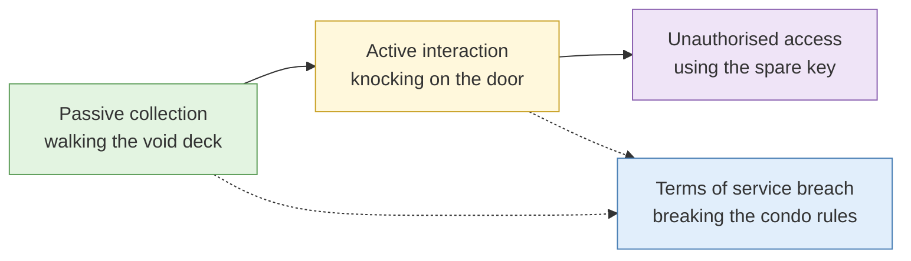
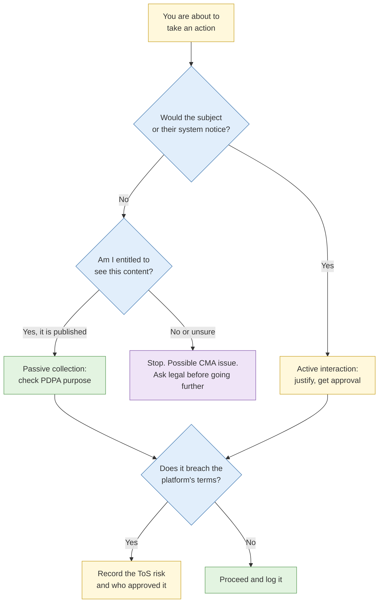

# S3 Legal and ethical boundaries

**Duration:** 25 minutes in class, about 35 minutes to read in full · **Leads into:** [Lab 1.3 Legal boundary classification](../labs/lab-1-3-legal-boundary-classification.md)


This page is training material, not legal advice. Your organisation's legal team and policies take precedence. When in doubt during a live investigation, stop and ask. Section summaries of the Acts below are simplified; read the current text on Singapore Statutes Online (sso.agc.gov.sg) before relying on them.


"It was publicly available" is not a legal defence on its own. What you may do with open-source material depends on how you got it, what it contains, who you are acting for and what you do with it afterwards.

## The analogy: the HDB void deck, the front door and the spare key

Imagine you need to find out whether a particular family still lives in an HDB flat in Toa Payoh.

- You walk through the **void deck** and along the **common corridor**. You notice shoes outside the door, a name on the letterbox and a Deepavali decoration. Anyone could see these. This is **passive collection**.
- You **knock on the door** and ask the person who answers. Now they know someone was asking. This is **active interaction**. It may be perfectly legal, but it changes the situation: they can tell others, move, or warn someone.
- You find a **spare key under the doormat** and let yourself in to look at the post on the dining table. It does not matter that the key was easy to find. You were not invited in. This is **unauthorised access**, and online it is a criminal offence under the Computer Misuse Act.

Every action you take in an investigation sits in one of these three places. The skill this session builds is recognising which one before you take the action.

## The three zones of activity

| Zone | Definition | Examples | Default position |
| --- | --- | --- | --- |
| Passive collection | Viewing or capturing openly published material without interacting with the subject | Reading a public website, searching ACRA BizFile, viewing archived pages on the Wayback Machine | Generally permitted, subject to PDPA rules on what you keep |
| Active interaction | Any action the subject, or their systems, could notice, or that engages with them | Following an Instagram account, joining a closed Telegram group, sending a message, triggering a password-reset email | Needs a written justification and usually policy approval |
| Unauthorised access | Accessing a computer, account or data you are not entitled to access, without consent from the person entitled to give it | Logging in with leaked credentials, changing a number in a URL to see another customer's order, using someone else's session | Prohibited. A criminal offence under the Computer Misuse Act |

The line between passive and active matters for OPSEC as much as for law. Active steps can alert the subject and end the investigation.

## Singapore's Personal Data Protection Act 2012 (PDPA)

The PDPA governs how **organisations** collect, use, disclose and look after personal data in Singapore. It is administered by the Personal Data Protection Commission (PDPC).

**The analogy:** the PDPA works like a library's rules for borrowing. You need a reason to take a book out (purpose), you are responsible for not losing or damaging it while you have it (protection), you must return it when you are done (retention limitation), and you cannot lend it to whoever you like (disclosure). Finding a book lying on a public bench does not give you the right to photocopy it and hand copies around the office.

### Points that matter for investigators

- **Who it binds.** Private-sector organisations, including when their employees research on their behalf. Public agencies are outside the PDPA and have their own regime. Individuals acting purely in a personal or domestic capacity are also outside it.
- **Consent and its exceptions.** Collecting, using or disclosing personal data generally requires consent. The Act provides exceptions, including for personal data that is **publicly available** and for collection necessary for an **investigation or proceedings**. Know which exception you rely on and write it in the case file.
- **Obligations continue after collection.** Even when an exception covers collection, the organisation must still protect the data, keep it accurate if it will be used to make a decision about a person, and not keep it longer than the purpose needs.
- **Purpose limitation.** Collect for the stated requirement only. Personal data swept up "just in case" is hard to justify and becomes a liability if your systems are ever breached.
- **NRIC numbers.** Since September 2019, the PDPC's advisory guidelines restrict organisations from collecting, using or disclosing NRIC numbers (and copies of the NRIC) unless required by law or needed to verify identity to a high degree of fidelity. If an NRIC number turns up in your collection, treat it as sensitive and check your policy before keeping it.
- **Penalties.** Financial penalties can reach 10% of an organisation's annual Singapore turnover (for organisations with turnover above S$10 million) or S$1 million, whichever is higher. The PDPC publishes its enforcement decisions, and many involve organisations that simply kept data too long or protected it poorly.

**In practice:** your Lab 1.1 requirement is also your legal purpose statement. Data outside it should not be in your case file.

## Singapore's Computer Misuse Act 1993 (CMA)

The CMA makes it an offence to interfere with computers and data without authority.

**The analogy:** the CMA is about the spare key. It does not matter that the door was easy to open, that the key was in an obvious place or that you meant no harm. The test is whether you were entitled to go in.

| Section | Offence (simplified) | How investigators fall into it |
| --- | --- | --- |
| s3 | Unauthorised access to computer material | Using found credentials; changing URL parameters to reach non-public records; using another person's session |
| s4 | Access with intent to commit or facilitate an offence | Unauthorised access done in support of another offence |
| s5 | Unauthorised modification of computer material | Submitting data that changes a target system; uploading files to it |
| s6 | Unauthorised use or interception of a computer service | Intercepting traffic; using a service you are not entitled to use |
| s7 | Unauthorised obstruction of use of a computer | Aggressive scanning or automation that slows or blocks a service |
| s8 | Unauthorised disclosure of access codes | Sharing passwords or API keys you came across during research |
| s8A | Dealing in personal information obtained through a CMA offence | Obtaining, keeping or supplying breach data you know or have reason to believe came from an offence |
| s8B | Obtaining or making available items for use in CMA offences | Acquiring tools or credentials intended for unauthorised access |

The CMA also reaches beyond Singapore. An act done overseas can still be an offence if, for example, the computer, program or data involved was in Singapore at the time.

**"Authorised" is the test.** A system that is reachable from the internet may still be off limits in parts. If nobody gave you credentials or permission, and the content was not published for the public, assume you are not authorised.

## Terms of service breaches versus legal breaches

**The analogy:** your condo's by-laws say no barbecues after 10pm and no visitors in the gym. Breaking them can get you a warning letter or a fine from the management corporation, and you may lose access to the facilities. It does not get you arrested. Breaking into your neighbour's unit does.

Breaching a platform's terms of service, for example by creating an account under an invented identity or by scraping, is usually a contractual matter between you and the platform rather than a crime. It still has costs:

- The platform may suspend the account, which ends your access to that source.
- Evidence gathered in breach of terms may be challenged when findings are disclosed or litigated.
- Your organisation may forbid it by policy even where the law does not.
- In some situations a terms breach can support a civil claim, or form part of conduct that is unlawful for other reasons.

Record every terms-of-service risk you take, why the requirement justified it and who approved it.

## Cross-border collection and data handling

**The analogy:** crossing the Causeway at Woodlands. You are subject to Singapore's rules leaving and Malaysia's rules arriving, and what is fine in one place is not automatically fine in the other.

- Collecting from a server in another country can engage that country's law as well as Singapore's.
- Storing collected personal data in a cloud region outside Singapore is a **transfer** under the PDPA, which carries its own obligations to ensure comparable protection.
- Some jurisdictions restrict access to certain sources, or treat particular research (for example, into government officials) as sensitive.

On a cross-border case, record in the case file where each piece of data came from and where it is stored.

## Breach and leak data

**The analogy:** someone offers you a "very cheap" iPhone outside a hawker centre, no box, no receipt. It may be stolen, it may be a fake, and simply buying it may get you into trouble. Breach data is that phone.

When the SingHealth cyberattack in 2018 exposed the personal particulars of about 1.5 million patients, the data became something criminals could trade. An investigator who later comes across a copy faces exactly the questions below.

1. **Legality.** Holding or using data obtained through a CMA offence can itself be an offence under s8A. Get your organisation's legal position before you obtain, store or query any breach corpus.
2. **Reliability.** Breach data is often old, duplicated, merged from several leaks, or partly fabricated by sellers to make it look bigger. A "2024 DBS customer database" may be a 2019 leak from an unrelated company with the word DBS added.
3. **Policy.** Many organisations prohibit breach data entirely, or allow it only through a vetted commercial provider.

**Never use a credential from breach data to log in to anything.** That is unauthorised access regardless of where you found the password.

## Other Singapore laws to be aware of

- **Protection from Harassment Act 2014 (POHA).** Since the 2019 amendments, publishing a person's identity information intending to harass, threaten or facilitate violence against them ("doxxing") is an offence. Be careful what you disseminate and to whom, especially after a scam investigation where emotions run high.
- **Sector rules.** Financial institutions regulated by MAS, healthcare providers and public-sector bodies often have stricter handling rules than the general law.

## Evidence handling where findings may be disclosed or litigated

**The analogy:** the lost-and-found counter at a shopping mall. When you hand in a wallet, the staff write down when it came in, who handed it in, where it was found, and who has handled it since. When the owner turns up, nobody can claim money went missing, because every hand it passed through is on the log.

If your findings could end up in a disciplinary hearing, a regulator's file or a court, assume the method will be examined. You must be able to show:

| Question | What you record |
| --- | --- |
| What did you capture? | The file, with a hash proving it has not changed |
| When? | Date and time from a reliable clock, with time zone (SGT, UTC+8) |
| How? | Tool, settings and steps, in enough detail for someone else to repeat |
| Who has handled it since? | Every transfer, with date and recipient |

S6 and Lab 1.6 build this into your case file from the first day.

## Common mistakes

- Assuming "public" means "free to use however I like".
- Treating a password-reset check as harmless. It can email the subject a warning.
- Downloading a breach file "just to have a look" before asking legal.
- Publishing names in a report that goes wider than the people who need it.

## Check your understanding

1. You find a login page for a supplier's staff portal, and a matching username and password on a paste site. Which zone is logging in, and which CMA section applies?
2. Your organisation's PDPA basis for collection is the investigation exception. What obligations still apply to the data you collect?
3. A platform's terms prohibit accounts under false names. Is creating one a crime in Singapore? What are the risks anyway?
4. During collection you find a scanned NRIC of the subject on a public forum. What do you do?

## Key points

- Classify every action as passive, active or unauthorised before you take it.
- PDPA obligations continue after collection, and your requirement is your purpose statement.
- Under the CMA, "reachable" and "authorised" are different tests. Never use found credentials.
- Terms of service breaches are usually not crimes, but they carry real operational and evidential risk.

## Further reading

- Personal Data Protection Act 2012 and Computer Misuse Act 1993, Singapore Statutes Online (sso.agc.gov.sg).
- PDPC, *Advisory Guidelines on Key Concepts in the PDPA* and *Advisory Guidelines for NRIC and other National Identification Numbers* (pdpc.gov.sg).
