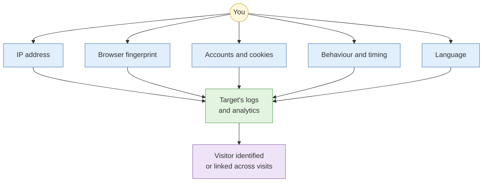
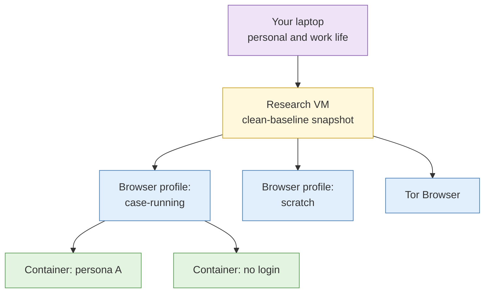

# S4 Operational security for the researcher

**Duration:** 25 minutes in class, about 30 minutes to read in full · **Leads into:** [Lab 1.4 Building the research environment](../labs/lab-1-4-research-environment.md)

Every time you visit a target's website, view a profile or run a search, you leave traces. Operational security (OPSEC) is the discipline of controlling those traces so the investigation is not detected, not attributed to you or your organisation, and not contaminated by your own identity.

## The analogy: wearing your company lanyard to the target's office

Imagine you are checking out a competitor's showroom in Ubi. You arrive in your company polo shirt, wearing your staff lanyard, park your company car with the logo on the door, pay for a coffee with your corporate card, and come back at exactly the same time every day for a week. The sales staff do not need to be detectives to work out who you are and what you want.

Online, your **IP address** is the company car in the car park. Your **browser fingerprint** is your face. Being **logged in** to your Google account is the lanyard. **Visiting the same pages every morning at 9.15** is turning up at the same time every day. **Searching in Singlish** on a Vietnamese-language site is your accent.

Good OPSEC means turning up as an ordinary customer: no lanyard, a different car, normal behaviour, and nothing that links today's visit to last week's.

## Attribution surfaces

| Surface | What it reveals | Example | Showroom equivalent |
| --- | --- | --- | --- |
| IP address | Organisation, location, ISP | Your corporate egress IP appears in the target's web server logs | Company car in the car park |
| Browser fingerprint | A near-unique device identity across sites | Screen size, fonts, graphics card, canvas rendering, time zone, language | Your face |
| Device identifiers | Hardware and operating system IDs | Phone advertising IDs; MAC addresses on local Wi-Fi | Your car's licence plate |
| Accounts and cookies | Your real identity | Still logged in to your personal Gmail while researching | Your staff lanyard |
| Behaviour | Patterns that distinguish you | Careers page, then executive bios, then the same pages again the next day | Inspecting only the price tags, never the products |
| Timing | Working hours and time zone | Every visit between 9am and 6pm Singapore time, Monday to Friday | Arriving at 9.15 every day |
| Language | Where you are from | English searches with Singapore spellings on a Thai-language site | Your accent |

Your IP address is the obvious one. In practice, **fingerprint and behaviour** are what link separate sessions together, even when the IP changes.

### Real case: the "altoid" posts

Ross Ulbricht ran the Silk Road darknet market. Investigators linked him to it partly through early forum posts made under the username "altoid" promoting the site. In a later post on another forum, the same "altoid" asked for programming help and gave a Gmail address containing his real name. One reused username and one careless post connected an anonymous operator to a real person. Every analyst should remember that their own slips are found the same way.

## Non-attribution versus misattribution

- **Non-attribution** means your activity cannot be tied to you or your organisation. It looks like ordinary, unremarkable traffic. This is the default for almost all OSINT work.
- **Misattribution** means your activity is deliberately made to look like it comes from someone else, for example from another country or a particular type of organisation. It is harder to keep up, raises ethical and sometimes legal questions, and needs explicit approval.

**The analogy:** non-attribution is walking into the showroom as a regular customer in a plain T-shirt. Misattribution is turning up in a rival company's uniform. The first draws no attention. The second can work, but if anyone checks, you now have a much bigger problem to explain.

Choose the lightest approach that protects the investigation. Over-engineered cover can itself draw attention.

## Network options compared

**The analogy:** different ways of getting to the showroom.

| Option | Strengths | Weaknesses | Good for | Travel analogy |
| --- | --- | --- | --- | --- |
| Commercial VPN | Cheap, easy, many exit locations | Known VPN IP ranges are flagged or blocked; the provider can see your traffic | Low-sensitivity browsing | A Grab ride: the driver knows where you went |
| Cloud VM | Controlled, disposable, choice of region | Cloud provider IP ranges are easy to identify as data-centre traffic | Infrastructure research, automation | A rental car with rental plates: anonymous, but obviously a rental |
| Residential egress | Looks like an ordinary home user | Cost; sourcing ethics and provider trust vary | Platforms that block data-centre IPs | Borrowing a neighbour's car |
| Isolated hardware | Physical separation from corporate systems | Cost, logistics | High-sensitivity or long-running investigations | A dedicated car used for nothing else |
| Tor | Strong anonymity for the network path | Exit nodes are public and widely blocked; slow | Onion services, specific high-risk lookups | Changing buses three times so nobody can follow your route |

None of these fixes a fingerprint or a logged-in account. A Grab ride does not help if you still wear the lanyard.

## Compartmentalisation

The aim is that nothing from one investigation, or from your personal life, leaks into another.

**The analogy:** a bento box. Each compartment holds one food, and the curry does not soak into the rice. Your VM is the box. Each browser profile is a compartment. Your personal life is a different box altogether, kept at home.

- **Virtual machines.** Do research inside a VM, never on your host operating system. If the VM is fingerprinted or infected, you roll it back.
- **Browser profiles.** One profile per investigation, with no personal bookmarks, extensions or saved logins.
- **Containers.** Browser containers isolate cookies between personas within one investigation.
- **Snapshot discipline.** Take a clean baseline snapshot after setup and revert to it at the start of each new investigation. Take named snapshots before risky steps so you can return to them.

**The analogy for snapshots:** a save point in a video game. Before you open the door to the boss level, you save. If it goes badly, you reload and nothing that happened inside counts.

## Separating identities across investigations

Cross-contamination happens when something links two investigations, or links a persona to you. Common causes:

- Using the same persona or browser profile on two unrelated cases
- Logging in to a personal account "just for a second" inside the research environment to check a message
- Copying files between investigations without checking their metadata
- Searching for yourself or your colleagues from the research environment

Treat each investigation as a sealed container. Data leaves only through your case export.

## Reducing your own digital footprint

You study targets through their public footprint. Adversaries can study you the same way, and scam syndicates targeting Singapore routinely research the people who investigate them.

Before working sensitive cases:

1. Search for yourself: full name in English and Chinese or other scripts, usernames, email addresses, phone numbers.
2. Review privacy settings on Facebook, Instagram and TikTok. Remove your employer and job title where you can.
3. Check what your LinkedIn profile says about your OSINT or investigations role. "Cyber threat intelligence analyst at (your bank)" is a useful line for an attacker.
4. Keep work and personal usernames completely different.
5. Be careful with conference speaker bios, published papers and photos where your staff pass is visible.
6. Look at what family members post about you. Your cousin's wedding photos may name you and your employer.

## Common mistakes

- Trusting the VPN and forgetting the fingerprint.
- Researching from the office network "just quickly" before the VM is ready.
- Using the research browser for personal online banking.
- Never reverting the VM, so months of cookies and history build up.

## Check your understanding

1. You use a VPN but stay logged in to your personal Chrome profile. What is exposed?
2. When would misattribution be appropriate, and who should approve it?
3. Why revert to a clean snapshot at the start of each investigation instead of just clearing cookies?
4. Using the showroom analogy, describe what "behaviour" as an attribution surface looks like online.

## Key points

- Your IP is one attribution surface of many. Fingerprint, accounts, behaviour and timing link sessions together.
- Default to non-attribution. Misattribution needs explicit approval.
- One VM baseline, one browser profile per investigation, regular snapshots.
- Reduce your own footprint before working sensitive cases.

## Further reading

- Michael Bazzell, *OSINT Techniques: Resources for Uncovering Online Information* (latest edition), sections on the research environment.
- Electronic Frontier Foundation, *Surveillance Self-Defense* (ssd.eff.org).
