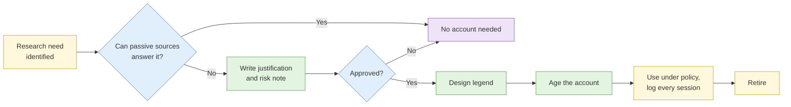
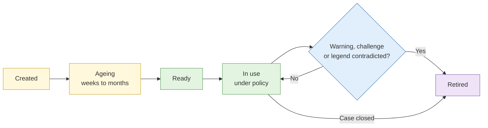

# S5 Research account creation and maintenance

**Duration:** 15 minutes in class, about 25 minutes to read in full · **Leads into:** [Lab 1.5 Attribution leak test and persona hygiene](../labs/lab-1-5-leak-test-and-persona-hygiene.md)

Some sources can only be seen when you are logged in. A research account (also called a persona or sock puppet) lets you see them without exposing your real identity. It is also one of the riskiest tools you will use, legally, ethically and operationally.


In this course you use **instructor-supplied accounts only**. You design a persona in Lab 1.5, but you do not create accounts on real platforms.


## The analogy: the undercover mystery shopper

Retail chains in Singapore hire mystery shoppers to visit their own outlets and report on service. A good mystery shopper looks exactly like a normal customer. They dress normally, buy something ordinary, ask the questions a real customer would ask, and leave. They never reveal who sent them, and they never do anything a real customer would not do.

Now imagine a mystery shopper who:

- wears the same distinctive outfit to every outlet,
- visits ten branches in one afternoon,
- only ever asks about the staff roster and the cash register,
- or, worst of all, starts chatting up the cashier to get her phone number.

Within a week, every branch would know about them. That is what a badly run research account looks like to a platform's fraud team, and to your subject.

## Purpose, risk and approval

Before any research account is created, someone with authority should approve it against a written case:

| Question | What to write |
| --- | --- |
| Purpose | Which requirement needs logged-in access, and why passive sources cannot answer it |
| Risk | Terms of service breach, detection, account loss, and the chance of accidental interaction with real people |
| Rules of use | Passive viewing only, or limited interaction? What is never allowed? |
| Ownership | Who controls the credentials and recovery details, and where they are stored |
| Review date | When the account's use will be reviewed or ended |

If you cannot write the justification in two sentences, you probably do not need the account.

## Persona design and legend consistency

A persona's **legend** is its backstory: name, age, location, job, interests and history.

**The analogy:** a legend is like an actor's character in a Mediacorp drama. The actor needs to know where the character grew up, what they do for a living, how they speak and what they would never do. If the character is a Toa Payoh hawker in episode 1 and a Sentosa yacht owner in episode 3 with no explanation, viewers notice. Platforms and subjects notice too.

A good legend is:

- **Plausible and boring.** Ordinary people attract less attention. "Logistics coordinator in Jurong, likes cycling and food reviews" beats "former special forces turned crypto millionaire".
- **Consistent.** Time zone, language, spelling, interests, photo and friends must agree on every platform the persona uses.
- **Matched to the need.** A persona viewing Singapore property groups should plausibly live in, or be moving to, Singapore.
- **Not a real person.** Never use a real person's name or photograph. Use generated or properly licensed images, and check they are not already used by other accounts.

### Example: a consistent legend and an inconsistent one

| Detail | Consistent persona | Inconsistent persona |
| --- | --- | --- |
| Location | Woodlands, Singapore | Woodlands, Singapore |
| Time zone shown by browser | UTC+8 | UTC+0 (because of a hardening setting) |
| Active hours | Evenings and weekends | 9am to 6pm weekdays (your office hours) |
| Language | Singapore English, the occasional "lah" in comments | American spelling, no local references |
| Interests | Cycling at Admiralty Park, hawker food | Only follows companies linked to the subject |
| Profile photo | Generated image, checked with reverse search | Stock photo found on 2,000 other sites |

## Account ageing

New accounts get extra scrutiny and are often restricted. Ageing means building ordinary history before an account is used for research: occasional logins, following general-interest pages, normal browsing.

**The analogy:** a new HDB neighbour who knocks on every door on the first day asking personal questions is suspicious. One who has lived on the floor for a year, says hello at the lift and joins the residents' committee barbecue is not. Ageing takes weeks to months, which is why research accounts have to be prepared long before they are needed.

## Platform detection signals

Platforms look for:

- Registration from data-centre or VPN IP ranges
- Phone numbers from virtual number services
- Many accounts sharing one device fingerprint or IP
- Profile photos that appear elsewhere on the internet
- Behaviour that does not look human: no feed scrolling, immediately searching for specific people, logging in at fixed intervals
- Sudden jumps in location or language

## Common failure modes

- Logging in to the persona once from your real phone or home Wi-Fi
- Reusing the same photo or bio text across two personas
- A recovery email or phone number that leads back to you or your organisation
- Accidentally liking, following or reacting to the subject's content (the "fat finger" problem)
- Switching between personas in one browser profile

## Maintenance and retirement

Keep a log for each persona with its creation date, platforms, where the credentials are stored, every use, and any warning or restriction from the platform.

Retire an account when the platform has restricted it, when a subject may have noticed it, when its legend has been contradicted, or when its investigation has ended with no approved further use.

## When research accounts must not be used

- To interact with a subject under a false identity without legal and policy approval
- With minors or vulnerable people
- To get into closed groups whose members reasonably expect privacy, unless specifically approved
- Where the evidence must be beyond challenge and passive sources can answer the requirement
- Where your organisation's policy forbids it

## Check your understanding

1. List three details a Singapore-based persona's legend would need to keep consistent.
2. Why is a profile photo from a stock site a poor choice?
3. Name two triggers for retiring a research account.
4. Using the mystery shopper analogy, explain why a persona should never message the subject.

## Key points

- Research accounts need a written justification and approval before creation.
- Plausible, boring and consistent beats detailed and interesting.
- Most persona failures are one-off slips that link the account to you.
- Retire accounts deliberately and keep a log for each.
