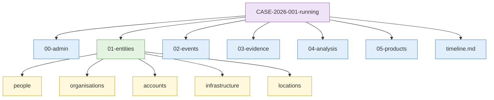
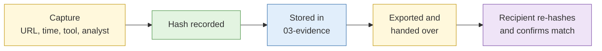

# S6 Collection and cataloguing

**Duration:** 20 minutes in class, about 30 minutes to read in full · **Leads into:** [Lab 1.6 Case construction with Hunchly and Obsidian](../labs/lab-1-6-case-construction.md)

An open-source finding that cannot be proven later is an anecdote. This session sets out how to capture evidence so it survives scrutiny, and how to organise a case so that you, and anyone who takes it over, can find things weeks later.

## The analogy: the CCTV recorder and the detective's notebook

Think of a police investigation into a theft at a void deck.

- The **CCTV recorder** captures everything that happened, timestamps it and cannot be edited without leaving a trace. Nobody argues with the footage about what happened at 2.14am.
- The **detective's notebook** is where the officer writes who the people in the footage might be, how they connect to each other, and which leads to follow next. It holds reasoning, not proof.

You need both, and you must not mix them up. In this course:

- **Hunchly is the CCTV recorder.** It captures what you saw, when you saw it, and proves the capture has not changed.
- **Obsidian is the detective's notebook.** It holds entities, relationships, the timeline and your reasoning, and every note points back to the footage.


## Hunchly

Hunchly runs alongside your browser and records pages as you browse them, as long as a case is open and active.

| Feature | What it does | Why it matters |
| --- | --- | --- |
| Automatic capture | Saves every page you visit while a case is active | You never lose the page you forgot to save, even if it is deleted an hour later |
| Hashing | Records a cryptographic hash of each capture | Proves the capture has not been changed since |
| Selectors | Tracks terms (names, emails, usernames, phone numbers) and flags pages where they appear | Shows connections you might have scrolled past |
| Tags and notes | Lets you mark important captures and annotate them | Separates evidence from browsing noise |
| Dashboard | Shows captures, selectors and tags for the case | Quick review of what you have |
| Case export | Exports the case with captures and hashes | Handover, disclosure and archiving |

### What a hash is, in one analogy

A hash is a fingerprint for a file. Run the same file through the hash function and you always get the same long string of characters. Change a single pixel or a single comma and the fingerprint changes completely. If the hash you recorded on Monday matches the hash today, the file is unchanged.

Think of it like the tamper-proof seal on a bottle of medicine from Guardian. If the seal is intact, nobody has opened it since the factory.

### Good practice

- Open the correct case **before** you start browsing.
- One Hunchly case per investigation.
- Tag captures you will rely on, and add a one-line note saying why.
- Export at the end of each day.

## Obsidian

Obsidian is a note-taking application that stores notes as plain Markdown files in a folder called a **vault**.

| Feature | How you use it in a case |
| --- | --- |
| Entity notes | One note per person, organisation, account, domain, location or event |
| Templates | Standard headings for each entity type, so every note records the same things |
| Bidirectional links | `[[Entity name]]` links notes; the backlinks panel shows everything that mentions an entity |
| Graph view | Shows how entities connect, so you can spot clusters and gaps |
| Timeline note | One chronological note of dated events, each linked to entities and evidence |

**The analogy for linking:** an MRT map. Each station is an entity. Each line is a relationship. When you look at the map, you see interchanges immediately. A person who links to six other entities in your graph is an interchange station, and that is usually where you should look next.

Because the vault is ordinary files, it is easy to back up, hash and export.

### Example entity note

```markdown
# Organisation - Example Logistics Pte Ltd

**Type:** Company (Singapore)
**UEN:** (from ACRA record)
**Status:** Live

## Summary
Freight forwarder named in the client's finance emails as a "new supplier".

## Selectors
- example-logistics.com.sg
- accounts@example-logistics.com.sg

## Linked entities
- [[Person - Director A]] (director, per ACRA)
- [[Domain - example-logistlcs.com]] (lookalike domain, note the "l" for "i")

## Sources
- Hunchly #14: ACRA BizFile extract, captured 2026-11-03 10:42 SGT
- Hunchly #17: company website "About us"

## Confidence
Identity of company: high. Link to lookalike domain: low (name similarity only).
```

## Case structure and naming conventions

**The analogy:** a well-organised HDB kitchen. Everyone in the family knows the rice is in the third drawer and the Milo is above the sink. If each person stores things wherever they like, nobody finds anything, and you end up buying a second tin of Milo. A case folder works the same way, and it matters even more when a colleague takes over your case while you are on leave.

This course uses:

```
CASE-<year>-<number>-<shortname>/
  00-admin/        requirements, approvals, persona log, custody log
  01-entities/
    people/
    organisations/
    accounts/
    infrastructure/
    locations/
  02-events/
  03-evidence/     exported Hunchly captures and other files
  04-analysis/     ACH matrices, assessments, drafts
  05-products/     reports that went out
  timeline.md
```



**File naming:** `YYYY-MM-DD_<source>_<short-description>`, for example `2026-11-03_companyregistry_example-co-directors.pdf`. Putting the date first means files sort in date order.

**Entity naming:** `<Type> - <Name>`, for example `Person - Firstname Lastname` or `Domain - example.com`. Consistent names make links reliable. Agree how you will write Singapore names (surname first or last, with or without hyphen) at the start of the case and stick to it.

## Chain of custody in an open-source context

Chain of custody shows that the evidence presented is the same as the evidence collected.

**The analogy:** sending a parcel with SingPost registered mail. Every time it changes hands, it is scanned: collected at the post office, sorted at the mail centre, out for delivery, delivered and signed for. If the parcel arrives damaged, the tracking history shows where it was at every step.

For OSINT, record:

1. **Capture:** URL, date and time (with time zone), method, tool and analyst.
2. **Integrity:** a hash at capture, and a check of that hash whenever the evidence is used.
3. **Storage:** where the evidence is kept and who can access it.
4. **Transfer:** every handover, with date and recipient.



If evidence is re-saved, cropped or converted, the new file is a derivative. Keep the original, and record how the derivative was made.

## The timeline as a live analytic artefact

A timeline is not a summary written at the end. Build it as you go.

**The analogy:** your EZ-Link card's travel history. Each tap in and tap out is a dated event. Looking at a month of them, you see the routine (Bishan to Raffles Place every weekday), the exceptions (a Saturday trip to Changi Airport) and the gaps (no taps for a week, perhaps on leave). An investigation timeline shows the same three things, and the exceptions and gaps are usually where the next question comes from.

- Add each dated event when you find it, linked to its evidence.
- Record where the date came from (a page's own timestamp, file metadata, an archive capture date, a WHOIS record). They mean different things.
- Look for gaps and clusters. A burst of activity or an unexplained silence is often where the next question is.

| Date source | What it tells you | What it does not tell you |
| --- | --- | --- |
| Page's own "posted on" date | When the site says it was posted | Whether the date was edited later |
| Archive capture date | The content existed by that date | When it was first published |
| WHOIS creation date | When the domain was registered | When it was first used |
| File metadata (EXIF, PDF) | When the software says the file was made | Whether the device clock was right |

## Common mistakes

- Browsing with Hunchly open but the wrong case selected.
- Writing conclusions in Hunchly notes and evidence references in Obsidian, so neither is complete.
- Naming entities inconsistently, so `[[Tan Wei Ming]]` and `[[Wei Ming Tan]]` become two separate notes.
- Building the timeline at the end of the week from memory.

## Check your understanding

1. Why keep Hunchly and Obsidian as separate tools rather than storing everything in one place?
2. You crop a screenshot for a report. What do you record?
3. An archive capture of a page is dated 2024-05-02. Does that mean the content was published on that date?
4. Using the EZ-Link analogy, explain why gaps in a timeline matter.

## Key points

- Hunchly proves what you saw. Obsidian records what you think it means.
- Agree a case structure and naming convention before you collect.
- Hash at capture, check before use, record every handover.
- Build the timeline as you go, with the source of every date.

## Further reading

- Berkeley Protocol on Digital Open Source Investigations (2022), chapters on preservation and verification.
- Hunchly documentation (hunch.ly) and Obsidian help (help.obsidian.md).
