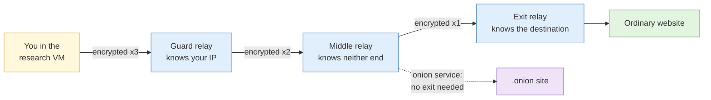
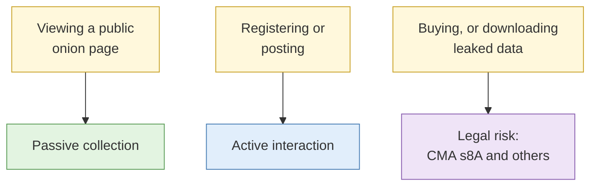

# Dark web access and isolation

**Duration:** 15 minutes in class, about 20 minutes to read in full · **Leads into:** [Lab 5.5 Tor isolation and source evaluation](../labs/lab-5-5-tor-isolation-and-source-evaluation.md)

This input covers safe access only. Research methods for marketplaces, forums and leak sites build on it in the capstone scenario.

## The analogy: passing a note through three people in a cinema

You want to pass a note to a friend at the far end of a dark cinema without anyone knowing it came from you.

You put the note in three envelopes, one inside the other. You hand it to the person next to you (the **guard**). They only know it came from you. They open the outer envelope, which says "pass to the person in row K", and pass it on. The person in row K (the **middle**) opens the next envelope and passes it to someone in row R. The person in row R (the **exit**) opens the last envelope and hands the note to your friend. They know who receives it, but they have no idea who sent it.

Nobody in the chain knows both ends. That is how Tor works.

## What Tor is

Tor (The Onion Router) sends your traffic through three volunteer-run relays, wrapped in layers of encryption, so that no single relay knows both who you are and what you are visiting.

**Onion services** (addresses ending in `.onion`) never leave the Tor network, so there is no exit relay, and both the visitor and the site stay hidden from each other.

## What is and is not visible

| Visible to | What they can see | Cinema version |
| --- | --- | --- |
| Your network or ISP | That you are using Tor, and when | The usher sees you handing someone an envelope |
| The guard relay | Your IP address | The person next to you knows it came from you |
| The exit relay | Unencrypted traffic to ordinary websites | The last person can read the note if it is not sealed |
| The website | That the visit came from Tor, plus anything you reveal yourself | Your friend can recognise your handwriting |

Tor protects the network path. It does not protect you if you log in as yourself, open a downloaded file that calls home, or have a distinctive browser fingerprint. If you sign the note with your name, the three envelopes were pointless.

## Access safety and isolation

- Use **Tor Browser** inside your research VM. Do not install add-ons or resize the window. Both make you easier to identify, because most Tor users keep the defaults.
- Set Tor Browser's **security level** to **Safer** or **Safest** for research. These restrict JavaScript, which is the most common route for de-anonymisation attacks.
- **Never open files downloaded from onion services** on your research VM. Treat them as hostile. If a file is needed, hash it and hand it to the instructor.
- Do not log in to anything, register on any site, or interact with anyone.
- If you see illegal content, especially child sexual abuse material, close the page immediately and tell the instructor. Do not capture it, screenshot it or bookmark it.
- Follow your organisation's policy. Many organisations require specific approval for dark web access, and some banks and government-linked organisations block it entirely.

## Indexing and search

**The analogy:** trying to find a good hawker stall in a neighbourhood with no Google Maps, no signboards, and stalls that move to a new unit every few weeks. You find them mostly through word of mouth.

Dark web search coverage is poor. Onion services are not linked to each other the way ordinary websites are, they change addresses often, and many are deliberately unlisted. Search engines such as Ahmia cover only a fraction, and their results are often out of date.

In practice, most dark web sources are found through:

- References on the ordinary web (news reporting, researcher blogs)
- Threat intelligence reports from security vendors
- Previously verified address lists maintained by your team

## Legal and operational boundaries

- Viewing a public onion page is passive collection in the same sense as viewing any other website.
- Registering, posting, buying or downloading leaked data moves you into active interaction or worse (see S3 on breach data and the CMA).
- Many onion sites are scams, honeypots or law-enforcement operations. Assume you may be watched.

## Common mistakes

- Maximising the Tor Browser window, which makes your screen size identifiable.
- Opening a "leaked database sample" PDF to see what is inside.
- Using Tor from your host laptop rather than the VM.
- Assuming a .onion address found on a forum is the real site, not a phishing copy.

## Check your understanding

1. Using the cinema analogy, which relay knows your IP address, and which knows the site you visited?
2. Why does resizing the Tor Browser window reduce your anonymity?
3. You find a "Singapore bank customer database" on an onion site with a free sample download. What do you do?

## Key points

- Tor hides your network path, not your behaviour or fingerprint.
- Use Tor Browser in the VM, at a high security level, with no logins and no downloaded files opened.
- Dark web search coverage is poor. Most sources are found indirectly.
- Stop and report immediately if you see illegal content.

## Further reading

- The Tor Project, *Tor Browser User Manual* (tb-manual.torproject.org).
