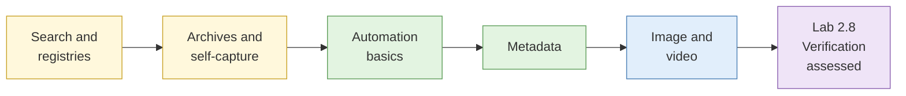

# Day 2: Essential OSINT skills

By the end of today you will have searched with precision across engines and registries, rebuilt a site's history from archives, captured evidence you can defend, read the hidden layer inside files, tested image and video claims, and passed your first assessed lab.

## The day at a glance

Think of today as learning to be a good librarian-detective. In the morning you learn to ask the catalogue exact questions (search and registries), and to find the old editions that were pulled from the shelves (archives). After lunch you learn to read what is written on the spine and inside the cover of every book (metadata), and to check whether a photograph in the book really came from where the caption says (image and video). The day ends with a test: six disputed items, six honest verdicts.

## Learning objectives covered

| # | Objective |
| --- | --- |
| 4 | Capture, hash, catalogue and retrieve evidence defensibly |
| 5 | Exploit search engines, archives, metadata and image analysis to establish provenance and verify claims |
| 9 | Use and adapt automated collection (introductory) |
| 11 | Stay within legal and ethical boundaries (revisited in Labs 2.2 and 2.7) |

## Run sheet

| Time | Item | Min |
| --- | --- | --- |
| 08:45 | [S1 Advanced search](sessions/s1-advanced-search.md) | 25 |
| 09:10 | [Lab 2.1 Operator comparison (demo)](labs/lab-2-1-operator-comparison.md) | 10 |
| 09:20 | [Lab 2.2 Exposed documents (sandbox)](labs/lab-2-2-exposed-documents.md) | 25 |
| 09:45 | [Lab 2.3 Registry retrieval](labs/lab-2-3-registry-retrieval.md) | 30 |
| 10:15 | [S2 Web archiving and persistence](sessions/s2-web-archiving.md) | 15 |
| 10:30 | Break | |
| 10:45 | [Lab 2.4 Archive reconstruction](labs/lab-2-4-archive-reconstruction.md) | 40 |
| 11:25 | [Lab 2.5 Self-archiving](labs/lab-2-5-self-archiving.md) | 15 |
| 11:40 | [Automation and scale](sessions/s5-automation-and-scale.md) | 10 |
| 11:50 | [Lab 5.1 API collection](labs/lab-5-1-api-collection.md) | 25 |
| 12:15 | Buffer | 15 |
| 12:30 | Lunch | |
| 13:30 | [S3 Metadata extraction](sessions/s3-metadata-extraction.md) | 15 |
| 13:45 | [Lab 2.6 Metadata extraction](labs/lab-2-6-metadata-extraction.md) | 45 |
| 14:30 | [S4 Image and video analysis](sessions/s4-image-and-video-analysis.md) | 25 |
| 14:55 | [Lab 2.7 Reverse image and face recognition](labs/lab-2-7-reverse-image-and-face-recognition.md) | 35 |
| 15:30 | Break | |
| 15:45 | [Lab 2.8 Verification challenge (assessed)](labs/lab-2-8-verification-challenge.md) | 75 |
| 17:00 | Buffer, case export and custody log | 30 |

## What you take into Day 3

- Operator reference sheet (Lab 2.1)
- Entity record for the scenario organisation (Lab 2.3)
- Dated change timeline in the running case (Lab 2.4)
- Defensible self-archive method (Lab 2.5)
- Collection script and log (Lab 5.1)
- Metadata map (Lab 2.6) and face-recognition reporting rule (Lab 2.7)
- Verification assessment, with feedback on Day 3 morning (Lab 2.8)
