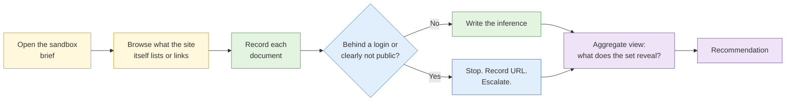

# Lab 2.2 Exposed documents in a sandbox

| Duration | Type | Running case | Assessed |
| --- | --- | --- | --- |
| 25 minutes | Individual | No: separate sandbox | No |

## Aim

Practise the judgement of what to do when documents an organisation never meant to publish are openly reachable, and see how much a handful of harmless-looking files reveals when read together.

## Outcome

A **findings list** for the sandbox site, with an inference statement for each document and a clear note on which documents you would stop at and escalate.

## The analogy: the noticeboard in the lift lobby

A condo management office pins notices to the board in the lift lobby. Most are fine: the pool will be closed on Tuesday. One day a staff member pins up the maintenance contractor's schedule, with names, mobile numbers and the days the guard is off duty. Each notice is harmless. Together, a burglar can plan around them.

This lab asks you to read the noticeboard as both the burglar and the building manager. The skill is mostly used **defensively**: finding what your own organisation has accidentally pinned up.

## What you need to do

- [ ] Browse the sandbox site named in the brief, using only what it publicly links or lists
- [ ] Record each document: what it is, who it names, what it reveals
- [ ] Write one inference per document and one for the set taken together
- [ ] Flag any document you would stop at, record only the URL, and escalate
- [ ] Write the recommendation the sandbox organisation should receive

**Deliverable:** `exposed-documents-findings.md`.

## What the instructor sets up beforehand

- A sandbox domain with a planted set of 12 to 15 documents (a mix of ordinary public files and a few that should not be public), reachable through the site's own pages, sitemap or an open folder listing
- A **planted trip-wire**: one document that sits behind a login prompt, so delegates must decide not to go further
- All names, numbers and addresses synthetic
- The answer key (instructor notes)

## Before you start

- Read [S1 Advanced search](../sessions/s1-advanced-search.md), especially the section on documents organisations publish without meaning to, and revisit your [Lab 1.3 decision reference](../../day-1/labs/lab-1-3-legal-boundary-classification.md).
- **Tools:** the `case-running` Firefox profile with Hunchly recording.

## Rules for this lab

- Stay inside the sandbox domain in the brief. Do not apply any of this to a real organisation.
- Do not log in, guess a password, or alter a URL to reach anything the site does not itself offer. If something is behind a login, stop there and record the URL.
- Do not download anything the brief marks as personal data. Capture the page in Hunchly and read it on screen.

## How the lab flows

## Steps

### Step 1: Browse the sandbox (8 min)

1. Open the sandbox address from the brief in the `case-running` profile with Hunchly recording.
2. Visit the pages the site links to: downloads, news, careers and "about us".
3. Check the files the site itself publishes for crawlers (`/robots.txt` and `/sitemap.xml`) and see what they list.
4. If the brief says a folder listing is open, open it and read the names of the files.

### Step 2: Record each document (7 min)

Create a table:

| # | Document | Where found | Names / roles / numbers it contains | Public by design? |
| --- | --- | --- | --- | --- |
| 1 | | | | |

### Step 3: Write the inference per document (5 min)

For each document, write one sentence beginning "An adversary could infer…". Keep it to what the document supports.

### Step 4: Write the aggregate inference and recommendation (5 min)

1. Write three sentences on what the whole set reveals that no single document does (names that recur, a naming pattern, a supplier relationship, a schedule).
2. Write the recommendation: which documents to remove, what to change in publishing practice, and who should be told.

## Worked example

| # | Document | Where found | Contains | Public by design? |
| --- | --- | --- | --- | --- |
| ex | `staff-outing-2025.pdf` | Open folder | 14 staff names, a coach company, a Saturday date | No |

> **Inference:** An adversary could infer who works at the sandbox firm, which Saturday most staff will be away, and which coach company has a relationship with it.

## Common mistakes

- Guessing a file name or changing a URL to "see what else is there". That is the move this lab exists to teach you not to make.
- Writing inferences that go beyond what the document says.
- Keeping personal data you do not need. Note the finding, not the personal details.

## If you finish early

Rewrite your recommendation as a three-line notice to the sandbox organisation's IT lead, in plain language, suitable for escalation.

## Summary

Documents that are individually dull can reveal names, schedules and relationships once read together. The professional response is to stop at the boundary, record what you saw and recommend a fix, much as a building manager would take the notice down and rethink what goes on the board.

## Carries forward

- Lab 4.2 and Lab 4.8 use the same aggregate-inference habit.
- The Day 4 attack-surface map of your own organisation is the defensive version of this lab.
