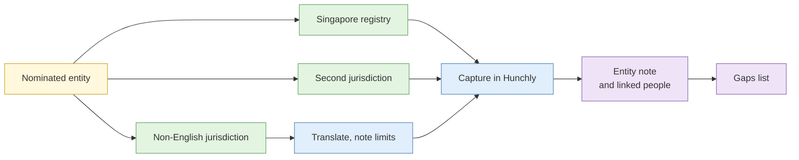

# Lab 2.3 Registry and vertical source retrieval

| Duration | Type | Running case | Assessed |
| --- | --- | --- | --- |
| 30 minutes | Individual | Yes: builds the client-side entity record | No |

## Aim

Retrieve official records about a company across at least three jurisdictions, including one non-English source, and cite each fact to its source.

## Outcome

An **entity record** with directors, addresses and filing history, every fact cited to a Hunchly capture, saved as an Obsidian entity note.

## The analogy: tracing a family tree at the registry of births

To find out where a family came from, you do not ask the internet. You go to the official registers, one place at a time: births here, marriages there, the old village in another country. Each register tells part of the story, in its own format, sometimes in another language. The skill is knowing which register holds which fact and writing down where each fact came from.

## What you need to do

- [ ] Retrieve the entity's record from the Singapore registry
- [ ] Retrieve records from two other jurisdictions named in the brief
- [ ] Translate any non-English record and note the translation tool and its limits
- [ ] Capture each page or extract in Hunchly
- [ ] Build the entity note with directors, addresses, filings and sources

**Deliverable:** `Organisation - <name>` note in `01-entities/organisations/`, plus linked person notes for each director.

## What the instructor sets up beforehand

- A nominated entity in the scenario with a deliberate trail: a Singapore company, a related company in a second jurisdiction and a third in a non-English jurisdiction
- Registry access arranged: either live public registries for real public-domain entities, or a **sandbox registry** mirroring their layout
- Any small registry fees pre-paid on the course account
- The answer key (instructor notes)

## Before you start

- Read [S1 Advanced search](../sessions/s1-advanced-search.md), the section on specialist sources.
- **Tools:** the `case-running` Firefox profile with Hunchly recording; Obsidian.

## Rules for this lab

- Use only the entity named in the brief.
- Directors are people. Record only what the requirement needs (name, role, appointment dates), and no personal identifiers such as NRIC numbers if they appear (see the PDPC rule in S3).

## How the lab flows

## Steps

### Step 1: Singapore record (8 min)

1. Open the Singapore registry (ACRA BizFile in a live run, or the sandbox mirror) and search the entity's name or UEN.
2. Capture the business profile: status, registered address, principal activities, officers and shareholders, incorporation date.
3. Note the retrieval date and time (SGT).

### Step 2: Second jurisdiction (8 min)

1. Use the registry named in the brief.
2. Find the related company and capture its officers and addresses.
3. Note any name that matches a Singapore officer. A match on name alone is a lead (S2), so look for a second identifier such as a date of birth range, a matching address or a shared role.

### Step 3: Non-English source (8 min)

1. Open the third record.
2. Translate with your preferred tool. Record the tool and mark any term you are unsure of.
3. Check names against the original script and transliteration (see S1 on name variants).

### Step 4: Build the entity note (6 min)

Use the entity template. Include:

- Summary, identifiers and status
- Officers and shareholders, with role and dates
- Addresses (and note any that appear for several entities)
- Filing history highlights
- Sources: the Hunchly capture numbers
- Gaps: what you could not find

## Worked example

> **Director, Example Freight Pte Ltd.** Appointed 2023-03-01 per ACRA business profile (Hunchly #21). Same name appears as director of a Malaysian company (Hunchly #24). Match on name only; DOB range and address differ. Treat as possible, not confirmed.

## Common mistakes

- Recording a director's NRIC or full identifiers you do not need.
- Treating a name match across registries as the same person.
- Using a machine translation as final for a key fact.
- Not recording when you retrieved the record, since registries update.

## If you finish early

List three questions the records raise that you would put to the next stage of collection, and tag each to an IR from Lab 1.1.

## Summary

Official registries hold the facts that matter, but each one speaks in its own format and language. Capture, cite and keep name matches as leads until a second identifier supports them.

## Carries forward

- The entity note feeds the Day 3 people work and the Day 4 infrastructure work.
- The gaps list becomes collection requirements.
