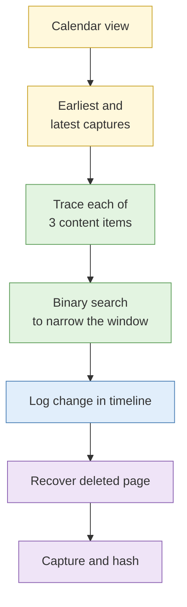

# Lab 2.4 Archive reconstruction and deleted content

| Duration | Type | Running case | Assessed |
| --- | --- | --- | --- |
| 40 minutes | Individual | Yes: adds a dated change timeline to the case | No |

## Aim

Reconstruct how a target site changed over several years, work out when specific content was added and removed, and recover a page that no longer exists on the live web.

## Outcome

A dated **change timeline** entered into the running case file, with the capture for each change and the recovered page captured and hashed.

## The analogy: renovation photos of a shophouse

You find old photos of a shophouse over the years. In 2019 it is a bakery, in 2021 a wall has been knocked down, in 2023 the signboard has changed. You cannot say the exact day the wall came down, but you can say it happened between two photos. That is the honesty an archive timeline requires.

## What you need to do

- [ ] Open the calendar view for the target URL and note the date range of captures
- [ ] Find when each of three named pieces of content first appeared and when they disappeared
- [ ] Narrow each change to the smallest window you can
- [ ] Recover the deleted page and capture it with a hash
- [ ] Add every change to `timeline.md` with its date source

**Deliverable:** updated `timeline.md` and a recovered-page capture in `03-evidence/`.

## What the instructor sets up beforehand

- A target site (the lookalike or client sandbox in the scenario) with a seeded archive history over several years, hosted on an instructor-run archive instance or a real public site with known history
- A brief naming the three pieces of content to trace (for example a director's name on the "About" page, a product page, a contact address)
- One page deliberately deleted from the live site but present in the archive

## Before you start

- Read [S2 Web archiving and persistence](../sessions/s2-web-archiving.md).
- **Tools:** Firefox `case-running` with Hunchly; the archive named in the brief; Obsidian.

## Rules for this lab

- Prefer existing captures over triggering new archive requests, so you do not alert the target site.
- Record capture timestamps in SGT and UTC.

## How the lab flows



## Steps

### Step 1: Survey the history (5 min)

1. Open the calendar view for the target's home page.
2. Note the first and last capture dates and any long gaps.

### Step 2: Trace three content items (20 min)

For each item in the brief:

1. Open the earliest and latest captures and decide whether the item is present in each.
2. Use binary search: open the capture halfway between a capture where it is absent and one where it is present. Repeat until you have two adjacent captures.
3. Record "Added between capture A (date) and capture B (date)" and the same for removal.
4. Use the compare/changes view to confirm the difference.

### Step 3: Recover the deleted page (10 min)

1. Find the URL from the brief's hint or from a capture that links to it.
2. Open the last capture before deletion. Check the page renders fully, including images.
3. Capture it in Hunchly and, if the brief allows, save a copy and hash it:
   ```bash
   sha256sum recovered-page.html
   ```
4. Record the archive URL, capture time and your retrieval time.

### Step 4: Update the timeline (5 min)

Add a row per change in this form:

```markdown
| Date window | Event | Entities | Evidence | Date source |
| --- | --- | --- | --- | --- |
| 2021-03 to 2021-06 | Director name removed from About page | [[Organisation - Client]] | Hunchly #31, #32 | Archive capture dates (window) |
```

## Worked example

> Name "Lim A." appears on the About page in the 12 Jan 2020 capture and is absent in the 3 Sep 2020 capture. Binary search narrowed to 2 Jun to 14 Jun 2020. Statement: "removed between those two captures", not "removed on 14 June".

## Common mistakes

- Writing the capture date as the publication date.
- Treating a missing capture as proof the content was absent.
- Recovering a page but not hashing it.

## If you finish early

Find one more change that the brief did not ask about and judge whether it matters for any of your IRs.

## Summary

Archives let you say what existed by a date and when something changed within a window. Honest windows are more useful than false precision.

## Carries forward

- The change timeline feeds Day 3's people work and the capstone.
- The recovered page is evidence: keep it in `03-evidence/` with its hash.
