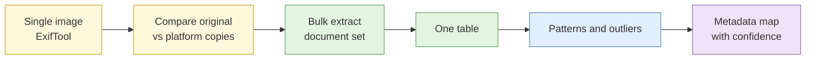

# Lab 2.6 Metadata extraction at file and set level

| Duration | Type | Running case | Assessed |
| --- | --- | --- | --- |
| 45 minutes | Individual | Yes: the document set comes from the scenario organisation | No |

## Aim

Extract and interpret metadata from single files, compare what survives upload to different platforms, then run bulk extraction across a document set to build a map of authors, software and file paths.

## Outcome

A **metadata map** that identifies probable authorship and the originating environment for the document set, with each inference marked as a lead or as supported.

## The analogy: reading the handwriting on a pile of exam scripts

One exam script tells you little. Fifty scripts from one school show you the pen colour most students use, the teacher who set the paper, and the one script written in a different hand with a different pen. Patterns and outliers are the whole point of bulk extraction.

## What you need to do

- [ ] Extract metadata from three sample images and read the key fields
- [ ] Compare the same photo as original, downloaded from two platforms
- [ ] Bulk-extract metadata from the document set into one table
- [ ] Find patterns (recurring authors, software, paths) and outliers
- [ ] Write the metadata map with a confidence level for each inference

**Deliverable:** `metadata-table.csv` and `metadata-map.md`.

## What the instructor sets up beforehand

- A sample image set with known metadata and the same photo uploaded to two platforms in the sandbox
- A document set of about 40 Office and PDF files from the scenario organisation, with planted patterns (a recurring author, a software version, a path with a username) and one outlier
- ExifTool installed in the VM image
- The answer key (instructor notes)

## Before you start

- Read [S3 Metadata extraction](../sessions/s3-metadata-extraction.md).
- **Tools:** VM terminal; ExifTool; a spreadsheet or Python.

## Rules for this lab

- Use only the provided files.
- Remember the Day 1 rule on personal data: the file path or name of a real person is personal data. In the sandbox these are synthetic.

## How the lab flows



## Steps

### Step 1: Single image (8 min)

```bash
cd ~/lab2/images
exiftool photo1.jpg
exiftool -s -DateTimeOriginal -Make -Model -Software -GPSLatitude -GPSLongitude photo1.jpg
```

Write down the camera make and model, the original date and time, software and any GPS values. Note the time zone issue: EXIF times often carry no time zone.

### Step 2: What survives upload (8 min)

```bash
exiftool -s -DateTimeOriginal -Make -GPSLatitude original.jpg
exiftool -s -DateTimeOriginal -Make -GPSLatitude platformA.jpg
exiftool -s -DateTimeOriginal -Make -GPSLatitude platformB.jpg
```

Fill in a table of which fields each copy kept, and note the file size and dimensions of each.

### Step 3: Bulk extraction (12 min)

```bash
cd ~/lab2/docs
exiftool -csv -Author -LastModifiedBy -Creator -Producer -Software -CreateDate -ModifyDate -Company -Template -r . > ~/metadata-table.csv
head -5 ~/metadata-table.csv
```

Open `metadata-table.csv` in a spreadsheet.

### Step 4: Find patterns and outliers (10 min)

1. Sort by Author, Producer and Software. Count how many files share each value.
2. Look for text that looks like a path or username in any field (for example `Company` or a template path).
3. Filter by dates and find the file created far from the others.
4. Note the one outlier and why it stands out.

### Step 5: Write the map (7 min)

For each inference, add a line:

| Inference | Evidence (file and field) | Confidence | Lead or supported? |
| --- | --- | --- | --- |
| Most documents prepared by one person | Author = "J. Example" in 28 of 40 files | Moderate | Lead |
| Created on a Windows machine with Office 2019 | Producer / Software fields | Moderate | Lead |

## Worked example

> **Outlier.** `tender-addendum.pdf` was produced by a different PDF tool than the other 39 files and has a creation date four months earlier than the rest. It may have come from a different author or machine. Treated as a lead; independent corroboration needed.

## Common mistakes

- Assuming a tidy author field is the real author.
- Reading a timestamp without considering its time zone.
- Ignoring the outlier because it does not fit the pattern.

## If you finish early

Find any field in the set that reveals a folder or drive naming scheme and say what it might tell you about the organisation's internal layout.

## Summary

One file's metadata is a lead; a hundred files' metadata show who works how. Patterns and outliers matter most, and every inference stays a lead until something independent supports it.

## Carries forward

- The metadata map goes into the running case and into Lab 2.8.
- Day 4 uses the same approach on infrastructure artefacts.
