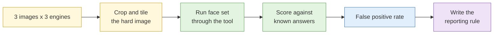

# Lab 2.7 Reverse image search and facial recognition evaluation

| Duration | Type | Running case | Assessed |
| --- | --- | --- | --- |
| 35 minutes | Individual | No | No |

## Aim

Compare reverse image search engines on the same images, use cropping and tiling on a hard image, and measure the false positive rate of a facial recognition tool against a consented ground-truth set so you see the error for yourself.

## Outcome

A **comparative tool assessment**, and a short **written rule** for how face-matching results may be used in your own reporting.

## The analogy: the lost-and-found photo board

A school's lost-and-found board has a hundred photos of students. A teacher says "I think that is Wei Ming". Sometimes right. Sometimes the person is his cousin. If the teacher says it with a big smile and total confidence, that does not make it more likely to be true. This lab measures how often the confident guess is wrong.

## What you need to do

- [ ] Run three images through at least three reverse image engines and record the results
- [ ] Crop and tile the hard image until you find a match
- [ ] Run the consented face set through the face tool and mark each result right or wrong against the known answers
- [ ] Calculate the false positive rate
- [ ] Write the reporting rule

**Deliverables:** `tool-assessment.md` and `face-recognition-rule.md`.

## What the instructor sets up beforehand

- Three test images: one easy, one modified (cropped, filtered) and one deliberately hard
- A **ground-truth face set** of consenting volunteers or properly licensed images, with written consent and licence terms on file, containing deliberate look-alikes. Real photos of private individuals are never used.
- Access to the face tool used in the demo, configured only against the ground-truth set
- Answer keys (instructor notes)

## Before you start

- Read [S4 Image and video analysis](../sessions/s4-image-and-video-analysis.md).
- **Tools:** Firefox `scratch` profile; the face tool provided.

## Rules for this lab

- Use only the test images and the ground-truth set provided.
- Do not upload the ground-truth faces to any public service.
- Do not use any face tool on any real person outside this lab.

## How the lab flows



## Steps

### Step 1: Reverse search the three images (10 min)

For each image, run it through at least three engines. Record:

| Image | Engine | Best match? | Earliest appearance found | Notes |
| --- | --- | --- | --- | --- |
| 1 | | | | |

### Step 2: Crop and tile the hard image (8 min)

1. Open the hard image in an image editor.
2. Crop the most distinctive element (a sign, a logo, a building detail) and search again.
3. Try overlapping tiles. Record which crop gave the first useful result.

### Step 3: Face tool evaluation (12 min)

1. Load the ground-truth set. Run each probe image against the gallery.
2. For each result, record the top match, its score and whether the tool was right according to the answer sheet.
3. Count: correct matches, wrong matches (false positives), and probes with no match.

```text
False positive rate = wrong top matches / total probes that returned a match
```

4. Note whether the wrong matches had high scores.

### Step 4: Write the reporting rule (5 min)

Write a rule in 4 to 6 lines covering: what a face match may be called in a report ("lead" not "identification"), what independent corroboration is required, what the score means, who must approve its use, and when it must not be used.

## Worked example rule

> A face-match result is reported only as a lead. A name is not stated unless a second, independent source (such as the original page of the photo, or a document) supports it. Scores are never quoted as probabilities. Any use on a private individual needs written approval.

## Common mistakes

- Reporting a high score as if it were certainty.
- Stopping after one engine.
- Counting only correct matches and forgetting to count the wrong ones.

## If you finish early

Look at your false positives. Do they cluster around particular people or image conditions (lighting, angle, glasses)? Write one line on what that suggests.

## Summary

Different engines find different things. Face tools produce confident wrong answers, and the only way to know how often is to measure. Your reporting rule is the guardrail that stops a wrong match becoming a wrong accusation.

## Carries forward

- The reporting rule applies in Lab 2.8, Lab 3.8 and the capstone.
- Revisit it before using any face tool on live work.
