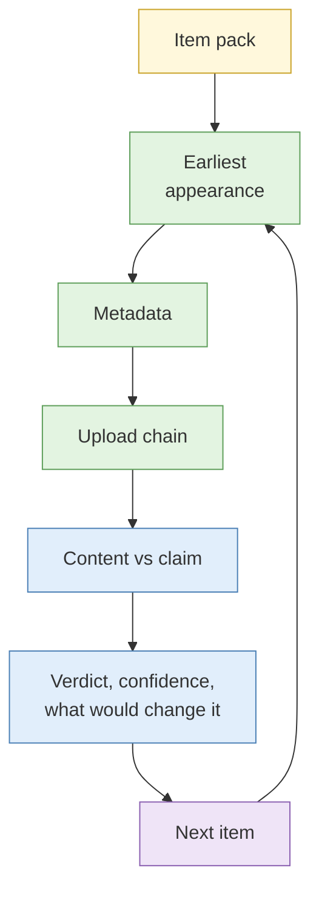

# Lab 2.8 Verification challenge (assessed)

| Duration | Type | Running case | Assessed |
| --- | --- | --- | --- |
| 75 minutes | Individual | Partly: one item connects to the scenario | **Yes: scored by the instructors** |

## Aim

Test a set of image and video claims of disputed origin: find the earliest verifiable appearance of each, extract metadata, trace the upload chain, and give each claim a verdict with a stated confidence level.

## Outcome

A **verification assessment** for each item, scored on the rubric below.

## The analogy: the Carousell dispute

A buyer says the phone arrived scratched. The seller says it left scratch-free and sends photos. You are the arbiter. You check when the photos were taken, whether the same photos appear on another listing, what the metadata says, and whether the story is consistent. Your answer is not "who do I believe" but "what can I show, and how sure am I".

## What you need to do

- [ ] For each of 6 items (4 images, 2 video clips), trace the earliest appearance you can find
- [ ] Extract and interpret available metadata
- [ ] Trace the upload chain from earliest copy to the claimed source
- [ ] Check content against the claim (place, date, context)
- [ ] Write one assessment per item: verdict, confidence, reasoning, what would change your mind
- [ ] Keep a method note and capture log for the whole exercise

**Deliverable:** `verification-assessment.md`, plus your Hunchly case export.

## What the instructor sets up beforehand

- A pack of 6 items, each with a claimed origin ("filmed in Johor last week", "from the 2025 event", "taken by a resident"), all synthetic or properly licensed, with a planted ground truth
- A mix: one genuine, one recycled from earlier, one with stripped metadata, one lightly edited, one mislabelled place, one with a misleading caption
- Rubric printed and shared at the start
- Second marker briefed

## Before you start

- Read [S2](../sessions/s2-web-archiving.md), [S3](../sessions/s3-metadata-extraction.md) and [S4](../sessions/s4-image-and-video-analysis.md); keep your [Lab 2.7 reporting rule](lab-2-7-reverse-image-and-face-recognition.md) open.
- **Tools:** the research VM, `case-running` profile with Hunchly, ExifTool, any reverse image engines, the archive services.

## Rules for this lab

- Work alone. You may use your notes and your operator sheet.
- Use only the items in the pack. No searches on real private individuals.
- Treat face matching as a lead only (your Lab 2.7 rule).

## Marking rubric

| Criterion | What earns marks |
| --- | --- |
| Earliest appearance | Found the earliest verifiable copy, with evidence |
| Method and capture | Reproducible steps, captures, hashes, time zones |
| Metadata handling | Fields read correctly; limits stated |
| Reasoning | Claims tested against evidence; alternative explanations considered |
| Confidence | Level stated and justified; no overreach |
| Clarity | A reader can follow the verdict quickly |

Scoring: 0 to 4 per criterion per item, with the total scaled to a final mark. Feedback is returned on Day 3.

## How the lab flows



## Steps

### Step 1: Plan (5 min)

Skim all six items. Decide an order, with the hardest last. Allow about 10 minutes per item and keep 10 minutes spare.

### Step 2: Work each item (about 55 min)

For every item, in this order:

1. **Capture** the item and its claimed source.
2. **Earliest appearance:** reverse image search (three engines), crop and tile if needed; for video, extract keyframes and search those.
3. **Metadata:** run ExifTool; note stripped or inconsistent fields.
4. **Upload chain:** list each copy found with its date; identify the earliest and the claimed source.
5. **Content check:** compare weather, signs, shadows, language and context with the claim.
6. **Write the assessment** in the format below.

### Step 3: Assessment format

```markdown
## Item <n>: <short description>

- **Claim:**
- **Verdict:** supported / partly supported / not supported / cannot be determined
- **Confidence:** low / moderate / high
- **Earliest verifiable appearance:** (date, source, capture)
- **Metadata findings:**
- **Upload chain:**
- **Content checks:**
- **Reasoning:**
- **What would change my assessment:**
```

### Step 4: Final check (5 min)

Re-read your six verdicts. Make sure the confidence matches the evidence, and that nothing relies on one engine or one metadata field alone.

## Worked example (not from the pack)

> **Claim:** "Flood photo taken this morning in Orchard." **Verdict:** Not supported. **Confidence:** Moderate. Earliest appearance is a 2021 news article about a different city (capture linked). EXIF is absent. Signage in the photo is in a script not used in Singapore. What would change my view: an original file with a matching camera timestamp.

## Common mistakes

- Writing "fake" or "real" without a confidence level.
- Relying on a single engine or metadata field.
- Forgetting time zones in upload chronology.
- Spending 30 minutes on one item and rushing the rest.

## Summary

Verification is the discipline of tracing an item's life and being honest about what you can and cannot show. A calibrated "moderate confidence, because X and Y, but Z could change it" is a better result than a bold verdict.

## Carries forward

- The rubric criteria (evidence, confidence, clarity) are the same ones used for Lab 3.8 and the capstone.
- Feedback arrives on Day 3 morning.
