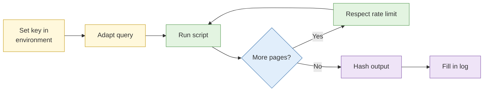

# Lab 5.1 API collection with rate limit handling

| Duration | Type | Running case | Assessed |
| --- | --- | --- | --- |
| 25 minutes (includes a short change-detection demo) | Individual | Optional: can feed the running case | No |


This lab moved from Day 5 and now uses a **supplied script** that you adapt and run, rather than writing one from scratch. The change-detection lab (old Lab 5.2) is folded in as a short demonstration with a config handout.


## Aim

Run a small collection script against a permitted API, handle authentication, pagination and rate limiting, and keep a log that survives later scrutiny.

## Outcome

A working collection **script** (adapted from the supplied one), the **raw output**, and a **collection log** with timestamps and hashes.

## The analogy: the queue at the bubble tea shop

The shop serves a set number of drinks per minute. If you send ten friends in at once, the staff turn some away. A polite regular orders at the pace the counter can handle, and keeps the receipt. The API is the counter, the rate limit is its pace, and your log is the receipt.

## What you need to do

- [ ] Read the supplied script and say what each part does
- [ ] Set your API key in an environment variable (not in the script)
- [ ] Change the query to the one in the brief
- [ ] Run it, watch it page through results and respect the limit
- [ ] Hash the output and fill in the collection log
- [ ] Watch the instructor demo of change detection

**Deliverable:** `collect.py`, `output.json`, `collection-log.md`.

## What the instructor sets up beforehand

- A **permitted API**: a public API that allows the use, or an instructor-hosted mock API with realistic rate limits and pagination
- One API key per delegate, shared by a secure handout
- The supplied `collect.py` and the change-detection config handout
- Python 3 and the `requests` library installed in the VM image

## Before you start

- Read [Automation and scale](../sessions/s5-automation-and-scale.md).
- **Tools:** VM terminal and a text editor.

## Rules for this lab

- Use the permitted API only, at the stated rate.
- Never paste your API key into the script or the case file.

## How the lab flows



## Steps

### Step 1: Read the script (5 min)

Open `collect.py`. Find and note:

- Where the key is read (`os.environ`)
- The loop that follows pagination
- The pause between requests
- Where results are saved

### Step 2: Set the key and adapt (4 min)

```bash
export COURSE_API_KEY="<your key from the handout>"
nano collect.py
```

Change `QUERY` to the value in the brief and save (Ctrl + O, Enter, Ctrl + X).

### Step 3: Run it (6 min)

```bash
python3 collect.py
```

Watch the output. You should see page numbers, a wait message when the limit is reached, and a final count.

### Step 4: Hash and log (5 min)

```bash
sha256sum output.json | tee output.sha256
```

Fill in the log:

```markdown
| Field | Value |
| --- | --- |
| Script / version | collect.py v1 |
| Run time (SGT / UTC) | |
| Endpoint | |
| Query | |
| Expected results | |
| Received results | |
| Errors | |
| Output hash | |
```

### Step 5: Change-detection demo (5 min)

The instructor shows a monitor that fetches a page on a schedule, compares a clean-text copy and alerts only when the key paragraph changes. Note one example of a change **not** worth alerting on.

## Worked example

> Expected 230 results (from the API's count field). Received 230. Two 429 responses handled by waiting 30 seconds. No other errors.

## Common mistakes

- Putting the key in the script and saving it into the case file.
- Reading only page one.
- Removing the pause "to go faster".
- Not comparing received count against the API's own total.

## If you finish early

Change the script to stop and write a clear message if it receives three errors in a row, and test it by running with a wrong key.

## Summary

A collection script is a polite, patient customer that writes everything down. The rate limit protects the service, and the log protects you.

## Carries forward

- Day 3's dataset triage lab can ingest what you collected.
- Keep `collect.py` and the log in `04-analysis/` of the case.
