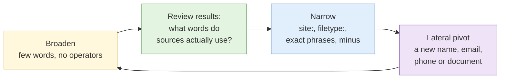

# S1 Advanced search

**Duration:** 25 minutes in class, about 35 minutes to read in full · **Leads into:** [Lab 2.1](../labs/lab-2-1-operator-comparison.md), [Lab 2.2](../labs/lab-2-2-exposed-documents.md) and [Lab 2.3](../labs/lab-2-3-registry-retrieval.md)

Most people use a search engine like a vending machine: type a few words, take whatever drops out. An investigator uses it like a librarian uses a catalogue, asking precise questions, in the right language, of the right index, and knowing what that index leaves out.

## The analogy: ordering kopi at the kopitiam

Say "coffee" at the drinks stall and the uncle gives you kopi: condensed milk, sugar, hot. If you wanted black coffee, no sugar, iced, you have to say "kopi-o kosong peng". Each word changes the order. "O" removes the milk, "kosong" removes the sugar, "peng" adds ice.

Search operators work the same way. `site:` says which stall. `filetype:` says which cup. Quotation marks say "exactly this, no substitutes". A minus sign says "no sugar". The person who knows the codes gets what they want on the first try. Everyone else gets whatever the uncle thinks they meant. And just as "kopi-o" is read slightly differently in a Malaysian kopitiam, each search engine reads the same operator a little differently.

## Operator syntax across engines

| Purpose | Google | Bing | Yandex | Baidu |
| --- | --- | --- | --- | --- |
| Exact phrase | `"term"` | `"term"` | `"term"` | `"term"` |
| Exclude a word | `-term` | `-term` or `NOT term` | `-term` | `-term` |
| Either word | `term1 OR term2` | `term1 OR term2` | `term1 \| term2` | `term1 \| term2` |
| Within one site | `site:example.com` | `site:example.com` | `site:example.com` | `site:example.com` |
| File type | `filetype:pdf` | `filetype:pdf` | `mime:pdf` | `filetype:pdf` |
| Word in page title | `intitle:term` | `intitle:term` | `title:term` | `intitle:term` |
| Word in URL | `inurl:term` | `inurl:term` (limited) | `inurl:term` | `inurl:term` |
| Date range | `before:` and `after:` | Tools menu | `date:` | Tools menu |
| Language | Settings | Settings | `lang:en` | Simplified Chinese focus |


Operators change without notice. Google withdrew the `cache:` operator in 2024, and others quietly stop working from time to time. Treat this table as a starting point and confirm behaviour in Lab 2.1.


### Why the engines give different answers

- **Different indexes.** Each engine crawls different parts of the web. Yandex often indexes Russian-language and Eastern European sites more deeply. Baidu is strongest on mainland Chinese sites. Naver is strongest on Korean content.
- **Different ranking.** The same pages come back in a different order, so the result you need may be on page one of Bing and page five of Google.
- **Different treatment of your query.** Google often rewrites your words, adding synonyms or dropping terms it thinks unimportant. Quotes reduce this but do not always stop it.
- **Personalisation and location.** Results change with your location, language and history. Your hardened `case-running` profile helps, but a Singapore exit IP will still give different results from the same query in Jakarta.

## Query construction strategy

**The analogy:** fishing at Pasir Ris. Start with a wide net to see what is in the water. Once you know where the fish are, switch to a line and hook for the one you want. If nothing bites, move along the jetty.

- **Broaden** to learn the vocabulary. People inside an organisation may call a product by a code name. You cannot narrow until you know the words.
- **Narrow** with operators once you know the target: `site:example.com.sg filetype:pdf "annual report"`.
- **Pivot laterally** whenever you find a new selector. A director's name in an annual report becomes a new search; their email format becomes a pattern to find colleagues.

### Worked example: building a query step by step

Requirement: find published documents that name the finance team of a fictional company, Example Freight Pte Ltd.

| Step | Query | What it does |
| --- | --- | --- |
| 1 | `Example Freight` | Too broad: freight companies everywhere |
| 2 | `"Example Freight Pte Ltd"` | Exact company name, including Singapore's "Pte Ltd" |
| 3 | `"Example Freight" site:sg` | Only Singapore domains |
| 4 | `"Example Freight" filetype:pdf` | Only PDFs, such as annual reports and tender documents |
| 5 | `"Example Freight" ("finance manager" OR "financial controller" OR CFO)` | Finance roles, in three common titles |

## Documents organisations publish without meaning to

Organisations sometimes leave material reachable on the public web that they assumed was private: an internal PDF saved to a public folder, a report linked from a page they forgot about, a file named in a sitemap. From an investigator's side this is ordinary passive collection of openly reachable material. From the organisation's side it is an exposure to be fixed.

Two rules keep this on the right side of the line drawn in Day 1's S3:

1. **Reachable is not the same as authorised.** If a file sits behind any login, or was plainly never meant to be public (a backup, a staff list, anything with credentials), stop, record the URL, do not download personal data in bulk, and escalate. That is the "spare key under the mat" from Day 1, and using it can be an offence under the Computer Misuse Act.
2. **Purpose limits what you keep.** Even for genuinely public files, keep only what your requirement needs (the PDPA purpose rule from Day 1's S3).

Lab 2.2 runs this against an instructor-built sandbox so you practise the judgement safely. Treat the skill as something you will mostly use **defensively**, to find and close your own organisation's exposures before someone else does.

## Specialist and vertical sources

General search engines index a thin slice of what exists. For Singapore and the region, these official and specialist sources are often where the real answer is:

| Need | Source |
| --- | --- |
| Company registration, directors, shareholders | ACRA BizFile (bizfile.gov.sg) |
| Court records and judgments | Singapore Courts (judiciary.gov.sg), eLitigation |
| Government tenders and procurement | GeBIZ (gebiz.gov.sg) |
| Property ownership and transactions | SLA's INLIS; URA for transacted prices |
| Regulated financial entities | MAS Financial Institutions Directory and Register of Representatives |
| Intellectual property | IPOS (ip2.sg) for Singapore; regional and global patent databases |
| Academic and research output | Google Scholar, institutional repositories |
| Charities and societies | Charity Portal; Registry of Societies |

Many of these are not fully indexed by Google, so you must search them directly. Several charge a small fee for full extracts (ACRA, SLA), which is still passive collection.

## Non-indexed and semi-indexed sources

**The analogy:** the main shopping street is indexed by Google. The back-alley shophouses, the noticeboard at the community centre and the handwritten menu taped inside the stall are not. You only find them by going there.

- **Paste sites, code repositories, forums and job boards** often hold material that never reaches general search. A company's GitHub may reveal its technology and sometimes secrets committed by mistake. A job advert can reveal the exact systems a company runs.
- Search inside these platforms directly, because their own search covers content Google never sees.

## Language and translation strategy

Singapore is multilingual, and regional cases rarely stay in English.

- Run key queries in the subject's own language. A Chinese-language company name or a Bahasa Indonesia forum post will not surface from English terms.
- Translate names carefully. "Tan", "Chen" and "陈" may be the same surname; transliteration differs across Hokkien, Teochew, Mandarin and Pinyin.
- Use machine translation to read results, but have a fluent speaker check anything your conclusion depends on. Machine translation flattens tone, slang and sarcasm, which can reverse the meaning of a post.

## Common mistakes

- Using one engine and assuming the web ends there.
- Trusting Google's rewritten query instead of forcing exact terms with quotes.
- Searching only in English on a regional case.
- Treating a specialist registry's absence of a record as proof something does not exist, when you may simply be searching the wrong register.

## Check your understanding

1. Write a query that finds only PDF annual reports on Singapore government domains mentioning a company called "Harbour Logistics".
2. Why might Yandex return results that Google does not for an Eastern European target?
3. You find a file that was clearly meant to be internal. What do you do before anything else?
4. A subject's name could be written four ways across dialects. How do you handle that in your searches?

## Key points

- Operators are the codes that turn a vague request into an exact one; they differ by engine.
- Use several engines, because their indexes and ranking differ.
- Official Singapore registries (ACRA, GeBIZ, the courts, MAS) often hold the real answer and are not fully indexed.
- Reachable is not authorised, and purpose limits what you keep.

## Further reading

- Michael Bazzell, *OSINT Techniques*, chapters on search engines and specialist resources.
- ACRA, GeBIZ and MAS directory help pages.
