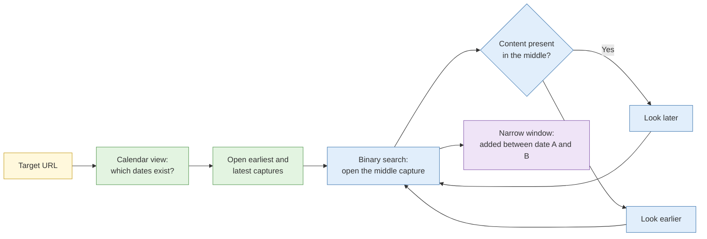

# S2 Web archiving and persistence

**Duration:** 15 minutes in class, about 25 minutes to read in full · **Leads into:** [Lab 2.4](../labs/lab-2-4-archive-reconstruction.md) and [Lab 2.5](../labs/lab-2-5-self-archiving.md)

Web pages are not permanent. Companies rewrite "About us" pages, scammers delete posts the moment they are reported, and officials quietly edit statements. If you did not capture a page, you may never see it again. This session covers where old versions live, how to rebuild a page's history, and how to preserve a page so you can prove what it said.

## The analogy: the tuition centre whiteboard

Imagine a tuition centre where the teacher writes the answers on a whiteboard, the class copies them down, and then the board is wiped for the next lesson. Anyone who wants to know what was written at 4pm last Tuesday can only rely on someone's notes or a photo taken at the time.

The live web is that whiteboard. A web archive is the student who photographed it every so often. Your own capture is the photo you take yourself, with the date and time visible, so nobody can say you made it up afterwards.

## Where old versions live

| Source | What it holds | Strengths | Limits |
| --- | --- | --- | --- |
| Wayback Machine (web.archive.org) | Snapshots taken by the Internet Archive and by users | Huge history going back to the 1990s; free; has a calendar view | Captures are irregular; many dynamic pages and images are missing; sites can ask to be excluded |
| archive.today (archive.ph and mirrors) | Snapshots saved on request, including a screenshot | Often captures pages the Wayback Machine cannot; good for social posts | Mostly user-triggered; the service is run by an anonymous operator and its availability changes |
| Search engine caches | A recent copy held by the engine | Very recent changes | Short-lived, and several engines have withdrawn public cache links |
| Site-specific archives | For example, news archives, government gazette archives | Authoritative for that source | Narrow coverage |
| Your own captures | Whatever you saved in Hunchly or by another method | You control the proof | Only exists from the moment you captured it |


Use the same hygiene as any other collection. Asking an archive service to save a page makes a request to the target's site, so it may appear in their logs. If you must not alert the subject, look for an existing capture first rather than triggering a new one.


## Reconstructing a page's history

**The analogy:** flipping through a family photo album to see how a flat looked over the years: the first sofa, the later wall colour, the year the TV stand appeared.

1. Search the Wayback Machine for the URL and open the **calendar view**. Dots show which days have captures.
2. Open the earliest and latest captures first, to see the full span of change.
3. Step through the captures in between, looking for when something appears or disappears. Narrow down by opening the capture halfway between a "before" and an "after" (a binary search).
4. Record each capture's timestamp and URL in your timeline. The timestamp is the time of the **capture**, not the time the content was created.
5. Compare two captures side by side. The Wayback Machine has a **Changes** feature that highlights differences between two dates.

### What an archive date proves and does not prove

| You can say | You cannot say |
| --- | --- |
| "The content existed on or before the capture date" | "The content was published on the capture date" |
| "The content was absent on this capture" (with caution) | "The content never existed before it" (the crawler may simply have missed it) |
| "Between capture A and capture B the content was added" | "It was added on the exact day of capture B" |

## Self-archiving and defensible timestamping

Relying on someone else's archive is fine for background. For evidence you may have to defend, capture it yourself.

**The analogy:** a notary stamping a document. The stamp does not make the content true. It proves that this document existed in this form on this date.

A defensible capture records:

1. **What:** the full page, ideally as both a rendered screenshot and the underlying HTML.
2. **When:** the date and time, from a reliable clock, with time zone (SGT, UTC+8).
3. **Where from:** the exact URL, and the egress you used.
4. **How:** tool and settings.
5. **Integrity:** a SHA-256 hash of each file, recorded at capture.

For stronger proof, add an independent timestamp. This can be a trusted third-party timestamping service, or an archive copy made at the same moment, so that someone other than you can vouch for the time.

## Capturing dynamic content

Modern pages build themselves with JavaScript as you scroll, so a simple "save as" misses most of them.

- **Infinite scroll:** scroll to the end (or to the depth the requirement needs) before capturing, or use a tool that scrolls and then captures. Record how far you went.
- **Pop-ups and consent banners:** dismiss them in a consistent way and note it, so a reader understands what they are seeing.
- **Authenticated views:** content that only appears when logged in is captured under your research persona. Record which account, because another viewer may have seen something different. Remember the Day 1 rule that the persona policy governs what you may do.
- **Video and audio:** capture the file or the stream with its source URL and hash; a screen recording alone is a derivative.

## Recovering deleted and modified content

| Situation | What to try | Caution |
| --- | --- | --- |
| Page deleted | Wayback Machine, archive.today, cached copies | Not every page was ever archived |
| Post deleted from social media | Third-party archives, quote-posts or replies that preserved it, news articles that embedded it | A screenshot someone else took is a derivative and can be faked |
| Page edited quietly | Compare archive captures over time | Gaps between captures hide changes |
| Document replaced | Look for older versions at the same URL or by file name in archives | The old file may never have been captured |

Always note which version is the primary capture and which is a copy of a copy.

## Common mistakes

- Treating the first archive date as the publication date.
- Capturing only a screenshot, with no HTML, hash or time zone.
- Triggering a new archive request on a page you were hoping not to alert.
- Forgetting to scroll before capture, then missing most of the content.

## Check your understanding

1. A Wayback Machine capture is dated 2 May 2024. What can you say about when the content was published?
2. Why might two viewers see different content at the same URL?
3. List the five things a defensible capture should record.
4. When would you avoid asking an archive service to save a page?

## Key points

- If you did not capture it, you may never see it again.
- An archive date proves existence on or before that date, not publication on it.
- Capture what matters yourself, with a hash and a time zone.
- Dynamic and logged-in pages need extra care, and the care must be documented.

## Further reading

- Internet Archive help pages on the Wayback Machine.
- Berkeley Protocol on Digital Open Source Investigations, preservation chapter.
