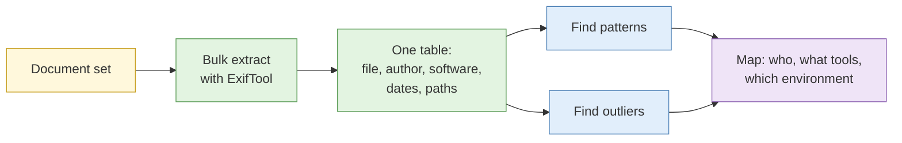

# S3 Metadata extraction

**Duration:** 15 minutes in class, about 25 minutes to read in full · **Leads into:** [Lab 2.6 Metadata extraction at file and set level](../labs/lab-2-6-metadata-extraction.md)

Every file carries a second layer of information that you do not see when you open it: who made it, with what, when, and sometimes where. That layer is metadata. It often tells a more honest story than the visible content, and it is just as easy to misread.

## The analogy: the luggage tag and the boarding pass stub

A suitcase at Changi has the visible contents inside and a paper tag on the handle. The tag shows the flight, the origin, the destination and a barcode. You can learn a lot about the trip without opening the case: it came from Frankfurt, went through Singapore, and was checked on the 22nd.

But the tag has limits. A tag can fall off. Someone can swap it. A tag from last year may still be on the handle. Metadata is the luggage tag: useful, fast, and a lead that still needs proof.

## Image metadata: EXIF, IPTC and XMP

| Standard | What it usually holds | Examples |
| --- | --- | --- |
| EXIF | Technical details from the camera | Make and model, date and time taken, exposure, sometimes GPS coordinates, lens, software |
| IPTC | Descriptive details added by photographers and agencies | Caption, creator, copyright, location text, keywords |
| XMP | Extensible container used by editing software | Edit history, ratings, software used |

### What platforms strip

Most large social platforms remove EXIF location data when a photo is uploaded, mainly for privacy, and often re-compress the image. That means:

- A photo downloaded from a platform often has little or no metadata.
- The **original** file, sent as a document or from the source, may keep everything.
- Some messaging apps keep metadata if you send the image "as a file" but strip it when sent as a photo.

Lab 2.6 compares what survives on different platforms.

## Document metadata

Office files and PDFs carry hidden details:

| Field | Why it matters |
| --- | --- |
| Author and "last modified by" | May show a real name or a username |
| Created and modified dates | Shows a timeline, but depends on the device clock |
| Software and version | Shows the toolchain; a mismatch with the claimed source is a lead |
| Revision history and tracked changes | Sometimes retains deleted text and comments |
| Embedded file paths | Can reveal usernames, drive names or project folders (for example `C:\Users\...`) |
| Printer or template names | Links documents to the same organisation or machine |

**The analogy:** a hawker's recipe card with the previous owner's name still written in the corner. You do not need them to tell you who it came from.

## Bulk extraction across document sets

One file tells you little. A hundred files from the same organisation tell you a lot.

- Extract the same fields from every file and put them in one table.
- Look for patterns: the same "last modified by" name on many files, a single software version, a recurring internal path.
- Look for outliers: the one document created on a different machine, or with an unusual date.

## Content provenance standards and their limits

Newer standards try to attach a signed record of a file's origin and edits to the file itself. The best known is **C2PA** (Content Credentials), which camera makers, editing software and some platforms have started to adopt.

- A valid credential can show which tool created or edited a file, and when.
- Absence of a credential proves nothing, because most content does not have one yet.
- Credentials can be stripped when a file is re-saved or uploaded, and not every platform preserves them.
- A credential proves the file was **signed** by a given tool, not that what it depicts is true.

## Using metadata as a lead, not as proof

Metadata is easy to change and easy to misread.

| Risk | Example |
| --- | --- |
| Wrong device clock | A camera set to the wrong date gives a wrong "taken" time |
| Time zone confusion | A timestamp in UTC read as Singapore time is off by eight hours |
| Edited on purpose | Metadata editors let anyone rewrite author, date or GPS |
| Copied from elsewhere | A file built from a template keeps the template's metadata |
| Lost in transit | Stripping makes a genuine file look anonymous |

Rule of thumb: metadata tells you where to look next. It earns a place in the report only when something independent supports it.

## Common mistakes

- Treating a GPS tag as the location of the subject rather than of the camera at that moment.
- Reading a date without checking its time zone.
- Concluding "the author is X" from one field.
- Extracting metadata from a platform-downloaded copy and assuming the original was stripped.

## Check your understanding

1. A photo downloaded from Instagram has no GPS data. What can you conclude, and what can you not?
2. A PDF's "last modified by" shows a person's name that does not match the organisation's claimed author. What are two innocent explanations and one suspicious one?
3. Why is the absence of C2PA information not evidence that a file is fake?
4. What is the value of extracting metadata from 200 documents instead of one?

## Key points

- Metadata is a second layer of information inside the file. Treat it as a lead and look for proof elsewhere.
- Platforms strip a lot; originals keep more.
- Bulk extraction reveals patterns that single files hide.
- Always check clocks, time zones and the chance of editing before relying on a field.

## Further reading

- ExifTool documentation (exiftool.org).
- C2PA specification overview (c2pa.org).
