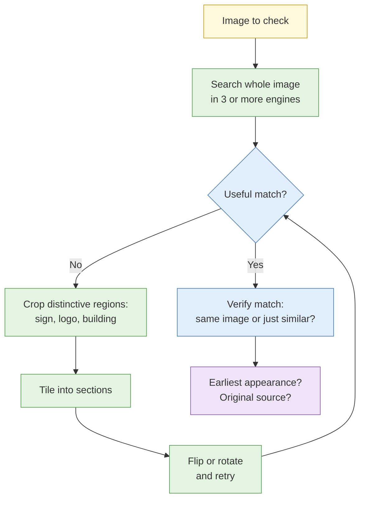

# S4 Image and video analysis

**Duration:** 25 minutes in class, about 35 minutes to read in full · **Leads into:** [Lab 2.7](../labs/lab-2-7-reverse-image-and-face-recognition.md) and [Lab 2.8 Verification challenge](../labs/lab-2-8-verification-challenge.md)

A picture is not a fact. It is a claim: "this happened here, then, like this". Image and video analysis is how you test that claim. This session covers finding where an image came from, how far to trust face-matching tools, how to check a video, and what to say about synthetic media.

## The analogy: checking a second-hand phone listing on Carousell

A seller posts photos and says "brand new, used once". You do not simply believe it. You ask: have these photos appeared on other listings? Is the background the same as a different seller's flat? Does the serial number on the box match the one in the photo? When was the listing first posted, and did the price or story change?

You are tracing the photo's earlier life and checking it for consistency. That is exactly what verification of an image or video claim involves.

## Reverse image search

Reverse image search takes a picture and looks for matches or similar pictures elsewhere.

| Engine | Strengths | Typical limits |
| --- | --- | --- |
| Google Lens / Images | Large index, good with products, landmarks and text | Weaker on faces; results shaped by location |
| Bing Visual Search | Good for objects and some regional content | Smaller index than Google |
| Yandex Images | Often strong at finding visually similar images and the same scene from other angles | Behaviour and policy on faces have changed over time |
| TinEye | Good at finding exact and modified copies with a timeline of first appearance | Smaller index, mostly exact-copy matching |
| Baidu Images | Strong for mainland Chinese content | Interface and results in Chinese |

### Why results differ

Each engine has its own index, its own matching method and its own policies. An image that returns nothing on one may return the original on another. Run at least three.

### Cropping, tiling and region search

If the whole image returns nothing, the useful part may be small.

- **Crop** to the most distinctive object: a sign, a logo, a vehicle, a building feature.
- **Tile** a large image into overlapping sections and search each one.
- Remove overlaid text, watermarks and borders that confuse matching.
- Flip or rotate the image if it may have been mirrored.

## Facial recognition: realistic capability and real limits

Facial recognition tools compare a face to a database and return similar faces with a score. They are widely misunderstood.

**The analogy:** a friend who says "that looks like Uncle Ah Seng" from across the void deck. Sometimes right. Sometimes it is his brother. Sometimes it is a stranger who happens to look like him. The friend's confidence tells you nothing about whether they are right.

| Issue | What it means for you |
| --- | --- |
| False positives | The tool will confidently return people who are not the subject, especially with a large database |
| Demographic differences | Studies, including NIST's evaluations, have found error rates that vary by age, sex and ethnicity; the same tool can be less accurate on some groups |
| Image quality | Low resolution, angle, lighting, masks, glasses and age change all reduce accuracy |
| Legal limits | Biometric data is personal data under the PDPA; tools may be restricted by your organisation, by platform terms and by law in some places |
| Ethical risk | A wrong match can attach an accusation to an innocent person (compare the Boston Marathon example in Day 1's S2) |

**Rules for this course:**

1. Treat a face match as a **lead**, never an identification.
2. Require **independent corroboration** before you report a name: a name on the photo's original page, a matching distinctive feature, a document, a context that fits.
3. Record the tool, the database, the score and its limits.
4. Never use a face tool on a private individual outside an authorised requirement and approved policy.

Lab 2.7 has you measure a false positive rate on a consented ground-truth set, so you see the error rate for yourself.

## Video verification

A video makes three claims: where it was, when it was, and who made it. Check each.

1. **Break it into keyframes.** Pull still frames at regular intervals and at scene changes, then reverse-search those frames like images.
2. **Trace the source.** Find the earliest upload, not the most viral one. Look for the uploader's other posts, their language, location tags and equipment hints.
3. **Check upload chronology.** Compare the earliest upload time with the claimed event time. A video that appeared online before the event it supposedly shows is not a video of that event.
4. **Examine the content for consistency.** Weather, shadows, signage, vehicles, clothing, language and background sounds should match the claimed place and date.
5. **Check platform details.** Resolution, compression and re-uploads change the file; the original often has more information than a copy.

### Real case: the recycled footage

After many breaking-news events, videos from earlier incidents or different countries are re-uploaded with a new caption. Verification teams, including those at news organisations, routinely find that a "live" clip was filmed years earlier by tracing the earliest copy. The lesson is to look for the first appearance before you look at the content.

## Synthetic and manipulated media

| Type | What it is | Indicators (none is conclusive) |
| --- | --- | --- |
| Face swap | One person's face placed on another's video | Edge flicker, mismatched skin tone, odd blinking or teeth |
| AI-generated image | Image created by a model | Inconsistent text, hands, reflections, jewellery, repeating patterns |
| Voice clone | Synthetic speech copying a real voice | Flat emotion, odd breaths, unnatural pacing |
| Cheapfake | Real footage edited or mislabelled | Cuts, speed changes, wrong captions |

**Limits of detection tools:**

- Detectors give probabilities, not proof, and they are often fooled by newer generators or by simple re-compression.
- A "real" score does not make something real, and a "fake" score does not make it fake.
- The most reliable checks remain traditional: find the source, check the context, find corroborating footage from another angle.

In Singapore, scams that use synthetic voices or faces of public figures to promote investments have been reported, so you may be asked to assess such material. Describe what you can show (source tracing, inconsistencies) and be honest about what you cannot.

## Common mistakes

- Accepting a "first result" from one engine as the original.
- Reporting a face-match score as if it were an identification.
- Confusing the most viral upload with the earliest.
- Declaring an image "AI-generated" or "real" from a detector alone.

## Check your understanding

1. A reverse search returns nothing for a crowd photo. List three things you try next.
2. A face tool returns your subject at 94% match. What do you do before writing a name in your report?
3. A video claims to show an event on 3 March, but its earliest copy online is dated 11 February. What does that tell you?
4. Why can a "this image is real" detector result not be used as proof?

## Key points

- Test an image or video as a claim before treating it as fact.
- Use several engines, and crop and tile when the whole image fails.
- Face matching is a lead needing independent corroboration, with known error and bias.
- For video, trace the earliest copy first and check the content for consistency.
- Detection tools for synthetic media give probabilities, not proof.

## Further reading

- Berkeley Protocol on Digital Open Source Investigations, verification chapters.
- NIST, *Face Recognition Vendor Test* reports on demographic effects.
- First Draft / Verification Handbook (verificationhandbook.com).
