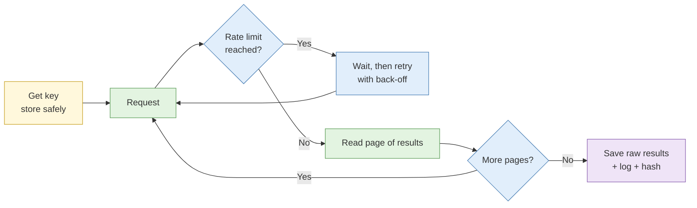

# Automation and scale

**Duration:** 10 minutes in class, about 20 minutes to read in full · **Leads into:** [Lab 5.1 API collection with a supplied script](../labs/lab-5-1-api-collection.md)

This input comes from the old Day 5 and is placed here so it follows the collection skills you have just practised. Once you can do a task by hand, you can decide whether to hand it to a script.

## The analogy: the rice cooker

A rice cooker is wonderful for cooking rice: same result every time, no watching the pot. It is useless, and a little dangerous, if you ask it to cook a steak. Automation is a rice cooker. It excels at repetitive, well-defined jobs, and it makes confident mistakes whenever the job needs judgement.

## Where automation helps and where it introduces error

| Helps | Introduces error |
| --- | --- |
| Pulling the same field from 500 pages | Silently skipping pages that load differently |
| Checking a list of URLs every morning | Treating a layout change as a content change |
| Converting and renaming files consistently | Overwriting originals if not careful |
| Logging every request with a timestamp | Collecting more personal data than the requirement allows |

**Rule:** automate only what you have done by hand at least once, and spot-check the output against the manual result.

## API-based collection

An API (application programming interface) is a front door built for programs. Many platforms and registries offer one, with rules.

- **Authentication:** most APIs need a key or token tied to an account. Keep it out of your scripts and case file (store it in an environment variable or a password manager).
- **Rate limits:** the number of requests allowed per minute or day. Exceeding them can get your key blocked, and aggressive volume against a small service can count as obstructing it (see the CMA discussion in Day 1's S3).
- **Pagination:** results come in pages. A script that reads only page one has missed most of the data.
- **Terms of service:** an API's terms say what you may collect and keep. An API is usually a safer route than scraping the same data from web pages.

## Command line and Python tooling

You do not need to be a programmer. Most investigative scripts are short and follow one pattern: ask, wait, save, log.

- `curl` fetches a URL or API response from the command line.
- `jq` filters and reshapes JSON.
- Python's `requests` library does the same inside a script, with loops and error handling.

## Scheduled monitoring and change detection

Instead of checking a page every day, let a script do it and tell you when it changes.

1. Fetch the page or record on a schedule.
2. Store a hash or a clean text copy.
3. Compare to the previous copy.
4. Alert only on changes that matter to the requirement, because every trivial change (a date in the footer, a rotating banner) creates noise.

Defining "a change worth alerting on" is the analytical part. In this course, Lab 5.2 is folded into Lab 5.1 as a short demonstration with a handout.

## Documenting automated collection for defensibility

If a script's output ends up in a report, someone may ask how it worked.

Record, for every run: the script name and version, the date and time (with time zone), the exact query or endpoint, the parameters, the number of results expected and received, any errors, and a hash of the raw output. Keep the script itself in the case file.

## Common mistakes

- Running a script at full speed against a small site.
- Hard-coding an API key into a script that gets saved into the case file or shared.
- Reading only the first page of results.
- Trusting the script's summary without opening a sample of the raw data.

## Check your understanding

1. Why is an API usually preferred to scraping the same website?
2. What goes wrong if a script ignores pagination?
3. List four things you record for each automated run.

## Key points

- Automate repetitive, well-defined jobs; keep judgement human.
- Respect authentication, rate limits and terms.
- Spot-check automated output against a manual sample.
- Log every run so it can be repeated and defended.
