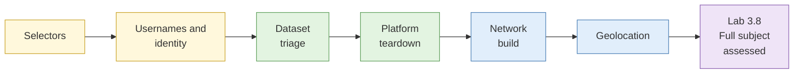

# Day 3: Investigating people and dataset triage

By the end of today you will have validated selectors without touching a real account, tested username matches for false positives, torn down a social profile, placed a photograph on the map, triaged a messy dataset, and built a defensible profile of a subject in an assessed lab.

## The day at a glance

Think of today as being a careful tracer in a big shopping mall. You start with one scrap (an email, a phone number, a username) and follow it from shop to shop. At every shop you ask: is this really the same customer, or just someone with the same shirt? After lunch you learn to read where a photo was taken from the shadows and the shop signs, and the day ends with a test where you must build one full profile from scraps and be honest about what you cannot prove.


**Consent and legal flags for today.** Subjects in every lab are synthetic personas or consenting public-domain subjects. Selector validation (Lab 3.1) runs on a mock platform only. The username sweep (Lab 3.2) uses pre-run sandbox output. The dataset lab uses a synthetic corpus: no real breach data is ever opened in the room. Profiles of real private individuals are out of scope.


## Learning objectives covered

| Theme | Objective |
| --- | --- |
| Selector and identity work | Pivot from email, phone and username to related accounts and test each link |
| Social media and network analysis | Analyse accounts, relationships and posting patterns |
| Geolocation | Place imagery by visual clues and, where possible, time |
| Dataset triage | Assess provenance, quality and legal status of large datasets |
| Subject profiling | Build a defensible profile with stated confidence |
| Law and ethics | Stay within PDPA, CMA and harassment law (applied in S1, S5 and S6) |

## Run sheet

| Time | Item | Min |
| --- | --- | --- |
| 08:45 | [S1 Selector-based investigation](sessions/s1-selector-based-investigation.md) | 25 |
| 09:10 | [Lab 3.1 Selector validation](labs/lab-3-1-selector-validation.md) | 20 |
| 09:30 | [S2 Username and identity correlation](sessions/s2-username-and-identity-correlation.md) | 15 |
| 09:45 | [Lab 3.2 Username sweep](labs/lab-3-2-username-sweep.md) | 20 |
| 10:05 | [S3 Social media analysis](sessions/s3-social-media-analysis.md) | 25 |
| 10:30 | Break | |
| 10:45 | [Large dataset triage (input)](sessions/s6-large-dataset-triage.md) | 10 |
| 10:55 | [Lab 3.3 Dataset triage (merged lab)](labs/lab-3-3-dataset-triage.md) | 45 |
| 11:40 | [Lab 3.4 Platform teardown](labs/lab-3-4-platform-teardown.md) | 35 |
| 12:15 | Buffer and Lab 2.8 feedback | 15 |
| 12:30 | Lunch | |
| 13:30 | [Lab 3.5 Network build](labs/lab-3-5-network-build.md) | 35 |
| 14:05 | [S4 Geolocation and chronolocation](sessions/s4-geolocation-and-chronolocation.md) | 20 |
| 14:25 | [Lab 3.6 Geolocation ladder](labs/lab-3-6-geolocation-ladder.md) | 30 |
| 14:55 | [Lab 3.7 Chronolocation (demo)](labs/lab-3-7-chronolocation.md) | 10 |
| 15:05 | [S5 Subject profile construction](sessions/s5-subject-profile-construction.md) | 10 |
| 15:15 | Buffer | 15 |
| 15:30 | Break | |
| 15:45 | [Lab 3.8 Full subject investigation (assessed)](labs/lab-3-8-full-subject-investigation.md) | 90 |
| 17:15 | Buffer and case export | 15 |

## What you take into Day 4

- Validated selector table and username match table
- Dataset triage note and join result
- Platform teardown and temporal profile
- Entity network graph
- Geolocation write-ups (and the take-home chronolocation image)
- Subject profile, with feedback on Day 4 morning (Lab 3.8)
