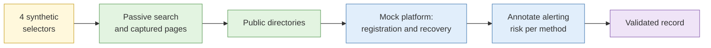

# Lab 3.1 Email and phone selector validation

| Duration | Type | Running case | Assessed |
| --- | --- | --- | --- |
| 20 minutes | Individual | Yes: validates selectors from the scenario | No |

## Aim

Validate whether synthetic email and phone selectors exist and what services they link to, and record the alerting risk of every method you use.

## Outcome

A **validated selector record** with an alerting-risk annotation for each method.

## The analogy: checking whether someone is home

You can look at the letterbox (passive), glance at whether the lights are on from the street (still passive), press the doorbell (active, and they will hear it) or ring their phone (active, and you leave a missed call). Every step finds out something, and every step from the second one on can tell them someone was asking.

## What you need to do

- [ ] Take the four synthetic selectors from the brief (two emails, two phones)
- [ ] Try the passive methods first and record what each reveals
- [ ] Use the **mock platform** to practise the registration and recovery signals
- [ ] For every method, write the alerting risk (very low, low, moderate, high) and why
- [ ] Complete the validated selector record

**Deliverable:** `selector-validation.md` in `04-analysis/`.

## What the instructor sets up beforehand

- A **mock platform** with registration and password-recovery screens that behave like a real service and send mock emails to a sandbox inbox
- Four synthetic selectors planted in captured pages from the scenario
- Written confirmation that no step is run against a real platform

## Before you start

- Read [S1 Selector-based investigation](../sessions/s1-selector-based-investigation.md) and your [Lab 1.3 rulings](../../day-1/labs/lab-1-3-legal-boundary-classification.md) on password-reset checks.
- **Tools:** `case-running` profile with Hunchly; the mock platform address in the brief.

## Rules for this lab

- Use only the mock platform and the passive sources named in the brief.
- Do not enter the selectors into any real service.
- Treat every step that notifies someone as active interaction.

## How the lab flows

## Steps

### Step 1: Passive methods (6 min)

For each selector, search in quotes in two engines, and search your Hunchly case for appearances. Record anything found with a capture reference.

### Step 2: Directory and archive look-ups (4 min)

Check the sandbox directory and archive named in the brief. Record whether the selector appears.

### Step 3: The mock platform (6 min)

1. Open the mock platform in the `case-running` profile.
2. Enter a selector on the recovery screen and note exactly what the screen says (for example, "If this account exists we have sent an email").
3. Check the sandbox inbox to see what the "owner" would receive.
4. Repeat on the registration screen with a different selector.

### Step 4: Annotate (4 min)

Complete a row for each method:

| Selector | Method | Result | Alerting risk | Why |
| --- | --- | --- | --- | --- |

## Worked example

| Selector | Method | Result | Alerting risk | Why |
| --- | --- | --- | --- | --- |
| a@example-mail.test | Recovery screen on mock platform | Account exists; message sent to owner | High | The real owner would get an email |

## Common mistakes

- Trying the high-risk method first.
- Recording only the result and not the risk.
- Assuming "the site did not say" means "no account".

## If you finish early

Rank all methods in the room from lowest to highest alerting risk and write the order you would use in a live case.

## Summary

Existence checks are cheap to run and expensive if they alert the subject. Order your methods from quietest to loudest and stop as soon as the requirement is met.

## Carries forward

- The validated record feeds Lab 3.2 and Lab 3.8.
