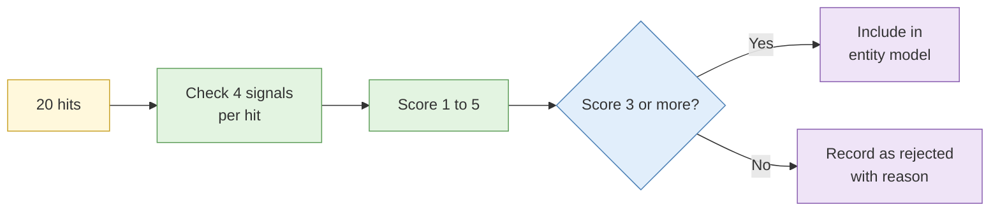

# Lab 3.2 Username sweep and false positive triage

| Duration | Type | Running case | Assessed |
| --- | --- | --- | --- |
| 20 minutes | Individual | Yes: adds scored accounts to the entity model | No |

## Aim

Triage the output of a cross-platform username sweep, separating genuine matches from coincidental collisions using content, timing and behaviour.

## Outcome

A **scored match list** with justification for every inclusion and exclusion, and an updated entity note.

## The analogy: finding the right "Ah Boy"

The sweep gives you a list of fifty Ah Boys. Your task is to find the one who was at the corridor window at 3pm. You do it by asking who else could have been there, not by picking the first.

## What you need to do

- [ ] Open the pre-run sweep results (about 20 hits) from the brief
- [ ] Check each hit against four signals: photo, writing style, timing, links
- [ ] Score each hit using the S1 scale (1 to 5) and write a one-line reason
- [ ] Record the rejected hits and why
- [ ] Update the entity resolution note

**Deliverable:** `username-match-list.md`.

## What the instructor sets up beforehand

- A **sandbox set of synthetic profiles** on a mock multi-site environment, including 3 true matches, 5 near matches and 12 unrelated hits
- The sweep output pre-generated so no live requests go to real platforms

## Before you start

- Read [S2 Username and identity correlation](../sessions/s2-username-and-identity-correlation.md).
- **Tools:** `case-running` profile; Obsidian.

## Rules for this lab

- Work only from the sandbox profiles in the brief.
- Do not contact any profile.

## How the lab flows

## Steps

### Step 1: Triage by photo and bio (6 min)

Open each hit. Mark clear mismatches immediately (different language, obviously different person).

### Step 2: Compare style, timing and links (8 min)

For the remaining hits compare phrases, spelling habits, time of posts and any cross-links.

### Step 3: Score and justify (4 min)

| Hit | Photo | Style | Timing | Links | Score | Reason |
| --- | --- | --- | --- | --- | --- | --- |

### Step 4: Update the entity note (2 min)

Add accepted accounts, rejected accounts and reasons to the entity note.

## Common mistakes

- Accepting hits with a good handle match and nothing else.
- Deleting rejected hits.
- Giving a high score with a one-word reason.

## If you finish early

Pick one rejected hit and write what single new piece of evidence would flip your decision.

## Summary

The hits are cheap; the judgement is the work. Several independent signals, written reasons and a visible rejected list make the result defensible.

## Carries forward

- The scored list feeds Lab 3.5 and Lab 3.8.
