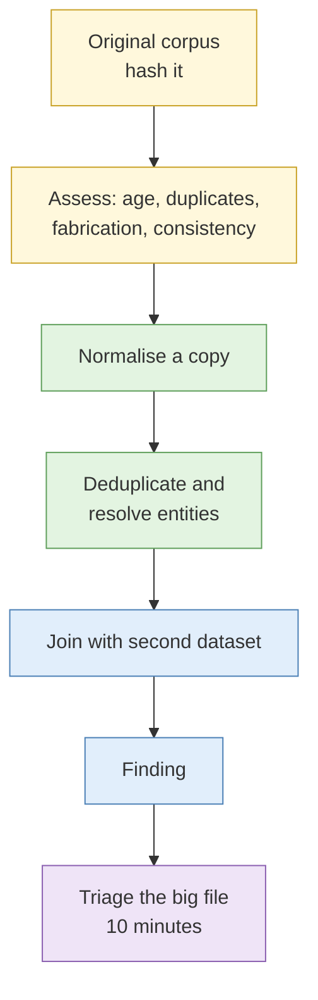

# Lab 3.3 Breach corpus assessment and dataset triage (merged lab)

| Duration | Type | Running case | Assessed |
| --- | --- | --- | --- |
| 45 minutes | Individual | Optional: feeds the scenario | No |


This lab merges the old Labs 3.3 (breach data reliability), 5.3 (ingest, deduplication, entity resolution) and 5.4 (triage under volume).


## Aim

Assess a synthetic breach corpus for age, duplication and fabrication, ingest and clean it, join it to a second dataset to surface a relationship neither shows alone, and triage under a time limit.

## Outcome

A **reliability statement and handling note**, a **resolved dataset**, the **finding from the join**, and a **triage rationale** listing what you chose not to read.

## The analogy: the lost-property room at the end of the school year

A room of unclaimed items arrives in one big pile. Some are duplicates (three identical water bottles), some are mislabelled, and some are rubbish. You work out what you have, clean it up, and match items to the owners lists. Then, because you have only an hour, you decide which boxes to open first.

## What you need to do

- [ ] Assess the corpus on five checks (age, duplication, fabrication, consistency, handling)
- [ ] Copy, normalise and deduplicate the data
- [ ] Resolve entities across inconsistent spellings
- [ ] Join against the second dataset and record the finding
- [ ] Apply a prioritisation strategy to a larger extra file in a strict 10 minutes

**Deliverables:** `reliability-statement.md`, `resolved.csv`, `join-finding.md`, `triage-rationale.md`.

## What the instructor sets up beforehand

- A **synthetic breach corpus** (about 20,000 rows) with planted duplicates, fabricated rows, inconsistent formats and aged records. No real personal data.
- A second synthetic dataset (for example a supplier list) that joins through shared phone numbers
- An extra 100,000-row triage file
- Tools in the VM: spreadsheet software, OpenRefine, command-line utilities

## Before you start

- Read [Large dataset triage](../sessions/s6-large-dataset-triage.md) and the breach section of [S3 on Day 1](../../day-1/sessions/s3-legal-and-ethical-boundaries.md).
- **Tools:** VM terminal, OpenRefine, spreadsheet.

## Rules for this lab

- The corpus is synthetic. In live work you would need your organisation's approval first.
- Never edit the original. Hash it, then work on a copy.

## How the lab flows



## Steps

### Step 1: Hash and assess (10 min)

```bash
cd ~/lab3
sha256sum corpus.csv | tee corpus.sha256
head -5 corpus.csv
wc -l corpus.csv
cut -d, -f1 corpus.csv | sort | uniq -d | head
```

Answer: date range in the data, share of duplicated rows, values that look fabricated (all the same, impossible formats), and fields that contradict each other.

### Step 2: Normalise and deduplicate (10 min)

1. Copy: `cp corpus.csv work.csv`.
2. Normalise phone numbers to `+65` and eight digits, lower-case emails, trim spaces.
3. Remove exact duplicates. Record the count removed.

### Step 3: Resolve entities (8 min)

In OpenRefine, cluster similar names. Accept merges only where a second field (phone or postcode) agrees. Record the rule.

### Step 4: Join (7 min)

Join `work.csv` to `suppliers.csv` on normalised phone. Record any person who appears in both and what the combined record shows. State what independent confirmation you would need.

### Step 5: Triage under volume (10 min)

You have 10 minutes for the 100,000-row file. Write your strategy first (30 seconds), apply it, list what you did not read and why.

## Common mistakes

- Cleaning the original.
- Merging entities on name alone.
- Treating the join result as a confirmed relationship.

## If you finish early

Write the three-line handling note a colleague would need before touching a real corpus.

## Summary

Data is only as good as its age, its origin and its cleaning, and a join is a lead until confirmed. Defensible triage means writing down what you skipped.

## Carries forward

- The method reappears in Lab 3.8 and the capstone.
