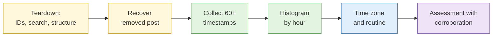

# Lab 3.4 Platform teardown and temporal analysis

| Duration | Type | Running case | Assessed |
| --- | --- | --- | --- |
| 35 minutes | Individual | Yes: analyses the scenario's synthetic account | No |

## Aim

Map the identifiers and search surfaces of a platform, recover removed content from a synthetic account, and infer routine and probable time zone from posting patterns.

## Outcome

An **activity pattern assessment** stating the inferred routine, the probable time zone and the corroboration each inference rests on.

## The analogy: reading the building's lights at night

From across the road you note which windows light up and when. After a few weeks you can say which flat is occupied by a night-shift worker. You cannot prove it from the lights alone, but with a second clue (a taxi at 5am) you can say it with more confidence.

## What you need to do

- [ ] Note the identifiers and search surfaces of the sandbox platform
- [ ] Recover one removed post from the synthetic account using archives and reposts
- [ ] Extract timestamps for at least 60 posts
- [ ] Draw the hourly histogram and find the quiet window
- [ ] Write the assessment with confidence levels

**Deliverable:** `activity-pattern-assessment.md`.

## What the instructor sets up beforehand

- A **mock social platform** with a synthetic account of about 120 posts, one removed post with traces in an archive, and a posting pattern fitting UTC+8 with a shift-work distortion
- Documentation of the platform's structure for delegates to confirm against

## Before you start

- Read [S3 Advanced social media analysis](../sessions/s3-social-media-analysis.md).
- **Tools:** `case-running` profile, spreadsheet, Obsidian.

## Rules for this lab

- Use only the mock platform.
- Do not interact with the account.

## How the lab flows

## Steps

### Step 1: Teardown (8 min)

Fill in a table: permanent identifier, username, search surfaces, what a deleted post leaves behind, how timestamps are shown.

### Step 2: Recover the removed post (7 min)

Use the archive and any reposts named in the brief. Capture and note the copy's strength.

### Step 3: Timestamps and histogram (12 min)

Copy 60+ timestamps into a sheet. Convert to UTC. Count by hour. Chart it.

### Step 4: Interpret (8 min)

Find the quiet window. List candidate time zones. Note anything that distorts the pattern (shift work, travel) and any other clue that supports or contradicts it.

## Worked example

> Posts cluster 11:00 to 15:00 UTC and 23:00 to 02:00 UTC with silence 03:00 to 09:00 UTC. Consistent with a UTC+8 evening routine with a late-night peak. A mention of "after shift" suggests shift work. Moderate confidence for UTC+8; low confidence for a fixed daily schedule.

## Common mistakes

- Mixing time zones in the sheet.
- Inferring location from time zone alone.
- Ignoring a contradicting clue.

## If you finish early

Find one post that does not fit the pattern and explain it.

## Summary

Time patterns give strong hints, never proof. Report the inference together with what supports it and what could distort it.

## Carries forward

- Used in Lab 3.8.
