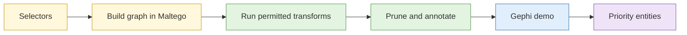

# Lab 3.5 Network build in Maltego, with Gephi demo

| Duration | Type | Running case | Assessed |
| --- | --- | --- | --- |
| 35 minutes | Individual (Gephi part is an instructor demo) | Yes: maps the scenario network | No |

## Aim

Build a relationship graph from the selectors gathered so far, expand it with transforms, then see community detection and centrality in Gephi to find the most connected and most bridging entities.

## Outcome

An **annotated network graph** identifying priority entities for further collection.

## The analogy: the MRT map for a gossip chain

Draw each person as a station and each friendship as a line. Interchanges (people who link otherwise separate groups) matter most. If you want to know how a rumour spread, start at the interchanges.

## What you need to do

- [ ] Import the selectors from your entity notes into Maltego
- [ ] Run the permitted transforms listed in the brief
- [ ] Remove irrelevant nodes and annotate the key ones
- [ ] Watch the Gephi demo (communities, centrality, betweenness)
- [ ] Name the three priority entities and say why

**Deliverable:** `network.mtgx` (or screenshot) and `network-notes.md`.

## What the instructor sets up beforehand

- Maltego installed with licences or the community edition, and the permitted transform list
- A mock data source so transforms return sandbox results
- Pre-built Gephi file for the demo

## Before you start

- Read [S3 Advanced social media analysis](../sessions/s3-social-media-analysis.md), network section.
- **Tools:** Maltego in the VM.

## Rules for this lab

- Run only the transforms listed. Some transforms call external services; stay within the brief.

## How the lab flows

## Steps

### Step 1: Build (8 min)

Create a new graph, add each selector as an entity, and arrange.

### Step 2: Expand (10 min)

Run the listed transforms. After each run, remove nodes that do not serve a requirement.

### Step 3: Annotate (7 min)

Add a note to each key node: why it is there, link strength, source capture.

### Step 4: Gephi demo (10 min)

Watch the instructor run community detection and betweenness on the sandbox graph. Note which entity bridges two communities.

## Common mistakes

- Letting the graph grow without pruning.
- Reading a link as a relationship without checking the source.
- Choosing the biggest node rather than the bridge.

## If you finish early

Write which entity you would research next and what you would try to learn.

## Summary

A graph shows structure, not guilt. Prune it, annotate it, and pick targets by role, not by size.

## Carries forward

- Lab 3.8 uses the graph for the subject network.
