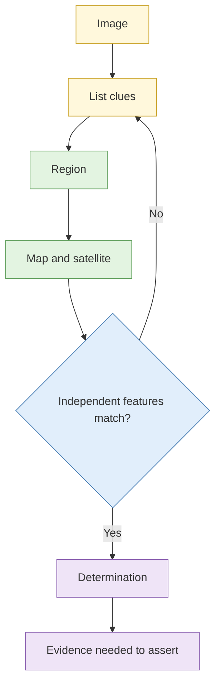

# Lab 3.6 Geolocation challenge ladder

| Duration | Type | Running case | Assessed |
| --- | --- | --- | --- |
| 30 minutes | Individual or pairs | No | No |

## Aim

Work two images of increasing difficulty to a location, stating the corroborating evidence you would require before asserting it.

## Outcome

Two **geolocation determinations** with confidence levels and supporting imagery comparisons. (The easiest rung is demonstrated by the instructor in the session.)

## The analogy: guessing which hawker centre from a photo of a plate

First you spot an obvious sign (easy). Then you notice a specific tray, a stall style, a ceiling fan (harder). Then you only have a corner of a table and the sound of a train (hard). You work from the strongest clue to the weakest and check each against a map.

## What you need to do

- [ ] Image 2 (medium): list every clue, narrow the region, find the location
- [ ] Image 3 (hard): vegetation, infrastructure and signage only
- [ ] For each, write the evidence you would need to assert the location and the confidence you have
- [ ] Record the imagery sources and their dates

**Deliverable:** `geolocation-determinations.md`.

## What the instructor sets up beforehand

- Three images licensed for training or synthetic, chosen so that **no private home or person is identifiable**
- Answer key (instructor notes)
- Satellite and street-level imagery access

## Before you start

- Read [S4 Geolocation and chronolocation](../sessions/s4-geolocation-and-chronolocation.md).
- **Tools:** browser with map and satellite services; Hunchly.

## Rules for this lab

- Use only the three images.
- Do not apply the techniques to photos of real private individuals or their homes.

## How the lab flows

## Steps

### Step 1: Image 2 (12 min)

List all clues. Narrow to a region. Find candidate areas. Compare imagery. Write the determination.

### Step 2: Image 3 (13 min)

Same process, with fewer obvious clues. If you cannot reach a determination, narrow to a region and say what additional evidence you would need.

### Step 3: Write up (5 min)

For each: location, confidence, two or three independent matching features, imagery dates, and what would raise your confidence.

## Common mistakes

- Fixing on a single striking feature.
- Using outdated satellite imagery.
- Not recording the imagery date.

## If you finish early

Write a one-paragraph version of Image 3's reasoning that a non-specialist could follow.

## Summary

A location claim is a chain of independent matches. Saying what extra evidence you would need is as useful as giving the answer.

## Carries forward

- Used in Lab 3.8 if the subject's media needs placing.
