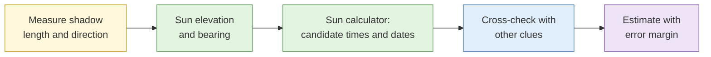

# Lab 3.7 Chronolocation through shadow analysis (demo)

| Duration | Type | Running case | Assessed |
| --- | --- | --- | --- |
| 10 minutes | Instructor demo, delegates follow along | No | No |

## Aim

See how to estimate the time of day and a date range from shadow direction and length, and test the estimate against ground truth.

## Outcome

Your own worked notes for **one image**, with a time and date estimate and a stated error margin. (A take-home exercise with a second image is provided.)

## The analogy: the sundial

A sundial tells the time because the shadow's direction changes through the day. A photo with a pole and its shadow is a snapshot of an unmarked sundial. You can read it if you know the compass direction and the location.

## What you need to do

- [ ] Follow the demo as the instructor measures shadow direction and length
- [ ] Use a sun-position calculator with the location and a candidate date
- [ ] Record the estimate and error margin
- [ ] Do the take-home image (optional)

**Deliverable:** `chronolocation-notes.md`.

## What the instructor sets up beforehand

- One image with a known location, date and time, and a vertical object with a visible shadow
- A sun-position calculator
- The take-home image with ground truth sealed in the instructor notes

## Before you start

- Read [S4 Geolocation and chronolocation](../sessions/s4-geolocation-and-chronolocation.md), shadow section.

## Rules for this lab

- Treat the result as an estimate. Never state an exact time.

## Steps

1. Note the object's height (estimate or known) and shadow length.
2. Calculate the sun elevation: elevation = arctan(height ÷ shadow length).
3. Find the shadow's compass direction from a known landmark.
4. In the calculator, find the times on candidate dates when the sun has that bearing and elevation.
5. Compare candidates with other clues in the image (season, activity).
6. State the estimate and the margin.

## Common mistakes

- Treating a rough shadow measurement as precise.
- Forgetting that near the equator elevation errors give big time errors.

## Summary

Shadow analysis narrows time and date; it never pins them. Always state a margin.

## Carries forward

- A reminder that precision is bounded by measurement. Use the same honesty in Lab 3.8.
