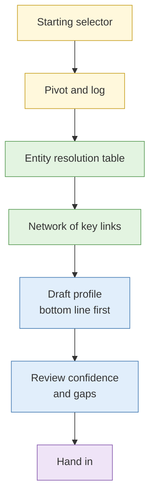

# Lab 3.8 Full subject investigation (assessed)

| Duration | Type | Running case | Assessed |
| --- | --- | --- | --- |
| 90 minutes | Individual | Yes: the subject belongs to the scenario | **Yes: scored by the instructors** |

## Aim

Starting from one selector, work an investigation end to end to a structured subject profile with a documented pivot chain, an entity network and a confidence assessment.

## Outcome

A **subject assessment** reviewed for analytic reasoning, not volume of findings.

## The analogy: the referral letter again

Your reader is a busy decision maker who will read the first paragraph and glance at the rest. They need to know what you found, how sure you are, and what would change your mind. A thick folder with no bottom line fails the test.

## What you need to do

- [ ] Receive the single starting selector
- [ ] Work the pivots, logging each one
- [ ] Build the entity resolution table and a small network
- [ ] Write the profile in the S5 structure with the bottom line first
- [ ] Hand in the profile and your pivot log

**Deliverable:** `subject-assessment.md` and `pivot-log.md`.

## What the instructor sets up beforehand

- A **synthetic persona or a consenting public-domain subject** chosen for this lab, with a seeded trail across the mock platforms, archive and registry
- Written consent on file if any public-domain subject is used
- Rubric printed
- Second marker briefed

## Before you start

- Read [S5 Subject profile construction](../sessions/s5-subject-profile-construction.md), and keep your Day 1 legal reference open.
- **Tools:** full research environment.

## Rules for this lab

- Synthetic personas and consenting public-domain subjects **only**.
- Active interaction is not permitted. If a step has high alerting risk, say what you would do and do not do it.
- Collect only what the requirement needs.

## Marking rubric

| Criterion | What earns marks |
| --- | --- |
| Pivot chain | Complete, logged and reproducible |
| Entity resolution | Matches scored and justified; rejects recorded |
| Evidence versus inference | Kept apart in the text |
| Confidence | Calibrated and stated |
| Gaps | Honest and useful |
| Clarity | Bottom line first, easy to read |
| Conduct | Stayed inside scope, legal and ethical limits |

Scored 0 to 4 per criterion. Findings volume is not scored.

## How the lab flows

## Steps

1. **Plan (5 min):** read the requirement and the starting selector. List two or three first pivots.
2. **Investigate (55 min):** work your pivots. After each, add a row to the log: from, method, found, confidence.
3. **Draft (20 min):** write the profile using the S5 structure.
4. **Review (10 min):** check that every claim is evidence or clearly marked as inference, and that the bottom line answers the requirement.

## Common mistakes

- Spending the whole lab collecting and none writing.
- A profile that reads like a list of findings.
- Overclaiming from a single link.
- Using an interaction that alerts the subject.

## Summary

The quality of a subject assessment shows in its restraint: a clear bottom line, honest confidence, visible reasoning and a list of what is still unknown.

## Carries forward

- The rubric criteria apply to the capstone.
- Feedback arrives Day 4 morning.
