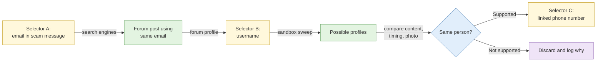

# S1 Selector-based investigation

**Duration:** 25 minutes in class, about 30 minutes to read in full · **Leads into:** [Lab 3.1 Selector validation](../labs/lab-3-1-selector-validation.md)

An investigation of a person rarely starts with a name. It starts with a thing the person left behind: an email address in a scam message, a phone number on a flyer, a username on a forum. That thing is a **selector**, and this session is about how to work outwards from one selector without fooling yourself or alerting the person.

## The analogy: a single key found at the void deck

You find one key on the floor of a void deck. It has a tag with a unit number. That one clue lets you ask: whose flat is it, who else lives there, did anyone report a lost key? Each answer is a new clue (a new selector). A good investigator keeps track of how they got from key to flat to family, because the first clue might be a tag someone wrote for a different key.

## Selector types

| Selector | Example (fictional) | What it can lead to |
| --- | --- | --- |
| Email address | `wm.tan88@example-mail.com` | Accounts registered with it, breach mentions, linked services |
| Phone number | `+65 5555 0142` | Messaging apps, marketplace listings, business records |
| Username / handle | `kopi_wm88` | Profiles on other platforms (with caution) |
| Account identifier | A numeric platform ID | Survives a username change; links old and new handles |
| Device / advertising ID | Mobile advertising identifier | Usually not available in open sources; mention for awareness |
| Name + location | "Tan Wei Ming, Woodlands" | Weak alone; needs a second selector |

## The pivot chain

Every step from one selector to another is a **pivot**. Record each one: what you started with, what you did, what you found, and how sure you are.

## Passive validation and its alerting risk

Checking whether an email address or phone number is real, and what it is linked to, can be done more or less quietly. The key idea is **alerting risk**: how likely a step is to tell the subject or a platform that someone is looking.

| Method type | Alerting risk | Why |
| --- | --- | --- |
| Searching your own captured material and public search engines | Very low | Nothing touches the subject or their accounts |
| Looking up a number or email in an archived or public directory | Low | A third party sees the query, not the subject |
| Checking a breach-notification service for presence only | Low to moderate | Reveals nothing to the subject, but policy may restrict it |
| Using a platform's recovery or registration screen to see whether an account exists | **High** | Can email or text the real owner, and may breach the platform's terms |
| Contacting the subject, or any message to the number | Highest | Active interaction |


In this course the recovery-and-registration signals are practised **only on an instructor-run mock platform**. Running them against real platforms is active interaction, usually breaches terms of service, and can alert a real person. Revisit your Lab 1.3 rulings on this.


## Working with breach corpora

Breach data links selectors quickly, which is why it is tempting and risky.

- **Legality:** possession or use can raise offences (see S3 on the CMA, section 8A), and most organisations restrict it. Never log in with a credential from a breach.
- **Reliability:** old, duplicated, merged from several leaks, sometimes fabricated.
- **Ageing:** a password or phone number from five years ago may belong to someone else now.
- **Handling:** use only data your organisation allows, store it separately, and record the source and date.

The merged dataset lab later today lets you test a synthetic corpus for these problems.

## Selector confidence scoring

Give every link a score, so the reader sees how strong it is. A simple scale:

| Score | Meaning | Example |
| --- | --- | --- |
| 1 | Coincidence is plausible | Same common first name |
| 2 | Lead | Same username on two platforms |
| 3 | Supported | Same username and same photo and overlapping posting hours |
| 4 | Strong | Above plus a unique shared detail (an uncommon phrase, a reused email) |
| 5 | Confirmed | Independent official source ties the selectors to the same person |

Explain the reasoning in one line next to the score.

## Common mistakes

- Treating a selector as a person.
- Not logging the pivot chain, so nobody can check your work.
- Using a validation step with high alerting risk without approval.
- Relying on old breach data as if it were current.

## Check your understanding

1. Rank four validation methods from lowest to highest alerting risk.
2. Why can the same phone number connect two unrelated people?
3. What do you write down for each pivot?

## Key points

- Every investigation of a person starts from a selector, and every step is a pivot you must record.
- Alerting risk and terms-of-service risk are separate things to weigh before you act.
- Breach data is powerful and risky: reliability, age and legality all matter.
- Score and explain the strength of each link.

## Further reading

- Berkeley Protocol on Digital Open Source Investigations, sections on identification and attribution.
