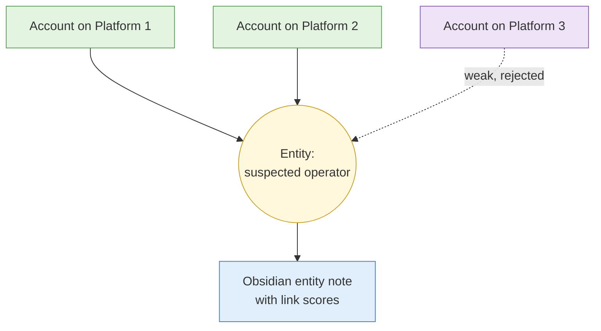

# S2 Username and identity correlation

**Duration:** 15 minutes in class, about 25 minutes to read in full · **Leads into:** [Lab 3.2 Username sweep and false positive triage](../labs/lab-3-2-username-sweep.md)

A username sweep finds accounts with the same handle across many platforms. The hard part is not finding them. It is deciding which belong to the person you are studying and which belong to strangers who happened to pick the same word.

## The analogy: five "Ah Boys" at the same school

A school has five boys everyone calls "Ah Boy". If a teacher says "Ah Boy broke the window" and you pick the one you know best, you may punish the wrong child. You have to ask: which Ah Boy was in that corridor, at that time, wearing those shoes? A name that many people share proves nothing by itself.

## The false-positive problem

Handles are short and popular, so collisions are common. A sweep of 300 sites will return many hits, and most may be unrelated people.

| Signal | Weak | Stronger |
| --- | --- | --- |
| Handle match | Common word or name plus numbers | Rare, distinctive handle |
| Profile photo | Generic or stock image | Same unique photo on both, not found elsewhere |
| Bio and language | Short or empty | Same unusual phrases, spelling habits or in-jokes |
| Interests | Broad (food, football) | Narrow overlap (a rare hobby plus a local reference) |
| Timing | Any hours | Same time zone pattern and routine |
| Links between profiles | None | One profile links to the other, or both link to the same unique page |

## Behavioural, stylistic and temporal signals

- **Style:** spelling mistakes, emoji habits, punctuation, code-switching between English, Mandarin, Malay or Singlish.
- **Time:** posting hours, days off, gaps that match holidays.
- **Content overlap:** the same pictures, the same stories, the same unusual references.
- **Network:** the same small group of friends or followers.

Each signal can fail. People imitate styles; teams share accounts. Look for several independent signals pointing the same way.

## Linking versus proving

| You may say | You may not say |
| --- | --- |
| "Profile B is consistent with Profile A on four signals (photo, phrase, hours, link)" | "Profile B is the same person as Profile A" with no qualification |
| "We assess it is likely the same operator, moderate confidence" | "It is definitely him" |
| "A match on handle alone is a lead" | "The sweep proves it" |

Always state what the correlation supports and what it does not.

## Building an entity resolution model in the case file

An **entity resolution model** records which accounts you believe belong to the same real-world entity, and why.

In Obsidian: one note per account, one note per suspected entity, and a table on the entity note listing each account, the signals, the score (S1 scale) and your reasoning. Rejected matches stay in the table with the reason, so nobody repeats the work.

## Common mistakes

- Merging accounts because the handle matches.
- Dropping rejected matches instead of recording why.
- Over-reading style similarities that many people share.
- Forgetting to check the earliest date of each account.

## Check your understanding

1. Give two signals that raise a handle match from a lead to supported.
2. Why do you keep rejected matches in the case file?
3. Rewrite "He runs both accounts" as a properly qualified statement.

## Key points

- Collisions are normal; correlate with several independent signals.
- State what a link supports and what it does not.
- Keep an entity resolution table, including rejected matches.
