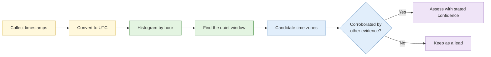

# S3 Advanced social media analysis

**Duration:** 25 minutes in class, about 30 minutes to read in full · **Leads into:** [Lab 3.4 Platform teardown and temporal analysis](../labs/lab-3-4-platform-teardown.md) and [Lab 3.5 Network build](../labs/lab-3-5-network-build.md)

Social platforms are structured databases that people fill in without thinking of it that way. Learning how a platform is built shows you what is searchable, what is permanent, and what a person's habits give away.

## The analogy: reading the guest book at a kampung wedding

A guest book records who came, when, who they came with and what they wrote. You never meet the guests, but from the book alone you can say who sat together, which families know each other, and who left early. A platform's posts, likes, tags and follower lists are a guest book that nobody realised they were signing.

## Platform-by-platform structure

For any platform, work out four things:

| Question | Why it matters |
| --- | --- |
| What is the **permanent identifier** of an account? | Usernames change; a numeric ID usually does not |
| What are the **search surfaces**? | Where can content be found (people search, hashtags, locations, group search)? |
| What do **third-party interfaces and archives** expose? | Some tools show public data in new ways, and the options change often |
| What happens to **deleted content**? | Some platforms keep traces, some do not |

Terms and features change often, so confirm current behaviour before you rely on it.

## Content, connection and activity analysis

| Layer | What you look at | What it can show |
| --- | --- | --- |
| Content | Posts, photos, captions, comments | Interests, places, opinions, language |
| Connection | Followers, friends, tags, group membership | Social circle, organisation links |
| Activity | When and how often the account acts | Routine, time zone, device habits |

## Temporal pattern analysis

**The analogy:** the lights in a block of flats. If one window is lit every weekday at 7am and again at 8pm, you can guess that someone gets up early and works away from home. Posting times work the same way.

1. Collect timestamps for a fair sample of posts. Convert them all to one time zone (UTC), noting the platform's own conversion.
2. Count posts by hour of day and day of week.
3. Look for the quiet period (sleep) and the busy periods.
4. Compare with candidate time zones. A quiet stretch of about 6 to 7 hours around 01:00 to 07:00 local time is typical.
5. Note holidays, travel and shift work that distort the pattern.

## Network mapping and community detection

A network graph turns relationships into a picture.

- **Nodes** are entities (accounts, people, organisations); **edges** are relationships (follows, tags, replies, shared groups).
- **Maltego** builds graphs interactively by running "transforms" that look up related entities.
- **Gephi** analyses larger graphs: **community detection** finds clusters; **centrality** finds the most connected nodes; **betweenness** finds the bridges between clusters.

**The analogy:** an MRT map. Interchange stations (high betweenness) matter more than quiet stations. Remove an interchange and the network splits.

A graph shows connection and says nothing about guilt. Being followed by someone is not evidence that you are linked to them.

## Recovering removed content and reconstructing account history

- Use archive services (Day 2, S2) and any content other users quoted or reposted.
- Reconstruct a history by combining captures with dates, and note what is missing.
- Record the strength of each recovered item, since a copy of a copy is weaker.

## Groups, channels and closed communities

Closed communities carry an expectation of privacy. Joining them with a research account is active interaction and needs approval (S3 of Day 1 and the research account policy). Passive viewing of public channels is different from joining a private group. Follow your approved policy and never use a persona to befriend a subject.

## Common mistakes

- Treating a username as permanent.
- Reading time-zone patterns without checking for shift work or travel.
- Mistaking a follower list for a loyalty list.
- Joining a group for access without approval.

## Check your understanding

1. Why use a numeric account ID rather than a username to track an account?
2. A subject's posts cluster between 21:00 and 02:00 UTC. What time zones does that suggest, and what could make it misleading?
3. What does a node with high betweenness suggest?

## Key points

- Learn the structure and identifiers of each platform before you analyse it.
- Time patterns are strong leads for routine and location, never proof.
- Graphs show relationships, and the interpretation is yours to qualify.
- Closed communities need explicit approval.
