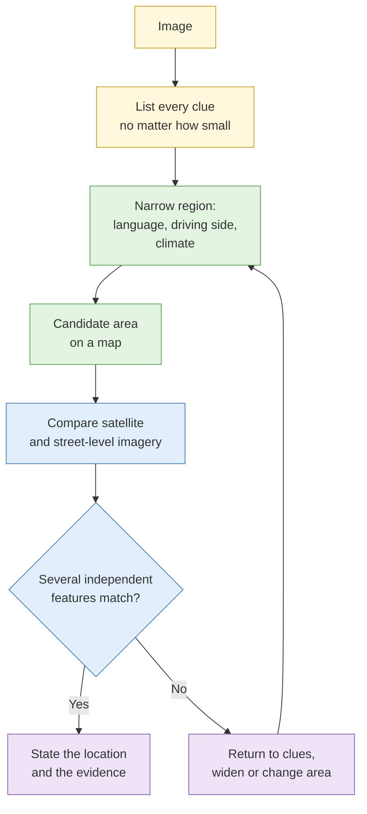

# S4 Geolocation and chronolocation

**Duration:** 20 minutes in class, about 30 minutes to read in full · **Leads into:** [Lab 3.6 Geolocation challenge ladder](../labs/lab-3-6-geolocation-ladder.md) and [Lab 3.7 Chronolocation](../labs/lab-3-7-chronolocation.md)

Geolocation answers "where was this taken?". Chronolocation answers "when?". Both work by finding details in the image that can be matched to maps, satellite views and sun calculations, and both require you to prove it, not to guess.

## The analogy: guessing the neighbourhood from a window view

A friend sends a photo from their window and asks "where am I?". You notice an HDB block's colour pattern, a bus stop sign, a particular overhead bridge, and the angle of the sun. None of them alone is enough. Together they narrow it to a handful of blocks. Then you check against a map. Good geolocation is exactly this, done carefully.

## Working from imagery: what to look for

| Category | Examples | Why it helps |
| --- | --- | --- |
| Signage and language | Shop names, road signs, scripts, phone prefixes | Quickly narrows the country or region |
| Architecture | Block design, roof shapes, building materials, window types | Regional styles |
| Vegetation and terrain | Tree species, soil colour, hills, coastline | Climate zone and landform |
| Infrastructure | Road markings, utility poles, rail gauges, bus stops, lamp posts | Often unique to a country or city |
| Vehicles | Driving side, licence plate format, taxi colours | Country-level clues |
| Skyline and horizon | Distinctive buildings, mountain outlines | Can match a unique viewpoint |
| Sun and shadows | Direction and length | Time of day and orientation |

## The workflow

## Satellite, aerial and street-level comparison

1. Find the candidate area on a map.
2. Use satellite or aerial views to match building shapes, roads and open spaces.
3. Use street-level views, where available, to match the exact viewpoint.
4. Note the date of each imagery source, because places change. A construction site in your photo may not exist in an older satellite image.

## Shadow analysis and sun position

Shadows give time and direction.

- A shadow points **away** from the sun. If you know the compass direction of the shadow, you know the sun's bearing at that moment.
- Shadow **length** relative to the object's height gives the sun's elevation.
- Sun-position calculators take a location and a date, and give the sun's bearing and elevation through the day. By matching your measurements, you narrow the time of day and, using the sun's seasonal path, the date range.
- Near the equator, as in Singapore, the sun is high at midday and shadows are short, which makes length measurements sensitive to error. Be honest about the margin.

## Terrain and skyline matching

Hills and distinctive buildings form an outline. Draw the outline from the image, then compare it with a 3D terrain view from the candidate viewpoint.

## Corroboration before asserting a location

A location claim needs:

1. **At least two or three independent features** that match (not two that come from the same source).
2. **A reason to exclude look-alikes.**
3. **A statement of confidence** and the margin of error.

## Ethics of geolocating images

Locating a photo can expose where a person lives or goes. In this course all images are licensed, synthetic or public-domain scenes. In live work, apply the PDPA purpose test: do not locate private individuals' homes or movements unless an authorised requirement and approval cover it.

## Common mistakes

- Latching on to one clue and ignoring contradicting ones.
- Using outdated satellite imagery.
- Stating a location without saying how sure you are.
- Forgetting that a photo may be mirrored.

## Check your understanding

1. List five categories of clue and one example of each.
2. Why is shadow-length analysis less precise near the equator?
3. What must you do before stating a location?

## Key points

- Collect every clue, narrow the region, then verify with imagery.
- Use several independent matches, not one striking one.
- Shadows give a lead on time, with a stated margin of error.
- Treat location data as sensitive.
