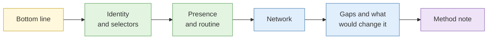

# S5 Subject profile construction

**Duration:** 10 minutes in class, about 15 minutes to read in full · **Leads into:** [Lab 3.8 Full subject investigation](../labs/lab-3-8-full-subject-investigation.md)

A subject profile is not a list of everything you found. It is a short, structured assessment that answers the requirement, says how sure you are, and says what is missing.

## The analogy: the doctor's referral letter

A good referral letter says who the patient is, what the problem seems to be, how certain the doctor is, what tests were done, and what is still unknown. It does not paste in the whole file. The specialist can act on it in two minutes. Your profile is a referral letter for the person who needs the decision.

## Structure of a profile

| Section | What it holds |
| --- | --- |
| Bottom line | The answer to the requirement in two or three sentences, with confidence |
| Identity | Who the subject appears to be, which selectors support it, and how strongly |
| Online presence | Accounts and their relationship, with scores |
| Activity and routine | What patterns show, with the evidence for each |
| Network | Key connections relevant to the requirement |
| Gaps | What you could not establish, and what would change the assessment |
| Method note | Pivot chain, sources and captures |

## Confidence language

Use consistent words so readers know what you mean. A common scale (used in this course) is:

| Phrase | Rough meaning |
| --- | --- |
| Almost certain | Above 90 percent |
| Likely | About 70 to 90 percent |
| Realistic possibility | About 40 to 60 percent |
| Unlikely | About 10 to 30 percent |
| Remote | Below 10 percent |

Pair a probability phrase with a **confidence level** (low, moderate, high) that describes the quality of evidence behind it.

## Stating collection gaps

For every gap, write what you lack and what would fill it. This turns weakness into a plan and stops the reader assuming absence of evidence means absence of fact.

## Common mistakes

- Burying the bottom line on the last page.
- Listing findings without ranking them.
- Mixing evidence and inference in one sentence.
- Skipping the gaps section.

## Key points

- A profile answers the requirement, not everything you found.
- Use consistent probability and confidence words.
- State gaps and what would change the assessment.
