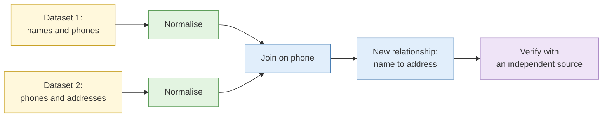

# Large dataset triage

**Duration:** 10 minutes in class, about 25 minutes to read in full · **Leads into:** [Lab 3.3 Breach corpus and dataset triage](../labs/lab-3-3-dataset-triage.md)

This input comes from the old Day 5. It sits here because Day 3 introduced breach data and large volumes of social data. When there is more data than you can read, your job changes from reading to deciding what to read.

## The analogy: sorting the haul from a Chinese New Year spring-cleaning

After a spring clean you have a mountain of bags: old clothes, papers, gadgets. You cannot examine every item. You sort fast: bin, donate, keep, and "need to look at this properly". Triage is the same: a quick first pass to decide what deserves your attention.

## Ingest and normalise

Different sources use different formats and spellings. Before you can compare anything:

1. **Ingest** the files into one place without altering the originals (work on copies; hash the originals).
2. **Normalise**: consistent date formats, consistent case, consistent phone formats (for example `+65` plus 8 digits), trimmed whitespace, one character encoding.
3. **Record** every change you make.

## Deduplication and entity resolution

- **Deduplication** removes exact copies.
- **Entity resolution** decides that "Tan Wei Ming", "Wei Ming Tan" and "TAN WEI-MING" are one entity, or are not.
- Prefer rules you can state ("same phone and same surname") and test on a sample.

## Joining datasets

A **join** matches records from two datasets on a shared field (phone number, email, address). The value is in the relationship neither dataset shows alone: a name from one and an address from another that only meet through a shared phone number.

## Filtering and prioritisation when volume exceeds capacity

When you cannot read everything:

1. Tie every filter to a requirement (Lab 1.1).
2. Rank by likely value: unusual records, records matching your selectors, records near key dates.
3. Sample the rest to estimate what you are skipping.
4. **Write down what you chose not to read and why.** That is part of defensible work.

## Tools

- **Spreadsheet techniques** (sort, filter, text-to-columns, lookup) go a long way.
- **OpenRefine** cleans messy data and clusters near-duplicates.
- **Command-line tools** (`sort`, `uniq`, `grep`, `cut`, `awk`) process large text files quickly.
- **Visualisation** helps you see patterns (timelines, histograms, graphs) rather than present results.

## Assessing a corpus before you rely on it (breach data)

Before using any leaked or scraped dataset, check:

| Check | Question |
| --- | --- |
| Age | When was it created? Do dates inside agree? |
| Duplication | How many records are repeated or merged from other sources? |
| Fabrication | Do values look random or too clean? Do formats fit the claimed source? |
| Internal consistency | Do fields agree (postcodes with areas, area codes with cities)? |
| Handling | Is your organisation's policy satisfied, and is it legal to hold? |

State what the corpus can and cannot support.

## Common mistakes

- Cleaning the original file rather than a copy.
- Joining on a field that is not unique.
- Treating a match from a join as proof.
- Not recording what you skipped.

## Key points

- Triage means deciding what to read, with reasons.
- Normalise before comparing; keep originals untouched.
- A join can reveal relationships, and each needs independent confirmation.
- Always assess a dataset's age, duplication, fabrication and legality first.
