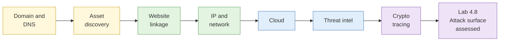

# Day 4: Websites, infrastructure and cryptocurrency tracing

By the end of today you will have read the paperwork behind a website, listed every name a certificate has ever carried, linked sites through the fingerprints they leave behind, mapped your organisation's outside view, sorted behaviour into ATT&CK, and followed a payment to the place where a name might exist.

## The day at a glance

Think of today as becoming a building inspector who works only from the street. You read the plaque on the door (registration), the utility bills (DNS history), the lease (hosting and cloud), the contractor's sticker on the lift (analytics IDs) and the fire-safety certificate (TLS certificates). You never open a locked door. You write down what is visible, how sure you are, and what a stranger could do with it. The day ends with turning the lens on your own organisation, with permission.


**Consent and legal flags for today.**
1. **Lab 4.8** runs on your real organisation only with signed scope. The instructors hold the sheets. No sheet means the fallback sandbox organisation.
2. **Lab 4.4** (origin behind a CDN) is an instructor demo on systems the instructor owns. It is not repeated by delegates.
3. **Lab 4.3** uses shared licensed scan accounts: read the platform terms. Passive search of scan-platform data only. No active scanning of anything.
4. **Lab 4.6**: if you find a storage reference, record the URL and escalate. Do not open it.
5. **Lab 5.6** uses a testnet or seeded case. No real wallets.


## Learning objectives covered

| Theme | Objective |
| --- | --- |
| Domain, DNS and IP intelligence | Map registration, resolution history, hosting and network ownership |
| Website analysis | Link sites through technical and tracking artefacts, and test the link |
| Cloud environments | Identify cloud dependencies passively and escalate exposure properly |
| Cyber threat intelligence | Map behaviour to ATT&CK and cluster with the Diamond Model |
| Cryptocurrency tracing | Trace payments, apply heuristics, state where confidence ends |
| Law and ethics | Passive versus active, scope, and escalation |

## Run sheet

| Time | Item | Min |
| --- | --- | --- |
| 08:45 | [S1 Domain and DNS intelligence](sessions/s1-domain-and-dns-intelligence.md) | 15 |
| 09:00 | [Lab 4.1 Registration and passive DNS](labs/lab-4-1-registration-and-passive-dns.md) | 25 |
| 09:25 | [Lab 4.2 Asset discovery](labs/lab-4-2-asset-discovery.md) | 25 |
| 09:50 | [S3 Website analysis and pivoting](sessions/s3-website-analysis-and-pivoting.md) | 15 |
| 10:05 | [Lab 4.5 Cross-site linkage](labs/lab-4-5-cross-site-linkage.md) | 25 |
| 10:30 | Break | |
| 10:45 | [S2 IP, hosting and network layer](sessions/s2-ip-hosting-and-network-layer.md) | 20 |
| 11:05 | [Lab 4.3 Network layer and scan data](labs/lab-4-3-network-layer-and-scan-data.md) | 40 |
| 11:45 | [Lab 4.4 Origin behind a CDN (demo)](labs/lab-4-4-origin-behind-a-cdn.md) | 15 |
| 12:00 | [S4 Cloud environments](sessions/s4-cloud-environments.md) | 15 |
| 12:15 | Buffer and Lab 3.8 feedback | 15 |
| 12:30 | Lunch | |
| 13:30 | [Lab 4.6 Cloud footprint](labs/lab-4-6-cloud-footprint.md) | 15 |
| 13:45 | [S5 Cyber threat intelligence](sessions/s5-cyber-threat-intelligence.md) | 25 |
| 14:10 | [Lab 4.7 ATT&CK and Diamond](labs/lab-4-7-attack-and-diamond.md) | 35 |
| 14:45 | [Cryptocurrency tracing (input)](sessions/s6-cryptocurrency-tracing.md) | 15 |
| 15:00 | [Lab 5.6 Blockchain tracing](labs/lab-5-6-blockchain-tracing.md) | 30 |
| 15:30 | Break | |
| 15:45 | [Lab 4.8 Attack surface map (assessed)](labs/lab-4-8-attack-surface-map.md) | 75 |
| 17:00 | Buffer and case export | 30 |

## What you take into Day 5

- Registration and passive DNS timeline
- Asset list from certificate names
- Network and scan-data notes
- Linkage assessment
- Cloud dependency map and escalation note
- ATT&CK mapping and clustering judgement
- Payment trace
- Exposure summary habit, with feedback on the Day 5 one-to-one
