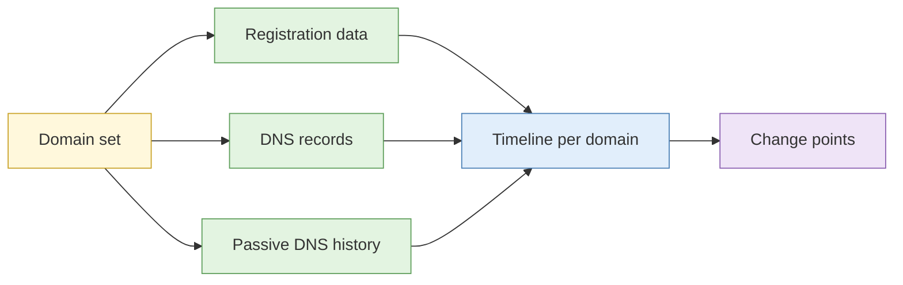

# Lab 4.1 Registration history and passive DNS timeline

| Duration | Type | Running case | Assessed |
| --- | --- | --- | --- |
| 25 minutes | Individual | Yes: the scenario's lookalike domain set | No |

## Aim

Pull current and historical registration data for a target domain set, build a passive DNS timeline, and find the point at which hosting or ownership changed.

## Outcome

A **domain lifecycle timeline** with change points annotated, added to `timeline.md`.

## The analogy: the history of a shophouse unit

You look up who owned the unit, when it was sold, which tenant moved in, and which moved out. The interesting moment is the change, such as the day a bakery became a phone repair shop with a new owner.

## What you need to do

- [ ] Retrieve registration data for each domain in the set
- [ ] Retrieve DNS records and passive DNS history
- [ ] Draw each domain's timeline
- [ ] Mark change points (new IP, new name server, new registrar)
- [ ] Add the key dates to the case timeline

**Deliverable:** `domain-lifecycle.md` and updated `timeline.md`.

## What the instructor sets up beforehand

- A set of 4 to 5 domains from the scenario (sandbox or real public-domain, fictional ones for the actor)
- Licensed access to a passive DNS service, or a sandbox mirror with seeded history
- A brief listing the domains and the registries to use

## Before you start

- Read [S1 Domain and DNS intelligence](../sessions/s1-domain-and-dns-intelligence.md).
- **Tools:** `case-running` profile with Hunchly; RDAP/WHOIS lookup; passive DNS service.

## Rules for this lab

- Use only the domains in the brief.
- Use lookup services only. Do not probe the domains' servers.

## How the lab flows

## Steps

1. **Registration (8 min):** for each domain capture creation, expiry and update dates, registrar and name servers.
2. **DNS and history (8 min):** note A, MX and NS records; list past IPs with first and last seen dates.
3. **Timeline (6 min):** draw a line per domain with events.
4. **Change points (3 min):** mark where the IP, name server or registrar changed.

## Worked example

> `example-lookalike.test`: created 2026-07-02 (registrar R1); A record to IP X from 07-02 to 07-30; moved to IP Y on 07-31 with a new name server. Change point on 07-31.

## Common mistakes

- Mixing time zones.
- Treating first-seen as registration date.
- Treating shared registrar as a link.

## If you finish early

Compare creation dates across all domains and note any pattern in time of day.

## Summary

Registration and DNS history tell the story of a domain's life. The change points are the questions to ask next.

## Carries forward

- Lab 4.2 and Lab 4.7 use this set.
