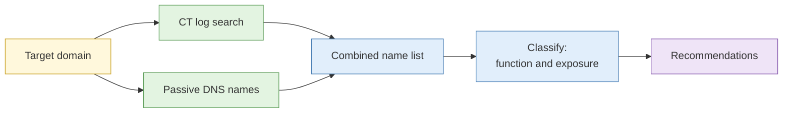

# Lab 4.2 Asset discovery through certificate transparency

| Duration | Type | Running case | Assessed |
| --- | --- | --- | --- |
| 25 minutes | Individual | Yes | No |

## Aim

Discover subdomains and forgotten assets of a sandbox target through certificate transparency logs and passive sources, then classify each by apparent function and exposure.

## Outcome

An **asset inventory** with an exposure classification for each item.

## The analogy: the building directory, plus the old signboards

The lobby directory lists the current tenants. The certificate logs are the stack of old signboard orders: they remember tenants who left, units never advertised and the back-office rooms.

## What you need to do

- [ ] Search certificate logs for the target domain
- [ ] List every name found, noting first-seen dates
- [ ] Check passive DNS for extra names
- [ ] Classify each asset by function (public site, mail, test, admin, unknown) and exposure level
- [ ] Recommend which to investigate further and which to flag to the owner

**Deliverable:** `asset-inventory.md`.

## What the instructor sets up beforehand

- A sandbox domain with certificates issued for 15 to 20 names, including forgotten test and staging names
- Access to a CT log search tool and the passive DNS service

## Before you start

- Read [S3 Website analysis and pivoting](../sessions/s3-website-analysis-and-pivoting.md).
- **Tools:** CT log search, passive DNS.

## Rules for this lab

- Passive sources only. Do not connect to, scan or log in to any discovered host.
- Treat names that suggest internal or admin functions as sensitive findings.

## How the lab flows

## Steps

1. **Search (8 min):** enter the domain in the CT search tool; export names and dates.
2. **Merge (5 min):** add names from passive DNS; remove duplicates.
3. **Classify (8 min):**

| Name | Likely function | First seen | Exposure | Notes |
| --- | --- | --- | --- | --- |

4. **Recommend (4 min):** top three to examine further and top three to report to the owner.

## Common mistakes

- Treating every name as a live service.
- Connecting to a discovered host to "check".

## If you finish early

Find a naming pattern in the list and predict, in words, what kind of names an owner might also have used.

## Summary

Certificate logs reveal more than a directory. Classify and recommend, and never touch what you find.

## Carries forward

- Lab 4.8 repeats this approach on your own organisation.
