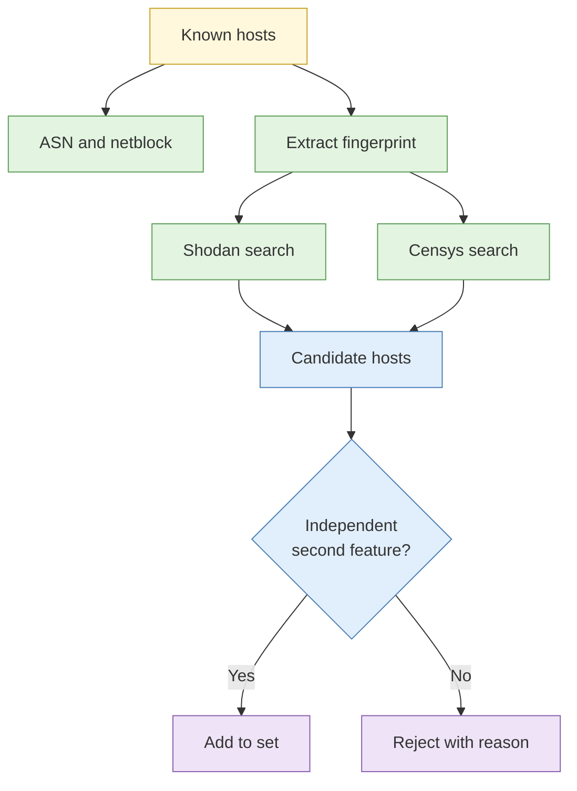

# Lab 4.3 Network layer and scan data pivoting

| Duration | Type | Running case | Assessed |
| --- | --- | --- | --- |
| 40 minutes | Pairs (shared licensed accounts) | Yes | No |

## Aim

Map the ASN, netblock and hosting relationships of the scenario infrastructure, then pivot in Shodan and Censys from banner, certificate and response fingerprints to find additional hosts that share the same characteristics.

## Outcome

An **expanded host set** with the pivot logic documented for every addition.

## The analogy: asking the estate manager which units share a landlord

You know one tenant. You ask the estate manager who else the same landlord manages, which units have the same unusual signboard, and which pay rent through the same company. The scan platform is the manager's logbook.

## What you need to do

- [ ] Look up IP, ASN and netblock for the scenario's known hosts
- [ ] Extract one distinctive fingerprint from a known host
- [ ] Search both platforms for that fingerprint
- [ ] Judge each result as related, unrelated or uncertain, and say why
- [ ] Build the expanded host table

**Deliverable:** `host-set.md`.

## What the instructor sets up beforehand

- Licensed Shodan and Censys accounts shared in pairs, with the platforms' terms reviewed
- Known hosts planted in the scenario with an unusual certificate or page, plus noise hosts
- Instructor-owned or sandbox addresses only

## Before you start

- Read [S2 IP, hosting and network layer](../sessions/s2-ip-hosting-and-network-layer.md).
- **Tools:** the two platforms in the research VM.

## Rules for this lab

- Read platform data only. Do not run your own scans.
- Search only for the fingerprints from the scenario.

## How the lab flows

## Steps

1. **Network mapping (8 min):** record IP, ASN, holder, country and neighbouring ranges for each known host.
2. **Fingerprint (7 min):** choose the most distinctive feature (certificate field, page title or response header combination). Note why it is distinctive.
3. **Pivot (15 min):** search both platforms; record the number of results and sample hosts.
4. **Judge (10 min):** for each candidate check for a second independent feature (same ASN, same setup date, matching page content). Record related, unrelated or uncertain.

## Worked example

| Host | Source pivot | Second feature | Judgement |
| --- | --- | --- | --- |
| H7 | Certificate issuer and subject pattern | Same hosting ASN, same first-seen week | Related, moderate confidence |

## Common mistakes

- Pivoting on a feature shared by millions of hosts.
- Accepting a result on one feature.
- Forgetting scan dates.

## If you finish early

Estimate how many results a more generic fingerprint would return and why that makes it less useful.

## Summary

Distinctive fingerprints plus a second independent feature turn a long list into a short, defensible set.

## Carries forward

- The host set feeds Lab 4.7 clustering.
