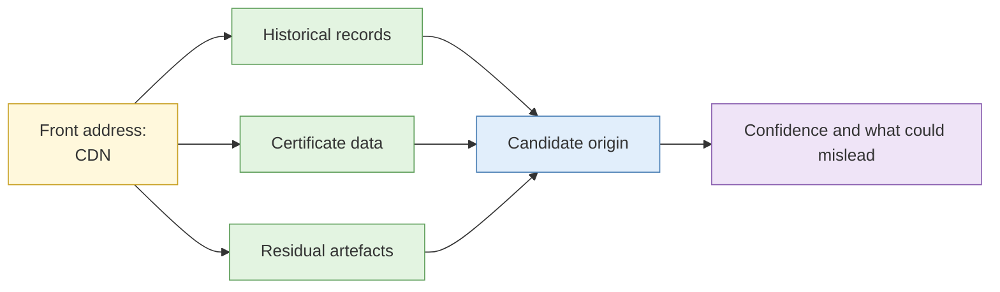

# Lab 4.4 Origin discovery behind a CDN (instructor demo)

| Duration | Type | Running case | Assessed |
| --- | --- | --- | --- |
| 15 minutes | Instructor demonstration on a sandbox target | No | No |


This was a delegate lab and is now a demonstration. The target is an instructor-owned sandbox. The technique is **not** to be tried on any organisation's real systems.


## Aim

Understand, at a conceptual level, how an analyst reasons about the real server behind a reverse proxy, and what evidence would support or weaken a candidate.

## Outcome

Your notes on the **evidence types** the instructor used and a **candidate-origin statement** with a confidence level, written for the demo target.

## The analogy: finding the back office behind the hotel front desk

The desk only deals with guests. If you need the back office, you look for places where the hotel's real address appeared by accident: an old letter, a forgotten brochure, a supplier invoice. Each is a weak clue. Several agreeing is a stronger one.

## What you need to do

- [ ] Watch how the instructor shows the front address and why it is not the origin
- [ ] Note the categories of evidence used (historical records, certificate data, residual artefacts, configuration slips)
- [ ] Write the candidate-origin statement with the supporting evidence and confidence
- [ ] Write one line on why this evidence can mislead

**Deliverable:** `origin-notes.md`.

## What the instructor sets up beforehand

- An instructor-owned sandbox site behind a reverse proxy, with deliberate historical and certificate traces pointing to an origin the instructor controls
- Authorisation covering the demo systems

## Before you start

- Read [S2 IP, hosting and network layer](../sessions/s2-ip-hosting-and-network-layer.md), CDN section.

## Rules for this lab

- Watch and take notes. Do not repeat the steps on any third-party system. Doing so may be unauthorised access or interference (CMA).

## How the demo flows



## Steps

1. Watch the instructor identify the front address and the protection layer.
2. Note each evidence category as it is used.
3. Write your candidate statement in the format below.

```markdown
Candidate origin: <IP or host>
Evidence: (1) ... (2) ... (3) ...
Confidence: low / moderate / high, because ...
What could mislead: ...
```

## Common mistakes

- Treating one historical record as proof.
- Forgetting the origin may have moved.

## Summary

Origin discovery is inference from independent weak signals. State the confidence, and recognise it may be wrong.

## Carries forward

- Lab 4.7 uses the same reasoning on infrastructure clusters.
