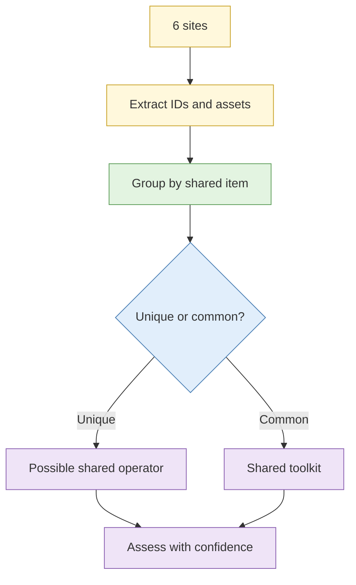

# Lab 4.5 Cross-site linkage through tracking and asset artefacts

| Duration | Type | Running case | Assessed |
| --- | --- | --- | --- |
| 25 minutes | Individual | Yes | No |

## Aim

Use analytics identifiers, advertising tags and favicon hashes to link a cluster of sandbox sites to a common operation, then test the linkage for false positives.

## Outcome

A **linkage assessment** distinguishing a shared operator from a shared toolkit or template.

## The analogy: two food stalls with the same supplier

Two stalls sell similar chilli sauce. They may be run by the same family, or they may simply buy from the same wholesaler. The test is whether anything *unique* ties them together, such as the same hand-written menu or the same owner's phone number.

## What you need to do

- [ ] Open the six sandbox sites and read their source
- [ ] Record analytics IDs, tags, favicon hashes and notable assets
- [ ] Group sites that share identifiers
- [ ] Test each group: is the shared feature unique or common?
- [ ] Write the assessment

**Deliverable:** `linkage-assessment.md`.

## What the instructor sets up beforehand

- Six sandbox sites with planted overlaps: two sharing a unique analytics ID, three sharing a popular template, one with a lookalike favicon
- A favicon-hash helper script or tool

## Before you start

- Read [S3 Website analysis and pivoting](../sessions/s3-website-analysis-and-pivoting.md).
- **Tools:** browser view-source, hash helper.

## Rules for this lab

- Read only what the sites publish to visitors. Do not probe for unlinked files.

## How the lab flows

## Steps

1. **Extract (10 min):** for each site view source, find IDs and note assets; compute the favicon hash.
2. **Group (5 min):** make a table of sites against shared items.
3. **Test (6 min):** for each shared item, estimate how common it is.
4. **Assess (4 min):** write the linkage with confidence.

## Common mistakes

- Reading a shared template as a shared owner.
- Not testing how common an identifier is.

## If you finish early

Write what extra evidence would raise confidence for the strongest group.

## Summary

Shared features link sites; unique shared features link operators. Always test for toolkit explanations.

## Carries forward

- Lab 4.7 clustering.
