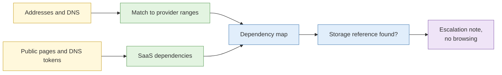

# Lab 4.6 Cloud footprint (guided exercise)

| Duration | Type | Running case | Assessed |
| --- | --- | --- | --- |
| 15 minutes | Guided, individual | No | No |

## Aim

Passively map the cloud-hosted assets and third-party service dependencies of a **sandbox organisation**, and practise the stop-and-escalate response to suspected exposure.

## Outcome

A **cloud dependency and exposure map** with an escalation note.

## The analogy: reading a company's lease and supplier list

You do not need to enter the storeroom to know which warehouse the company rents or which couriers it uses. The paperwork on show says it already.

## What you need to do

- [ ] Identify which provider hosts each of the sandbox organisation's addresses
- [ ] List SaaS and third-party services shown in DNS and public pages
- [ ] Find the sandbox's deliberately planted "public storage" reference and follow the escalation procedure
- [ ] Draw the dependency map

**Deliverable:** `cloud-map.md`.

## What the instructor sets up beforehand

- A **sandbox organisation** with DNS, certificates and public pages that reference cloud providers and SaaS
- A planted storage reference in a sandbox page. The linked content is a harmless instructor file marked "sandbox", and the exercise teaches what to do, not browsing
- The provider IP-range lists

## Before you start

- Read [S4 Cloud environments](../sessions/s4-cloud-environments.md).

## Rules for this lab

- Passive sources only.
- When you find the storage reference, **do not open its contents**. Record the URL and write the escalation note. (In real work, opening it would likely exceed your authority.)

## How the lab flows

## Steps

1. **Providers (5 min):** match each address to a provider range.
2. **SaaS (5 min):** list services from DNS tokens and public pages.
3. **Escalate (5 min):** write the note: what, where, how found, why it matters, recommended action.

## Common mistakes

- Opening storage links to "check".
- Treating a cloud IP as the operator.

## Summary

Cloud mapping is paperwork reading. When something looks exposed, escalate, do not explore.

## Carries forward

- Lab 4.8.
